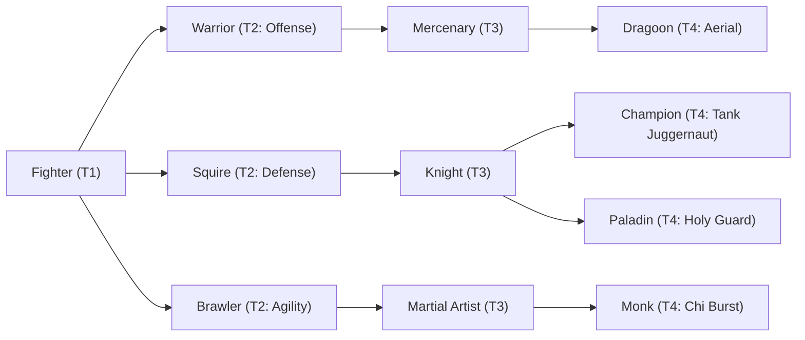

# 🛡️ Database Kelas: Fighter
> **Cabang:** `Jalur Fisik (Melee / Tank)` | **Tingkat:** `Tier 1` | **Batas Level:** `Lv. 1 – 10`

Petarung yang mengandalkan keberanian, latihan dasar, dan naluri tempur untuk menghadapi bahaya Nusvanir.

---

## 1. Profil & Identitas Peran
| Atribut Kelas | Rincian / Status |
| :--- | :--- |
| **Nama Resmi** | **Fighter** |
| **Class ID Database** | `CID: 10` |
| **Tier Penguasaan** | `Tier 1` *(Level Cap: 10)* |
| **Promosi Dari** | `—` |
| **Promosi Lanjutan** | `Warrior, Squire, Brawler` |
| **Peran Utama** | `Petarung Pemula` |
| **Kelemahan Taktis** | *Standar kelemahan arketipe* |

## 2. Parameter Pertumbuhan & Karakteristik (Turn-Based RPG)

### A. 6 Base Stats (Atribut Dasar Kelas)
| STR | INT | DEX | LUK | AGI | VIT |
| :---: | :---: | :---: | :---: | :---: | :---: |
| **9** | **1** | **3** | **4** | **4** | **7** |

* **Peringkat Atribut Dasar:** `STR: A | INT: E | DEX: C | LUK: C | AGI: C | VIT: B`
* **Pertumbuhan Stat Alami (Fixed Stat Growth per Class Level):** `+2 STR, +1 VIT`
* **Kurva Kebutuhan EXP:** `Tier 1 [25, 15, 20, 20]`

### B. Stat Turunan Awal (Baseline Derived Stats)
*Nilai di bawah dihitung deterministik dari 6 Base Stats awal kelas menggunakan formula resmi Nusvanir (sebelum bonus perlengkapan & alokasi poin pemain):*

#### 1. Sumber Daya Vital & Tempur Utama
| Parameter | Nilai Baseline | Formula / Perhitungan Resmi |
| :--- | :---: | :--- |
| **Max HP** | `200` | `Base 50 + (VIT 7 * 15) + (STR 9 * 5)` |
| **Max MP** | `28` | `Base 20 + (INT 1 * 8)` |
| **Max SP** | `73` | `Base 20 + (VIT 7 * 5) + (STR 9 * 2)` *(Preserved antar battle)* |
| **ATK** | `20` | `(STR 9 * 2) + (DEX 3 * 0.5)` *(Melee)* |
| **DEF** | `15` | `Base + (VIT 7 * 1.5) + (STR 9 * 0.5)` |
| **MAT** | `2` | `Base + (INT 1 * 2)` |
| **MDF** | `7` | `Base + (INT 1 * 1.2) + (VIT 7 * 0.8)` |
| **Action Speed** | `6` | `Base + (AGI 4 * 1.5)` |

#### 2. Presisi, Kritikal & Regenerasi Giliran (X-Param & S-Param)
| Parameter | Nilai (%) | Formula Perhitungan |
| :--- | :---: | :--- |
| **Hit Rate (HIT)** | `85.6%` | `0.85 + (DEX 3 * 0.002)` (Cap 100%) |
| **Evasion Rate (EVA)** | `3.0%` | `0.02 + (AGI 4 * 0.002) + (LUK 4 * 0.0005)` (Cap 80%) |
| **Critical Rate (CRI)** | `4.0%` | `0.03 + (DEX 3 * 0.002) + (LUK 4 * 0.001)` (Cap 85%) |
| **Critical Evasion (CEV)** | `1.3%` | `(LUK 4 * 0.0015) + (VIT 7 * 0.001)` |
| **Critical Damage (CDMG)** | `153.3%` | `1.5 + (STR 9 * 0.003) + (DEX 3 * 0.002)` |
| **Guard Efficiency (GRD)** | `103.5%` | `1.0 + (VIT 7 * 0.005)` *(Mitigasi saat bertahan)* |
| **HP Regen / Turn (HRG)** | `0.21%` | `VIT 7 * 0.0003` |
| **MP Regen / Turn (MRG)** | `0.03%` | `INT 1 * 0.0003` |
| **SP Regen / Turn (TRG)** | `3.30%` | `0.03 + (AGI 4 * 0.0004) + (VIT 7 * 0.0002)` |

### C. Karakteristik, Sasis & Peralatan
* **Innate Trait:** `—`
* **Senjata yang Dapat Digunakan (Weapon Types):** 01 Long Sword, 02 Sword, 03 Gloves, 04 Spear, 05 Axe
* **Zirah & Pelindung (Armor Types):** 01 Basic Clothes, 03 Light Armor, 05 Light Shield
* **Tipe Skill yang Dibuka (Skill Types):** `03 Skill, 05 Ultimate` *(Skill pasif aktif otomatis via YEP_AutoPassiveStates)*

## 3. Daftar Lengkap Skill & Pembelajaran (Learnings)
*Seluruh skill di bawah ini otomatis terbuka saat mencapai Class Level yang ditentukan.*

| Level | Nama Skill | Skill Type | MP / SP Cost | Scope | Hit Type / Repeat | Damage (Type, Element, Formula, Crit) | Effects & Description |
| :---: | :--- | :--- | :---: | :--- | :--- | :--- | :--- |
| **Lv 1** | **Hard Strike** | `03 Skill` | `0 MP / 10 SP` | 1 Enemy | Physical Attack / 1 | **Type:** HP Damage **Element:** 01 Neutral **Formula:** `Math.max(1, (a.atk * 1.5) - (b.def * 0.75))` **Crit:** Yes | **Efek:** Add State: [0208] Stun 20% (1 Turn) **Deskripsi:** Serangan tebasan bertenaga besar yang berisiko melumpuhkan musuh sesaat. |
| **Lv 4** | **Iron Skin** | `Passive` | `0 MP / 0 SP` | None | Certain Hit / 1 | **Type:** None **Formula:** None | **Efek:** Auto-Passive State [0301+] (Max HP +5%, Defense +10%) **Deskripsi:** Ketahanan fisik dasar petarung garis depan yang membuat tubuh lebih kebal terhadap hantaman. |
| **Lv 7** | **Provoking Roar** | `03 Skill` | `5 MP / 0 SP` | All Enemies | Certain Hit / 1 | **Type:** None **Formula:** None | **Efek:** Add State: [0224] Taunt 100% (2 Turns) + Debuff ATK **Deskripsi:** Teriakan provokasi untuk mengalihkan seluruh perhatian musuh agar menyerang petarung ini selama 2 giliran. |
| **Lv 10** | **Cleave** | `05 Ultimate` | `0 MP / 25 SP` | All Enemies | Physical Attack / 1 | **Type:** HP Damage **Element:** 01 Neutral **Formula:** `Math.max(1, (a.atk * 2.0) - (b.def * 0.75))` **Crit:** Yes | **Efek:** - **Deskripsi:** Tebasan sapuan luas pamungkas Tier 1 untuk membersihkan kerumunan musuh sekaligus. |

---

## 4. Alur Evolusi & Percabangan Kelas
