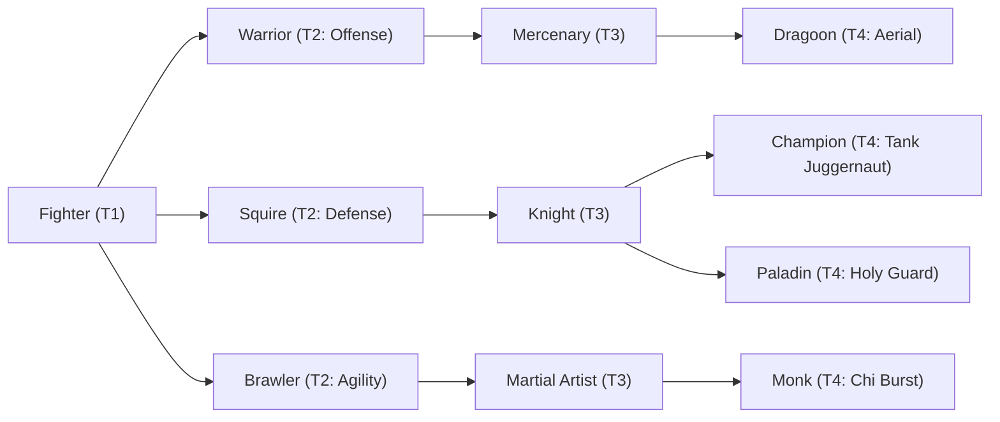

# 🛡️ Database Kelas: Warrior
> **Cabang:** `Jalur Fisik (Melee / Tank)` | **Tingkat:** `Tier 2` | **Batas Level:** `Lv. 1 – 30`

Prajurit tangguh yang menempuh hidup di garis depan, mengandalkan kekuatan, daya tahan, dan keberanian dalam pertempuran.

---

## 1. Profil & Identitas Peran
| Atribut Kelas | Rincian / Status |
| :--- | :--- |
| **Nama Resmi** | **Warrior** |
| **Class ID Database** | `CID: 21` |
| **Tier Penguasaan** | `Tier 2` *(Level Cap: 30)* |
| **Promosi Dari** | `—` |
| **Promosi Lanjutan** | `Mercenary` |
| **Peran Utama** | `Bruiser / Frontliner` |
| **Kelemahan Taktis** | *No innate sustain; only modest defense.* |

## 2. Parameter Pertumbuhan & Karakteristik (Turn-Based RPG)

### A. 6 Base Stats (Atribut Dasar Kelas)
| STR | INT | DEX | LUK | AGI | VIT |
| :---: | :---: | :---: | :---: | :---: | :---: |
| **18** | **2** | **7** | **5** | **8** | **12** |

* **Peringkat Atribut Dasar:** `STR: A+ | INT: E | DEX: C | LUK: C | AGI: C | VIT: B+`
* **Pertumbuhan Stat Alami (Fixed Stat Growth per Class Level):** `+2 STR, +1 VIT`
* **Kurva Kebutuhan EXP:** `Tier 2 [30, 20, 30, 30]`

### B. Stat Turunan Awal (Baseline Derived Stats)
*Nilai di bawah dihitung deterministik dari 6 Base Stats awal kelas menggunakan formula resmi Nusvanir (sebelum bonus perlengkapan & alokasi poin pemain):*

#### 1. Sumber Daya Vital & Tempur Utama
| Parameter | Nilai Baseline | Formula / Perhitungan Resmi |
| :--- | :---: | :--- |
| **Max HP** | `320` | `Base 50 + (VIT 12 * 15) + (STR 18 * 5)` |
| **Max MP** | `36` | `Base 20 + (INT 2 * 8)` |
| **Max SP** | `116` | `Base 20 + (VIT 12 * 5) + (STR 18 * 2)` *(Preserved antar battle)* |
| **ATK** | `40` | `(STR 18 * 2) + (DEX 7 * 0.5)` *(Melee)* |
| **DEF** | `27` | `Base + (VIT 12 * 1.5) + (STR 18 * 0.5)` |
| **MAT** | `4` | `Base + (INT 2 * 2)` |
| **MDF** | `12` | `Base + (INT 2 * 1.2) + (VIT 12 * 0.8)` |
| **Action Speed** | `12` | `Base + (AGI 8 * 1.5)` |

#### 2. Presisi, Kritikal & Regenerasi Giliran (X-Param & S-Param)
| Parameter | Nilai (%) | Formula Perhitungan |
| :--- | :---: | :--- |
| **Hit Rate (HIT)** | `86.4%` | `0.85 + (DEX 7 * 0.002)` (Cap 100%) |
| **Evasion Rate (EVA)** | `3.9%` | `0.02 + (AGI 8 * 0.002) + (LUK 5 * 0.0005)` (Cap 80%) |
| **Critical Rate (CRI)** | `4.9%` | `0.03 + (DEX 7 * 0.002) + (LUK 5 * 0.001)` (Cap 85%) |
| **Critical Evasion (CEV)** | `1.9%` | `(LUK 5 * 0.0015) + (VIT 12 * 0.001)` |
| **Critical Damage (CDMG)** | `156.8%` | `1.5 + (STR 18 * 0.003) + (DEX 7 * 0.002)` |
| **Guard Efficiency (GRD)** | `106.0%` | `1.0 + (VIT 12 * 0.005)` *(Mitigasi saat bertahan)* |
| **HP Regen / Turn (HRG)** | `0.36%` | `VIT 12 * 0.0003` |
| **MP Regen / Turn (MRG)** | `0.06%` | `INT 2 * 0.0003` |
| **SP Regen / Turn (TRG)** | `3.56%` | `0.03 + (AGI 8 * 0.0004) + (VIT 12 * 0.0002)` |

### C. Karakteristik, Sasis & Peralatan
* **Innate Trait:** `Frontline Conditioning`
* **Senjata yang Dapat Digunakan:** `Long Sword, Sword, Axe`
* **Zirah & Pelindung:** `Heavy Armor, Basic Armor, Light Shield`
* **Tipe Skill yang Dibuka:** `Physical, Support, Ultimate, Passive`

## 3. Daftar Lengkap Skill & Pembelajaran (Learnings)
*Seluruh skill di bawah ini otomatis terbuka saat mencapai Class Level yang ditentukan.*

| Level | Nama Skill | Tipe / Elemen | Biaya | Target | Formula / Efek Matematis | Deskripsi & Catatan |
| :---: | :--- | :--- | :---: | :--- | :--- | :--- |
| **1.0** | **Heavy Slash** | `Physical` / `Normal Attack` | `10 SP` | One Enemy | `Math.max(0, a.atk * 1.5 - b.def * 0.5)` | a.atk * 1.5 - b.def * 0.5 (Crit: Yes) |
| **3.0** | **Shield Breaker** | `Physical` / `Normal Attack` | `15 SP` | One Enemy | `Math.max(0, a.atk * 1.15 - b.def * 0.1)` | a.atk * 1.15 - b.def * 0.1 (Vulnerable 30%, 2 turns) *(Efek: Add State 215 Vulnerable 30%: 100%)* |
| **8.0** | **Combat Mastery** | `Passive` / `None / Neutral` | `0 SP` | User | `-` | Attack +8% (Permanen) |
| **11.0** | **Battle Cry** | `Support` / `None / Neutral` | `8 MP` | User | `-` | Buff ATK & DEF +12% (3 turns) | ATK +12% & DEF +12% (3 turns) *(Efek: Apply FX State 302 (FX 1004 - Battle Cry) as specified)* |
| **15.0** | **Heavy Impact** | `Physical` / `Normal Attack` | `18 SP` | One Enemy | `Math.max(0, a.atk * 1.7 - b.def * 0.3)` | a.atk * 1.7 - b.def * 0.3 (Crit: Yes) |
| **19.0** | **Iron Discipline** | `Passive` / `None / Neutral` | `0 SP` | User | `-` | Max HP +8% & Fear Immunity |
| **24.0** | **Sweeping Edge** | `Physical` / `Normal Attack` | `22 SP` | All Enemies | `Math.max(0, a.atk * 1.15 - b.def * 0.35)` | a.atk * 1.15 - b.def * 0.35 (Crit: Yes) |
| **28.0** | **Solid Stance** | `Support` / `None / Neutral` | `10 MP / 10 SP` | User | `-` | Buff DEF +25% & M.DEF +15% (2 turns) *(Efek: Apply FX State 304 (FX 1008 - Solid Stance) as specified)* |
| **30.0** | **Breakthrough Thrust** | `Ultimate` / `None / Neutral` | `35 SP` | One Enemy | `Math.max(0, a.atk * 2.5 - b.def * 0.3)` | a.atk * 2.5 - b.def * 0.3 (Crit: Yes) | Vulnerable 60% (1 turn) |

---

## 4. Alur Evolusi & Percabangan Kelas
