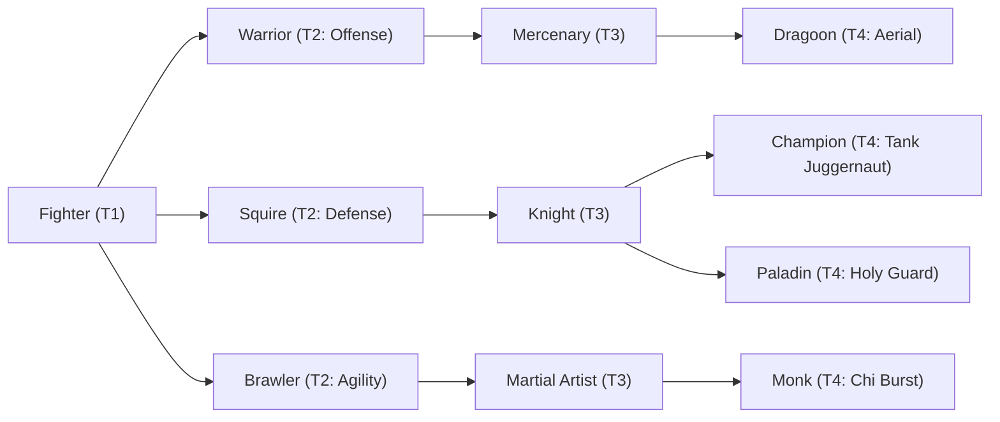

# 🛡️ Database Kelas: Squire
> **Cabang:** `Jalur Fisik (Melee / Tank)` | **Tingkat:** `Tier 2` | **Batas Level:** `Lv. 1 – 30`

Calon kesatria yang belajar disiplin, tata tempur, dan nilai kehormatan sebelum layak mengangkat sumpahnya sendiri.

---

## 1. Profil & Identitas Peran
| Atribut Kelas | Rincian / Status |
| :--- | :--- |
| **Nama Resmi** | **Squire** |
| **Class ID Database** | `CID: 22` |
| **Tier Penguasaan** | `Tier 2` *(Level Cap: 30)* |
| **Promosi Dari** | `—` |
| **Promosi Lanjutan** | `Knight` |
| **Peran Utama** | `Shield Tank / Protector` |
| **Kelemahan Taktis** | *Low AGI and lower damage ceiling.* |

## 2. Parameter Pertumbuhan & Karakteristik (Turn-Based RPG)

### A. 6 Base Stats (Atribut Dasar Kelas)
| STR | INT | DEX | LUK | AGI | VIT |
| :---: | :---: | :---: | :---: | :---: | :---: |
| **10** | **2** | **5** | **5** | **5** | **20** |

* **Peringkat Atribut Dasar:** `STR: B | INT: E | DEX: C | LUK: C | AGI: D | VIT: A+`
* **Pertumbuhan Stat Alami (Fixed Stat Growth per Class Level):** `+2 VIT, +1 STR`
* **Kurva Kebutuhan EXP:** `Tier 2 [30, 20, 30, 30]`

### B. Stat Turunan Awal (Baseline Derived Stats)
*Nilai di bawah dihitung deterministik dari 6 Base Stats awal kelas menggunakan formula resmi Nusvanir (sebelum bonus perlengkapan & alokasi poin pemain):*

#### 1. Sumber Daya Vital & Tempur Utama
| Parameter | Nilai Baseline | Formula / Perhitungan Resmi |
| :--- | :---: | :--- |
| **Max HP** | `400` | `Base 50 + (VIT 20 * 15) + (STR 10 * 5)` |
| **Max MP** | `36` | `Base 20 + (INT 2 * 8)` |
| **Max SP** | `140` | `Base 20 + (VIT 20 * 5) + (STR 10 * 2)` *(Preserved antar battle)* |
| **ATK** | `22` | `(STR 10 * 2) + (DEX 5 * 0.5)` *(Melee)* |
| **DEF** | `35` | `Base + (VIT 20 * 1.5) + (STR 10 * 0.5)` |
| **MAT** | `4` | `Base + (INT 2 * 2)` |
| **MDF** | `18` | `Base + (INT 2 * 1.2) + (VIT 20 * 0.8)` |
| **Action Speed** | `8` | `Base + (AGI 5 * 1.5)` |

#### 2. Presisi, Kritikal & Regenerasi Giliran (X-Param & S-Param)
| Parameter | Nilai (%) | Formula Perhitungan |
| :--- | :---: | :--- |
| **Hit Rate (HIT)** | `86.0%` | `0.85 + (DEX 5 * 0.002)` (Cap 100%) |
| **Evasion Rate (EVA)** | `3.2%` | `0.02 + (AGI 5 * 0.002) + (LUK 5 * 0.0005)` (Cap 80%) |
| **Critical Rate (CRI)** | `4.5%` | `0.03 + (DEX 5 * 0.002) + (LUK 5 * 0.001)` (Cap 85%) |
| **Critical Evasion (CEV)** | `2.8%` | `(LUK 5 * 0.0015) + (VIT 20 * 0.001)` |
| **Critical Damage (CDMG)** | `154.0%` | `1.5 + (STR 10 * 0.003) + (DEX 5 * 0.002)` |
| **Guard Efficiency (GRD)** | `110.0%` | `1.0 + (VIT 20 * 0.005)` *(Mitigasi saat bertahan)* |
| **HP Regen / Turn (HRG)** | `0.60%` | `VIT 20 * 0.0003` |
| **MP Regen / Turn (MRG)** | `0.06%` | `INT 2 * 0.0003` |
| **SP Regen / Turn (TRG)** | `3.60%` | `0.03 + (AGI 5 * 0.0004) + (VIT 20 * 0.0002)` |

### C. Karakteristik, Sasis & Peralatan
* **Innate Trait:** `Shieldbearer Discipline`
* **Senjata yang Dapat Digunakan:** 02 Sword, 04 Spear
* **Zirah & Pelindung:** 04 Heavy Armor, 05 Light Shield, 06 Heavy Shield
* **Tipe Skill yang Dibuka (Skill Types):** `03 Skill, 05 Ultimate` *(Skill pasif aktif otomatis via YEP_AutoPassiveStates)*

## 3. Daftar Lengkap Skill & Pembelajaran (Learnings)
*Seluruh skill di bawah ini otomatis terbuka saat mencapai Class Level yang ditentukan.*

| Level | Nama Skill | Tipe / Elemen | Biaya | Target | Formula / Efek Matematis | Deskripsi & Catatan |
| :---: | :--- | :--- | :---: | :--- | :--- | :--- |
| **1.0** | **Shield Bash** | `03 Skill` / `01 Neutral` | `10 SP` | One Enemy | `Math.max(1, (a.atk * 0.6 + a.def * 0.8) - b.def * 0.5)` | (a.atk * 0.6 + a.def * 0.8) - b.def * 0.5 (Stun 30%) *(Efek: Add State 208 Stun: 30%)* |
| **3.0** | **Guardian Armor** | `Passive` / `01 Neutral` | `0 SP` | User | `-` | Max HP +12%, Defense +7%, M.Defense +7% |
| **7.0** | **Intercept** | `03 Skill` / `01 Neutral` | `15 SP` | User | `-` | Cover (1 turn); while covering, damage taken -20% | Cover 1 turn; damage taken -20% while Cover is active *(Efek: Apply FX State 306 (FX 1012 - Intercept) as specified)* |
| **11.0** | **Shield Wall** | `03 Skill` / `01 Neutral` | `18 SP` | User | `-` | Buff Defense +25% (2 turns) | DEF +25% (2 turns) *(Efek: Apply FX State 307 (FX 1013 - Shield Wall) as specified)* |
| **15.0** | **Guard Counter** | `03 Skill` / `01 Neutral` | `20 SP` | One Enemy | `Math.max(1, a.def * 1.25 - b.def * 0.4)` | a.def * 1.25 - b.def * 0.4 | Next physical hit triggers a counterattack; counter damage scales from DEF |
| **19.0** | **Suppressing Strike** | `03 Skill` / `01 Neutral` | `16 SP` | One Enemy | `Math.max(1, a.atk * 1.15 - b.def * 0.5)` | a.atk * 1.15 - b.def * 0.5; Enemy ATK -12% (2 turns) *(Efek: Apply FX State 308 (FX 1015 - Suppressing Strike) as specified)* |
| **23.0** | **Unyielding Guard** | `Passive` / `01 Neutral` | `0 SP` | User | `-` | Stun/Fear Immunity; physical & magical damage taken -8% | Status: Stun; Fear |
| **27.0** | **Fortified Line** | `05 Ultimate` / `01 Neutral` | `30 SP` | All Allies | `-` | Party barrier = 12% of Squire Max HP for 2 turns | Party barrier equal to 12% of Squire Max HP for 2 turns *(Efek: Apply FX State 310 (FX 1017 - Fortified Line) as specified)* |

---

## 4. Alur Evolusi & Percabangan Kelas
