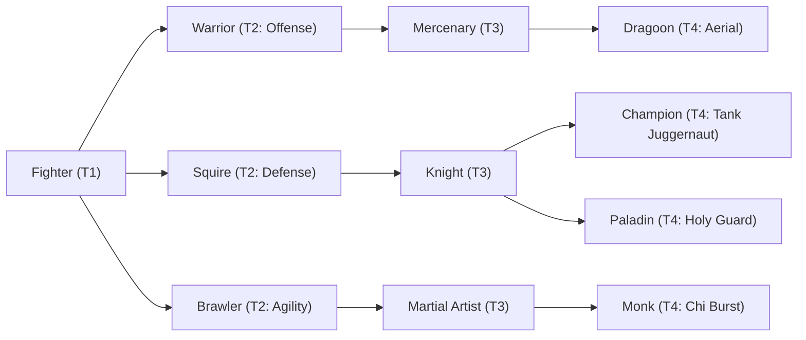

# 🛡️ Database Kelas: Brawler
> **Cabang:** `Jalur Fisik (Melee / Tank)` | **Tingkat:** `Tier 2` | **Batas Level:** `Lv. 1 – 30`

Petarung keras yang mengandalkan tinju, refleks, dan ketangguhan tubuh untuk menaklukkan lawan dari jarak dekat.

---

## 1. Profil & Identitas Peran
| Atribut Kelas | Rincian / Status |
| :--- | :--- |
| **Nama Resmi** | **Brawler** |
| **Class ID Database** | `CID: 23` |
| **Tier Penguasaan** | `Tier 2` *(Level Cap: 30)* |
| **Promosi Dari** | `—` |
| **Promosi Lanjutan** | `Martial Artist` |
| **Peran Utama** | `Dodge / Combo Fighter` |
| **Kelemahan Taktis** | *Lower DEF; relies on evasion and SP flow.* |

## 2. Parameter Pertumbuhan & Karakteristik (Turn-Based RPG)

### A. 6 Base Stats (Atribut Dasar Kelas)
| STR | INT | DEX | LUK | AGI | VIT |
| :---: | :---: | :---: | :---: | :---: | :---: |
| **14** | **2** | **8** | **6** | **14** | **8** |

* **Peringkat Atribut Dasar:** `STR: A | INT: E | DEX: B | LUK: C | AGI: A | VIT: C`
* **Pertumbuhan Stat Alami (Fixed Stat Growth per Class Level):** `+1 STR, +1 AGI, +1 DEX`
* **Kurva Kebutuhan EXP:** `Tier 2 [28, 18, 25, 25]`

### B. Stat Turunan Awal (Baseline Derived Stats)
*Nilai di bawah dihitung deterministik dari 6 Base Stats awal kelas menggunakan formula resmi Nusvanir (sebelum bonus perlengkapan & alokasi poin pemain):*

#### 1. Sumber Daya Vital & Tempur Utama
| Parameter | Nilai Baseline | Formula / Perhitungan Resmi |
| :--- | :---: | :--- |
| **Max HP** | `240` | `Base 50 + (VIT 8 * 15) + (STR 14 * 5)` |
| **Max MP** | `36` | `Base 20 + (INT 2 * 8)` |
| **Max SP** | `88` | `Base 20 + (VIT 8 * 5) + (STR 14 * 2)` *(Preserved antar battle)* |
| **ATK** | `32` | `(STR 14 * 2) + (DEX 8 * 0.5)` *(Melee)* |
| **DEF** | `19` | `Base + (VIT 8 * 1.5) + (STR 14 * 0.5)` |
| **MAT** | `4` | `Base + (INT 2 * 2)` |
| **MDF** | `9` | `Base + (INT 2 * 1.2) + (VIT 8 * 0.8)` |
| **Action Speed** | `21` | `Base + (AGI 14 * 1.5)` |

#### 2. Presisi, Kritikal & Regenerasi Giliran (X-Param & S-Param)
| Parameter | Nilai (%) | Formula Perhitungan |
| :--- | :---: | :--- |
| **Hit Rate (HIT)** | `86.6%` | `0.85 + (DEX 8 * 0.002)` (Cap 100%) |
| **Evasion Rate (EVA)** | `5.1%` | `0.02 + (AGI 14 * 0.002) + (LUK 6 * 0.0005)` (Cap 80%) |
| **Critical Rate (CRI)** | `5.2%` | `0.03 + (DEX 8 * 0.002) + (LUK 6 * 0.001)` (Cap 85%) |
| **Critical Evasion (CEV)** | `1.7%` | `(LUK 6 * 0.0015) + (VIT 8 * 0.001)` |
| **Critical Damage (CDMG)** | `155.8%` | `1.5 + (STR 14 * 0.003) + (DEX 8 * 0.002)` |
| **Guard Efficiency (GRD)** | `104.0%` | `1.0 + (VIT 8 * 0.005)` *(Mitigasi saat bertahan)* |
| **HP Regen / Turn (HRG)** | `0.24%` | `VIT 8 * 0.0003` |
| **MP Regen / Turn (MRG)** | `0.06%` | `INT 2 * 0.0003` |
| **SP Regen / Turn (TRG)** | `3.72%` | `0.03 + (AGI 14 * 0.0004) + (VIT 8 * 0.0002)` |

### C. Karakteristik, Sasis & Peralatan
* **Innate Trait:** `Flowing Momentum`
* **Senjata yang Dapat Digunakan:** 03 Gloves, 04 Spear
* **Zirah & Pelindung:** 01 Basic Clothes, 03 Light Armor
* **Tipe Skill yang Dibuka (Skill Types):** `03 Skill, 05 Ultimate` *(Skill pasif aktif otomatis via YEP_AutoPassiveStates)*

## 3. Daftar Lengkap Skill & Pembelajaran (Learnings)
*Seluruh skill di bawah ini otomatis terbuka saat mencapai Class Level yang ditentukan.*

| Level | Nama Skill | Tipe / Elemen | Biaya | Target | Formula / Efek Matematis | Deskripsi & Catatan |
| :---: | :--- | :--- | :---: | :--- | :--- | :--- |
| **1.0** | **Rapid Fists** | `03 Skill` / `01 Neutral` | `10 SP` | One Enemy | `Math.max(1, a.atk * 0.45 - b.def * 0.15)` | a.atk * 0.45 - b.def * 0.15 per hit (3 hits, Crit: Yes) |
| **3.0** | **Muscle Training** | `Passive` / `01 Neutral` | `0 SP` | User | `-` | Agility +8% & Evasion Rate +5% |
| **7.0** | **Inner Focus** | `03 Skill` / `01 Neutral` | `5 MP / 12 SP` | User | `-` | Critical Rate +20% (2 turns) *(Efek: Apply FX State 312 (FX 1020 - Inner Focus) as specified)* |
| **11.0** | **Low Sweep** | `03 Skill` / `01 Neutral` | `16 SP` | One Enemy | `Math.max(1, a.atk * 1.1 - b.def * 0.5)` | a.atk * 1.1 - b.def * 0.5; Enemy AGI -15% (2 turns) *(Efek: Apply FX State 313 (FX 1021 - Low Sweep) as specified)* |
| **16.0** | **Adrenaline Rush** | `Passive` / `01 Neutral` | `0 SP` | User | `-` | SP Charge Rate +15% when dealing damage |
| **21.0** | **Counter Stance** | `03 Skill` / `01 Neutral` | `15 SP` | User | `-` | Counter Attack +30% (1 turn) *(Efek: Apply FX State 315 (FX 1023 - Counter Stance) as specified)* |
| **26.0** | **Iron Fist** | `Passive` / `01 Neutral` | `0 SP` | User | `-` | Attack +12% & Ignore 8% DEF |
| **30.0** | **Falling Comet Fist** | `05 Ultimate` / `01 Neutral` | `30 SP` | One Enemy | `Math.max(1, a.atk * 2.4 - b.def * 0.25)` | a.atk * 2.4 - b.def * 0.25 (Crit: Yes) |

---

## 4. Alur Evolusi & Percabangan Kelas
