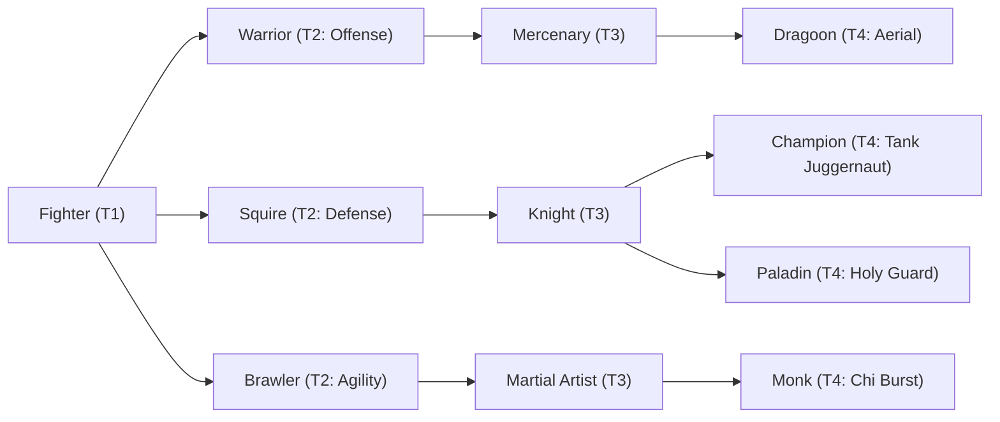

# 🛡️ Database Kelas: Mercenary
> **Cabang:** `Jalur Fisik (Melee / Tank)` | **Tingkat:** `Tier 3` | **Batas Level:** `Lv. 1 – 40`

Prajurit bayaran berpengalaman yang hidup dari kontrak, perang, dan kemampuan beradaptasi di medan yang tak menentu.

---

## 1. Profil & Identitas Peran
| Atribut Kelas | Rincian / Status |
| :--- | :--- |
| **Nama Resmi** | **Mercenary** |
| **Class ID Database** | `CID: 24` |
| **Tier Penguasaan** | `Tier 3` *(Level Cap: 40)* |
| **Promosi Dari** | `Warrior` |
| **Promosi Lanjutan** | `Dragoon` |
| **Peran Utama** | `Aggressive Bruiser` |
| **Kelemahan Taktis** | *Power-focused; limited protection/support.* |

## 2. Parameter Pertumbuhan & Karakteristik (Turn-Based RPG)

### A. 6 Base Stats (Atribut Dasar Kelas)
| STR | INT | DEX | LUK | AGI | VIT |
| :---: | :---: | :---: | :---: | :---: | :---: |
| **34** | **3** | **14** | **8** | **14** | **22** |

* **Peringkat Atribut Dasar:** `STR: S | INT: E | DEX: B | LUK: C | AGI: B | VIT: A`
* **Pertumbuhan Stat Alami (Fixed Stat Growth per Class Level):** `+2 STR, +1 VIT, +1 DEX`
* **Kurva Kebutuhan EXP:** `Tier 3 [35, 25, 35, 35]`

### B. Stat Turunan Awal (Baseline Derived Stats)
*Nilai di bawah dihitung deterministik dari 6 Base Stats awal kelas menggunakan formula resmi Nusvanir (sebelum bonus perlengkapan & alokasi poin pemain):*

#### 1. Sumber Daya Vital & Tempur Utama
| Parameter | Nilai Baseline | Formula / Perhitungan Resmi |
| :--- | :---: | :--- |
| **Max HP** | `550` | `Base 50 + (VIT 22 * 15) + (STR 34 * 5)` |
| **Max MP** | `44` | `Base 20 + (INT 3 * 8)` |
| **Max SP** | `198` | `Base 20 + (VIT 22 * 5) + (STR 34 * 2)` *(Preserved antar battle)* |
| **ATK** | `75` | `(STR 34 * 2) + (DEX 14 * 0.5)` *(Melee)* |
| **DEF** | `50` | `Base + (VIT 22 * 1.5) + (STR 34 * 0.5)` |
| **MAT** | `6` | `Base + (INT 3 * 2)` |
| **MDF** | `21` | `Base + (INT 3 * 1.2) + (VIT 22 * 0.8)` |
| **Action Speed** | `21` | `Base + (AGI 14 * 1.5)` |

#### 2. Presisi, Kritikal & Regenerasi Giliran (X-Param & S-Param)
| Parameter | Nilai (%) | Formula Perhitungan |
| :--- | :---: | :--- |
| **Hit Rate (HIT)** | `87.8%` | `0.85 + (DEX 14 * 0.002)` (Cap 100%) |
| **Evasion Rate (EVA)** | `5.2%` | `0.02 + (AGI 14 * 0.002) + (LUK 8 * 0.0005)` (Cap 80%) |
| **Critical Rate (CRI)** | `6.6%` | `0.03 + (DEX 14 * 0.002) + (LUK 8 * 0.001)` (Cap 85%) |
| **Critical Evasion (CEV)** | `3.4%` | `(LUK 8 * 0.0015) + (VIT 22 * 0.001)` |
| **Critical Damage (CDMG)** | `163.0%` | `1.5 + (STR 34 * 0.003) + (DEX 14 * 0.002)` |
| **Guard Efficiency (GRD)** | `111.0%` | `1.0 + (VIT 22 * 0.005)` *(Mitigasi saat bertahan)* |
| **HP Regen / Turn (HRG)** | `0.66%` | `VIT 22 * 0.0003` |
| **MP Regen / Turn (MRG)** | `0.09%` | `INT 3 * 0.0003` |
| **SP Regen / Turn (TRG)** | `4.00%` | `0.03 + (AGI 14 * 0.0004) + (VIT 22 * 0.0002)` |

### C. Karakteristik, Sasis & Peralatan
* **Innate Trait:** `Veteran Edge`
* **Senjata yang Dapat Digunakan:** 01 Long Sword, 05 Axe
* **Zirah & Pelindung:** 04 Heavy Armor, 01 Basic Clothes
* **Tipe Skill yang Dibuka (Skill Types):** `03 Skill, 05 Ultimate` *(Skill pasif aktif otomatis via YEP_AutoPassiveStates)*

## 3. Daftar Lengkap Skill & Pembelajaran (Learnings)
*Seluruh skill di bawah ini otomatis terbuka saat mencapai Class Level yang ditentukan.*

| Level | Nama Skill | Tipe / Elemen | Biaya | Target | Formula / Efek Matematis | Deskripsi & Catatan |
| :---: | :--- | :--- | :---: | :--- | :--- | :--- |
| **1.0** | **Raging Blow** | `03 Skill` / `01 Neutral` | `8 SP` | One Enemy | `Math.max(1, a.atk * 1.9 - b.def * 0.3)` | a.atk * 1.9 - b.def * 0.3 |
| **1.0** | **Bloodlust** | `Passive` / `01 Neutral` | `0 SP` | User | `-` | Lifesteal 10% of damage dealt |
| **4.0** | **War Howl** | `03 Skill` / `01 Neutral` | `10 SP` | All Enemies | `-` | Fear (55%, 2 turns) *(Efek: Add State 211 Fear: 100%)* |
| **9.0** | **Cyclone Strike** | `03 Skill` / `01 Neutral` | `16 SP` | All Enemies | `Math.max(1, a.atk * 1.25 - b.def * 0.18)` | a.atk * 1.25 - b.def * 0.18 per hit (2 hits) |
| **14.0** | **Rupture** | `03 Skill` / `01 Neutral` | `18 SP` | One Enemy | `Math.max(1, a.atk * 1.7 - b.def * 0.4)` | a.atk * 1.7 - b.def * 0.4 |
| **19.0** | **Unstoppable Force** | `Passive` / `01 Neutral` | `0 SP` | User | `-` | ATK +15%, Control Resistance +40% |
| **25.0** | **Frenzy** | `03 Skill` / `01 Neutral` | `25 SP` | User | `-` | Berserker: ATK +25%, damage taken +15%, 3 turns | ATK +25%; damage taken +15% (3 turns) *(Efek: Apply FX State 319 (FX 1032 - Frenzy) as specified)* |
| **31.0** | **Skull Crusher** | `03 Skill` / `01 Neutral` | `20 SP` | One Enemy | `Math.max(1, a.atk * 3.0 - b.def * 0.2)` | a.atk * 3.0 - b.def * 0.2 |
| **36.0** | **Desperate Fury** | `Passive` / `01 Neutral` | `0 SP` | User | `-` | When HP <25%: ATK +35%, AGI +20% |
| **40.0** | **Executioner's Wrath** | `05 Ultimate` / `01 Neutral` | `40 SP` | All Enemies | `Math.max(1, a.atk * 1.55 - b.def * 0.10)` | a.atk * 1.55 - b.def * 0.10 per hit (3 hits; ignores 15% DEF) | Ignores 15% DEF | Status: Fatal Bleed (25% per hit) *(Efek: Add State 204 Bleed: 25% per hit)* |

---

## 4. Alur Evolusi & Percabangan Kelas
