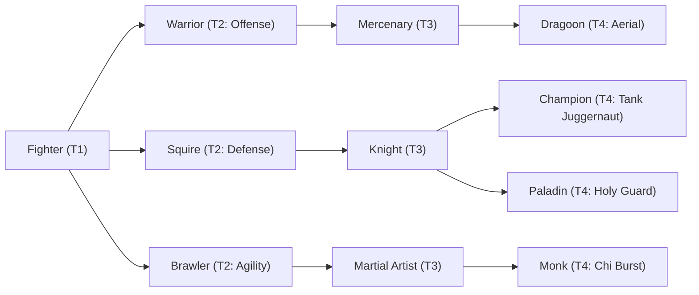

# 🛡️ Database Kelas: Knight
> **Cabang:** `Jalur Fisik (Melee / Tank)` | **Tingkat:** `Tier 3` | **Batas Level:** `Lv. 1 – 40`

Kesatria terlatih yang menjunjung sumpah, kehormatan, dan kewajiban untuk berdiri teguh di hadapan ancaman.

---

## 1. Profil & Identitas Peran
| Atribut Kelas | Rincian / Status |
| :--- | :--- |
| **Nama Resmi** | **Knight** |
| **Class ID Database** | `CID: 25` |
| **Tier Penguasaan** | `Tier 3` *(Level Cap: 40)* |
| **Promosi Dari** | `Squire` |
| **Promosi Lanjutan** | `Champion, Paladin` |
| **Peran Utama** | `Tank / Counter Protector` |
| **Kelemahan Taktis** | *Very slow; damage is secondary.* |

## 2. Parameter Pertumbuhan & Karakteristik (Turn-Based RPG)

### A. 6 Base Stats (Atribut Dasar Kelas)
| STR | INT | DEX | LUK | AGI | VIT |
| :---: | :---: | :---: | :---: | :---: | :---: |
| **20** | **4** | **12** | **8** | **10** | **38** |

* **Peringkat Atribut Dasar:** `STR: A | INT: E | DEX: B | LUK: C | AGI: C | VIT: S`
* **Pertumbuhan Stat Alami (Fixed Stat Growth per Class Level):** `+2 VIT, +1 STR, +1 DEX`
* **Kurva Kebutuhan EXP:** `Tier 3 [35, 25, 35, 35]`

### B. Stat Turunan Awal (Baseline Derived Stats)
*Nilai di bawah dihitung deterministik dari 6 Base Stats awal kelas menggunakan formula resmi Nusvanir (sebelum bonus perlengkapan & alokasi poin pemain):*

#### 1. Sumber Daya Vital & Tempur Utama
| Parameter | Nilai Baseline | Formula / Perhitungan Resmi |
| :--- | :---: | :--- |
| **Max HP** | `720` | `Base 50 + (VIT 38 * 15) + (STR 20 * 5)` |
| **Max MP** | `52` | `Base 20 + (INT 4 * 8)` |
| **Max SP** | `250` | `Base 20 + (VIT 38 * 5) + (STR 20 * 2)` *(Preserved antar battle)* |
| **ATK** | `46` | `(STR 20 * 2) + (DEX 12 * 0.5)` *(Melee)* |
| **DEF** | `67` | `Base + (VIT 38 * 1.5) + (STR 20 * 0.5)` |
| **MAT** | `8` | `Base + (INT 4 * 2)` |
| **MDF** | `35` | `Base + (INT 4 * 1.2) + (VIT 38 * 0.8)` |
| **Action Speed** | `15` | `Base + (AGI 10 * 1.5)` |

#### 2. Presisi, Kritikal & Regenerasi Giliran (X-Param & S-Param)
| Parameter | Nilai (%) | Formula Perhitungan |
| :--- | :---: | :--- |
| **Hit Rate (HIT)** | `87.4%` | `0.85 + (DEX 12 * 0.002)` (Cap 100%) |
| **Evasion Rate (EVA)** | `4.4%` | `0.02 + (AGI 10 * 0.002) + (LUK 8 * 0.0005)` (Cap 80%) |
| **Critical Rate (CRI)** | `6.2%` | `0.03 + (DEX 12 * 0.002) + (LUK 8 * 0.001)` (Cap 85%) |
| **Critical Evasion (CEV)** | `5.0%` | `(LUK 8 * 0.0015) + (VIT 38 * 0.001)` |
| **Critical Damage (CDMG)** | `158.4%` | `1.5 + (STR 20 * 0.003) + (DEX 12 * 0.002)` |
| **Guard Efficiency (GRD)** | `119.0%` | `1.0 + (VIT 38 * 0.005)` *(Mitigasi saat bertahan)* |
| **HP Regen / Turn (HRG)** | `1.14%` | `VIT 38 * 0.0003` |
| **MP Regen / Turn (MRG)** | `0.12%` | `INT 4 * 0.0003` |
| **SP Regen / Turn (TRG)** | `4.16%` | `0.03 + (AGI 10 * 0.0004) + (VIT 38 * 0.0002)` |

### C. Karakteristik, Sasis & Peralatan
* **Innate Trait:** `Bulwark Doctrine`
* **Senjata yang Dapat Digunakan:** 02 Sword
* **Zirah & Pelindung:** 04 Heavy Armor, 06 Heavy Shield
* **Tipe Skill yang Dibuka (Skill Types):** `03 Skill, 05 Ultimate` *(Skill pasif aktif otomatis via YEP_AutoPassiveStates)*

## 3. Daftar Lengkap Skill & Pembelajaran (Learnings)
*Seluruh skill di bawah ini otomatis terbuka saat mencapai Class Level yang ditentukan.*

| Level | Nama Skill | Tipe / Elemen | Biaya | Target | Formula / Efek Matematis | Deskripsi & Catatan |
| :---: | :--- | :--- | :---: | :--- | :--- | :--- |
| **1.0** | **Bastion Smash** | `03 Skill` / `01 Neutral` | `6 SP` | One Enemy | `Math.max(1, a.def * 1.3 - b.def * 0.4)` | a.def * 1.3 - b.def * 0.4 |
| **1.0** | **Fortified Guardian Armor** | `Passive` / `01 Neutral` | `0 SP` | User | `-` | Max HP +15%, DEF +8%, M.DEF +8% |
| **5.0** | **War Cry** | `03 Skill` / `01 Neutral` | `8 SP` | All Enemies | `-` | Taunt all enemies; Enemy ATK -5%, Enemy DEF -8% (2 turns) *(Efek: Add State 224 Taunt: 100% | Apply FX State 322 (FX 1038 - War Cry) as specified)* |
| **10.0** | **Knight’s Aegis** | `03 Skill` / `01 Neutral` | `12 SP` | User | `-` | Holy Veil: damage taken -40% for 2 turns | Damage taken -40% (2 turns) *(Efek: Apply FX State 323 (FX 1039 - Knight’s Aegis) as specified)* |
| **15.0** | **Shield Parry** | `Passive` / `01 Neutral` | `0 SP` | User | `-` | 10% chance to block physical damage and counterattack; counter scales from DEF |
| **21.0** | **Titanium Crash** | `03 Skill` / `01 Neutral` | `16 SP` | One Enemy | `Math.max(1, a.atk * 2.0 + a.def * 0.6 - b.def * 0.3)` | a.atk * 2.0 + a.def * 0.6 - b.def * 0.3 |
| **27.0** | **Vanguard Intercept** | `03 Skill` / `01 Neutral` | `14 SP` | One Ally | `-` | Redirects 50% of target ally's incoming damage to self for 1 turn; 25% counter chance | Protects 1 ally for 1 turn; redirects 50% damage; 25% counter chance *(Efek: Apply FX State 325 (FX 1042 - Vanguard Intercept) as specified)* |
| **33.0** | **Will of Iron** | `Passive` / `01 Neutral` | `0 SP` | User | `-` | Physical Damage -20%, Fear Immunity, HP Regen 2% Max HP/turn |
| **40.0** | **Bastion Quake** | `05 Ultimate` / `01 Neutral` | `35 SP` | All Enemies | `Math.max(1, a.def * 3.0 - b.def * 0.1)` | a.def * 3.0 - b.def * 0.1 (Ignore 20% DEF) | Ignores 20% DEF |

---

## 4. Alur Evolusi & Percabangan Kelas
