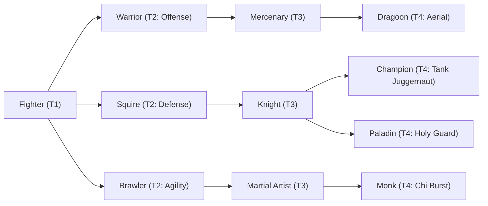

# 🛡️ Database Kelas: Martial Artist
> **Cabang:** `Jalur Fisik (Melee / Tank)` | **Tingkat:** `Tier 3` | **Batas Level:** `Lv. 1 – 40`

Pendekar yang mengasah tubuh dan teknik melalui disiplin panjang hingga setiap geraknya menjadi senjata.

---

## 1. Profil & Identitas Peran
| Atribut Kelas | Rincian / Status |
| :--- | :--- |
| **Nama Resmi** | **Martial Artist** |
| **Class ID Database** | `CID: 26` |
| **Tier Penguasaan** | `Tier 3` *(Level Cap: 40)* |
| **Promosi Dari** | `Brawler` |
| **Promosi Lanjutan** | `Monk` |
| **Peran Utama** | `Dodge / Combo / Chi` |
| **Kelemahan Taktis** | *Lower raw DEF; loses value if accuracy/evasion is countered.* |

## 2. Parameter Pertumbuhan & Karakteristik (Turn-Based RPG)

### A. 6 Base Stats (Atribut Dasar Kelas)
| STR | INT | DEX | LUK | AGI | VIT |
| :---: | :---: | :---: | :---: | :---: | :---: |
| **26** | **5** | **18** | **10** | **28** | **16** |

* **Peringkat Atribut Dasar:** `STR: A | INT: E | DEX: A | LUK: B | AGI: S | VIT: B`
* **Pertumbuhan Stat Alami (Fixed Stat Growth per Class Level):** `+2 AGI, +1 STR, +1 DEX`
* **Kurva Kebutuhan EXP:** `Tier 3 [32, 22, 30, 30]`

### B. Stat Turunan Awal (Baseline Derived Stats)
*Nilai di bawah dihitung deterministik dari 6 Base Stats awal kelas menggunakan formula resmi Nusvanir (sebelum bonus perlengkapan & alokasi poin pemain):*

#### 1. Sumber Daya Vital & Tempur Utama
| Parameter | Nilai Baseline | Formula / Perhitungan Resmi |
| :--- | :---: | :--- |
| **Max HP** | `420` | `Base 50 + (VIT 16 * 15) + (STR 26 * 5)` |
| **Max MP** | `60` | `Base 20 + (INT 5 * 8)` |
| **Max SP** | `152` | `Base 20 + (VIT 16 * 5) + (STR 26 * 2)` *(Preserved antar battle)* |
| **ATK** | `61` | `(STR 26 * 2) + (DEX 18 * 0.5)` *(Melee)* |
| **DEF** | `37` | `Base + (VIT 16 * 1.5) + (STR 26 * 0.5)` |
| **MAT** | `10` | `Base + (INT 5 * 2)` |
| **MDF** | `19` | `Base + (INT 5 * 1.2) + (VIT 16 * 0.8)` |
| **Action Speed** | `42` | `Base + (AGI 28 * 1.5)` |

#### 2. Presisi, Kritikal & Regenerasi Giliran (X-Param & S-Param)
| Parameter | Nilai (%) | Formula Perhitungan |
| :--- | :---: | :--- |
| **Hit Rate (HIT)** | `88.6%` | `0.85 + (DEX 18 * 0.002)` (Cap 100%) |
| **Evasion Rate (EVA)** | `8.1%` | `0.02 + (AGI 28 * 0.002) + (LUK 10 * 0.0005)` (Cap 80%) |
| **Critical Rate (CRI)** | `7.6%` | `0.03 + (DEX 18 * 0.002) + (LUK 10 * 0.001)` (Cap 85%) |
| **Critical Evasion (CEV)** | `3.1%` | `(LUK 10 * 0.0015) + (VIT 16 * 0.001)` |
| **Critical Damage (CDMG)** | `161.4%` | `1.5 + (STR 26 * 0.003) + (DEX 18 * 0.002)` |
| **Guard Efficiency (GRD)** | `108.0%` | `1.0 + (VIT 16 * 0.005)` *(Mitigasi saat bertahan)* |
| **HP Regen / Turn (HRG)** | `0.48%` | `VIT 16 * 0.0003` |
| **MP Regen / Turn (MRG)** | `0.15%` | `INT 5 * 0.0003` |
| **SP Regen / Turn (TRG)** | `4.44%` | `0.03 + (AGI 28 * 0.0004) + (VIT 16 * 0.0002)` |

### C. Karakteristik, Sasis & Peralatan
* **Innate Trait:** `Meridian Footwork`
* **Senjata yang Dapat Digunakan:** 03 Gloves, 04 Spear
* **Zirah & Pelindung:** 03 Light Armor
* **Tipe Skill yang Dibuka (Skill Types):** `03 Skill, 05 Ultimate` *(Skill pasif aktif otomatis via YEP_AutoPassiveStates)*

## 3. Daftar Lengkap Skill & Pembelajaran (Learnings)
*Seluruh skill di bawah ini otomatis terbuka saat mencapai Class Level yang ditentukan.*

| Level | Nama Skill | Tipe / Elemen | Biaya | Target | Formula / Efek Matematis | Deskripsi & Catatan |
| :---: | :--- | :--- | :---: | :--- | :--- | :--- |
| **1.0** | **Flurry Strikes** | `03 Skill` / `01 Neutral` | `6 SP` | One Enemy | `Math.max(1, a.atk * 0.75 - b.def * 0.15)` | a.atk * 0.75 - b.def * 0.15 per hit (3 hits) |
| **1.0** | **Agile Footwork** | `Passive` / `01 Neutral` | `0 SP` | User | `-` | Agility +15%, Evasion +10%, Slow Immunity |
| **4.0** | **Chi Palm** | `03 Skill` / `01 Neutral` | `8 SP` | One Enemy | `Math.max(1, a.atk * 1.5 - b.def * 0.3)` | a.atk * 1.5 - b.def * 0.3 |
| **9.0** | **Whirlwind Kick** | `03 Skill` / `05 Air` | `14 SP` | All Enemies | `Math.max(1, a.atk * 1.1 - b.def * 0.18)` | a.atk * 1.1 - b.def * 0.18 per hit (2 hits) |
| **14.0** | **Nerve Strike** | `03 Skill` / `01 Neutral` | `16 SP` | One Enemy | `Math.max(1, a.atk * 1.8 - b.def * 0.3)` | a.atk * 1.8 - b.def * 0.3 |
| **19.0** | **Mind's Eye** | `Passive` / `01 Neutral` | `0 SP` | User | `-` | When an attack misses against the user, recover 4% Max SP and gain 10% counter chance for 1 turn |
| **25.0** | **Dragon Stance** | `03 Skill` / `01 Neutral` | `22 SP` | User | `-` | ATK +25%, AGI +15%, SP Regen 4% Max SP/turn (3 turns) | ATK +25%, AGI +15%, SP Regen 4%/turn (3 turns) *(Efek: Apply FX State 329 (FX 1051 - Dragon Stance) as specified)* |
| **31.0** | **Comet Barrage** | `03 Skill` / `01 Neutral` | `28 SP` | One Enemy | `Math.max(1, a.atk * 0.6 - b.def * 0.08)` | a.atk * 0.6 - b.def * 0.08 per hit (6 hits) |
| **36.0** | **Feral Instinct** | `Passive` / `01 Neutral` | `0 SP` | User | `-` | Ignore 15% DEF, Crit Damage +30%, critical hits refund 3% Max SP |
| **40.0** | **Dragon Meridian Barrage** | `05 Ultimate` / `01 Neutral` | `40 SP` | One Enemy | `Math.max(1, a.atk * 0.8 - b.def * 0.06)` | a.atk * 0.8 - b.def * 0.06 per hit (8 hits) | Sure Hit; final hit deals +25% damage. |

---

## 4. Alur Evolusi & Percabangan Kelas
