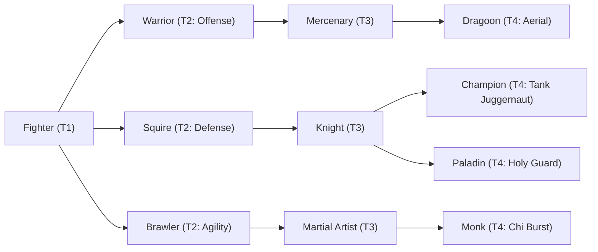

# 🛡️ Database Kelas: Champion
> **Cabang:** `Jalur Fisik (Melee / Tank)` | **Tingkat:** `Tier 4` | **Batas Level:** `Lv. 1 – 50`

Pejuang unggulan yang dikenal karena keberanian, ketangguhan, dan kemenangan yang ditempa dari banyak pertempuran.

---

## 1. Profil & Identitas Peran
| Atribut Kelas | Rincian / Status |
| :--- | :--- |
| **Nama Resmi** | **Champion** |
| **Class ID Database** | `CID: 28` |
| **Tier Penguasaan** | `Tier 4` *(Level Cap: 50)* |
| **Promosi Dari** | `Knight` |
| **Promosi Lanjutan** | `Holy Knight / Berserker (Tier 5)` |
| **Peran Utama** | `Offensive Tank` |
| **Kelemahan Taktis** | *Strong frontline stats but lower speed and less team protection than Paladin.* |

## 2. Parameter Pertumbuhan & Karakteristik (Turn-Based RPG)

### A. 6 Base Stats (Atribut Dasar Kelas)
| STR | INT | DEX | LUK | AGI | VIT |
| :---: | :---: | :---: | :---: | :---: | :---: |
| **52** | **5** | **20** | **12** | **18** | **50** |

* **Peringkat Atribut Dasar:** `STR: S | INT: E | DEX: A | LUK: B | AGI: B | VIT: S`
* **Pertumbuhan Stat Alami (Fixed Stat Growth per Class Level):** `+2 VIT, +2 STR, +1 DEX`
* **Kurva Kebutuhan EXP:** `Tier 4 [40, 30, 40, 40]`

### B. Stat Turunan Awal (Baseline Derived Stats)
*Nilai di bawah dihitung deterministik dari 6 Base Stats awal kelas menggunakan formula resmi Nusvanir (sebelum bonus perlengkapan & alokasi poin pemain):*

#### 1. Sumber Daya Vital & Tempur Utama
| Parameter | Nilai Baseline | Formula / Perhitungan Resmi |
| :--- | :---: | :--- |
| **Max HP** | `1060` | `Base 50 + (VIT 50 * 15) + (STR 52 * 5)` |
| **Max MP** | `60` | `Base 20 + (INT 5 * 8)` |
| **Max SP** | `374` | `Base 20 + (VIT 50 * 5) + (STR 52 * 2)` *(Preserved antar battle)* |
| **ATK** | `114` | `(STR 52 * 2) + (DEX 20 * 0.5)` *(Melee)* |
| **DEF** | `101` | `Base + (VIT 50 * 1.5) + (STR 52 * 0.5)` |
| **MAT** | `10` | `Base + (INT 5 * 2)` |
| **MDF** | `46` | `Base + (INT 5 * 1.2) + (VIT 50 * 0.8)` |
| **Action Speed** | `27` | `Base + (AGI 18 * 1.5)` |

#### 2. Presisi, Kritikal & Regenerasi Giliran (X-Param & S-Param)
| Parameter | Nilai (%) | Formula Perhitungan |
| :--- | :---: | :--- |
| **Hit Rate (HIT)** | `89.0%` | `0.85 + (DEX 20 * 0.002)` (Cap 100%) |
| **Evasion Rate (EVA)** | `6.2%` | `0.02 + (AGI 18 * 0.002) + (LUK 12 * 0.0005)` (Cap 80%) |
| **Critical Rate (CRI)** | `8.2%` | `0.03 + (DEX 20 * 0.002) + (LUK 12 * 0.001)` (Cap 85%) |
| **Critical Evasion (CEV)** | `6.8%` | `(LUK 12 * 0.0015) + (VIT 50 * 0.001)` |
| **Critical Damage (CDMG)** | `169.6%` | `1.5 + (STR 52 * 0.003) + (DEX 20 * 0.002)` |
| **Guard Efficiency (GRD)** | `125.0%` | `1.0 + (VIT 50 * 0.005)` *(Mitigasi saat bertahan)* |
| **HP Regen / Turn (HRG)** | `1.50%` | `VIT 50 * 0.0003` |
| **MP Regen / Turn (MRG)** | `0.15%` | `INT 5 * 0.0003` |
| **SP Regen / Turn (TRG)** | `4.72%` | `0.03 + (AGI 18 * 0.0004) + (VIT 50 * 0.0002)` |

### C. Karakteristik, Sasis & Peralatan
* **Innate Trait:** `Crownforged Vanguard`
* **Senjata yang Dapat Digunakan:** 02 Sword, 05 Axe
* **Zirah & Pelindung:** 04 Heavy Armor, 01 Basic Clothes, 05 Light Shield
* **Tipe Skill yang Dibuka (Skill Types):** `03 Skill, 05 Ultimate` *(Skill pasif aktif otomatis via YEP_AutoPassiveStates)*

## 3. Daftar Lengkap Skill & Pembelajaran (Learnings)
*Seluruh skill di bawah ini otomatis terbuka saat mencapai Class Level yang ditentukan.*

| Level | Nama Skill | Tipe / Elemen | Biaya | Target | Formula / Efek Matematis | Deskripsi & Catatan |
| :---: | :--- | :--- | :---: | :--- | :--- | :--- |
| **1.0** | **Royal Vanguard Discipline** | `Passive` / `01 Neutral` | `0 SP` | User | `-` | Max HP +10%, ATK +8%, Control Resistance +20% |
| **1.0** | **Sovereign Slash** | `03 Skill` / `01 Neutral` | `10 SP` | One Enemy | `Math.max(1, a.atk * 2.2 - b.def * 0.2)` | a.atk * 2.2 - b.def * 0.2 |
| **5.0** | **King's Command** | `03 Skill` / `01 Neutral` | `14 SP` | User | `-` | ATK +20%, DEF +15%, Crit Rate +10% (3 turns) *(Efek: Apply FX State 337 (FX 1068 - King's Command) as specified)* |
| **10.0** | **Unrelenting Offense** | `Passive` / `01 Neutral` | `0 SP` | User | `-` | ATK +12%; damage increases by 5% when HP is above 80% |
| **15.0** | **Crescent Cleave** | `03 Skill` / `01 Neutral` | `18 SP` | All Enemies | `Math.max(1, a.atk * 1.5 - b.def * 0.3)` | a.atk * 1.5 - b.def * 0.3 |
| **20.0** | **Overwhelming Pressure** | `03 Skill` / `01 Neutral` | `20 SP` | One Enemy | `Math.max(1, a.atk * 2.0 - b.def * 0.2)` | a.atk * 2.0 - b.def * 0.2 |
| **25.0** | **Relentless Assault** | `03 Skill` / `01 Neutral` | `24 SP` | One Enemy | `Math.max(1, a.atk * 0.85 - b.def * 0.3)` | a.atk * 0.85 - b.def * 0.3 per hit (3 hits) |
| **31.0** | **Vanguard Charge** | `03 Skill` / `01 Neutral` | `22 SP` | One Enemy | `Math.max(1, a.atk * 2.3 - b.def * 0.1)` | a.atk * 2.3 - b.def * 0.1 | If user has King's Command: gain 10% damage reduction for 1 turn |
| **36.0** | **Savage Triumph** | `Passive` / `01 Neutral` | `0 SP` | User | `-` | Critical damage +25%; when defeating an enemy, recover 5% Max HP |
| **40.0** | **Kingdom's Wrath** | `03 Skill` / `01 Neutral` | `38 SP` | All Enemies | `Math.max(1, a.atk * 1.35 - b.def * 0.2)` | a.atk * 1.35 - b.def * 0.2 per hit (2 hits) |
| **42.0** | **Final Ignition** | `03 Skill` / `01 Neutral` | `35 SP` | User | `-` | Sacrifice 30% current HP. ATK +60%, Crit Rate +15%, Crit Damage +25%, AGI +20% for 3 turns; healing received -30%. | Berserk State (3 turns); healing received -30%. *(Efek: Apply FX State 340 (FX 1076 - Final Ignition) as specified)* |
| **45.0** | **Mandala Judgment: Execution** | `05 Ultimate` / `01 Neutral` | `50 SP` | One Enemy | `Math.max(1, a.atk * 5.5)` | a.atk * 5.5 (ignores 60% DEF; barriers still apply) | Sure Hit; +20% damage if target HP is below 30%. Bosses are immune to execution effects. |

---

## 4. Alur Evolusi & Percabangan Kelas
