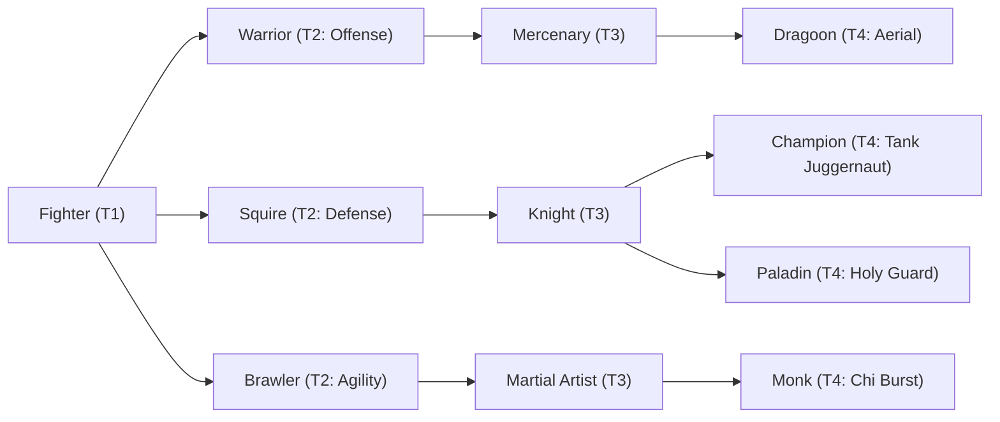

# 🛡️ Database Kelas: Dragoon
> **Cabang:** `Jalur Fisik (Melee / Tank)` | **Tingkat:** `Tier 4` | **Batas Level:** `Lv. 1 – 50`

Prajurit tombak yang menguasai lompatan dan serangan dari atas, meniru keganasan makhluk bersayap dan naga.

---

## 1. Profil & Identitas Peran
| Atribut Kelas | Rincian / Status |
| :--- | :--- |
| **Nama Resmi** | **Dragoon** |
| **Class ID Database** | `CID: 27` |
| **Tier Penguasaan** | `Tier 4` *(Level Cap: 50)* |
| **Promosi Dari** | `Mercenary` |
| **Promosi Lanjutan** | `Sky Sovereign (Tier 5)` |
| **Peran Utama** | `Boss Killer / Burst Bruiser` |
| **Kelemahan Taktis** | *High offense; not a full tank and still resource-dependent.* |

## 2. Parameter Pertumbuhan & Karakteristik (Turn-Based RPG)

### A. 6 Base Stats (Atribut Dasar Kelas)
| STR | INT | DEX | LUK | AGI | VIT |
| :---: | :---: | :---: | :---: | :---: | :---: |
| **56** | **6** | **22** | **12** | **36** | **30** |

* **Peringkat Atribut Dasar:** `STR: S | INT: E | DEX: A | LUK: B | AGI: S | VIT: A`
* **Pertumbuhan Stat Alami (Fixed Stat Growth per Class Level):** `+2 STR, +2 AGI, +1 DEX`
* **Kurva Kebutuhan EXP:** `Tier 4 [38, 28, 38, 38]`

### B. Stat Turunan Awal (Baseline Derived Stats)
*Nilai di bawah dihitung deterministik dari 6 Base Stats awal kelas menggunakan formula resmi Nusvanir (sebelum bonus perlengkapan & alokasi poin pemain):*

#### 1. Sumber Daya Vital & Tempur Utama
| Parameter | Nilai Baseline | Formula / Perhitungan Resmi |
| :--- | :---: | :--- |
| **Max HP** | `780` | `Base 50 + (VIT 30 * 15) + (STR 56 * 5)` |
| **Max MP** | `68` | `Base 20 + (INT 6 * 8)` |
| **Max SP** | `282` | `Base 20 + (VIT 30 * 5) + (STR 56 * 2)` *(Preserved antar battle)* |
| **ATK** | `123` | `(STR 56 * 2) + (DEX 22 * 0.5)` *(Melee)* |
| **DEF** | `73` | `Base + (VIT 30 * 1.5) + (STR 56 * 0.5)` |
| **MAT** | `12` | `Base + (INT 6 * 2)` |
| **MDF** | `31` | `Base + (INT 6 * 1.2) + (VIT 30 * 0.8)` |
| **Action Speed** | `54` | `Base + (AGI 36 * 1.5)` |

#### 2. Presisi, Kritikal & Regenerasi Giliran (X-Param & S-Param)
| Parameter | Nilai (%) | Formula Perhitungan |
| :--- | :---: | :--- |
| **Hit Rate (HIT)** | `89.4%` | `0.85 + (DEX 22 * 0.002)` (Cap 100%) |
| **Evasion Rate (EVA)** | `9.8%` | `0.02 + (AGI 36 * 0.002) + (LUK 12 * 0.0005)` (Cap 80%) |
| **Critical Rate (CRI)** | `8.6%` | `0.03 + (DEX 22 * 0.002) + (LUK 12 * 0.001)` (Cap 85%) |
| **Critical Evasion (CEV)** | `4.8%` | `(LUK 12 * 0.0015) + (VIT 30 * 0.001)` |
| **Critical Damage (CDMG)** | `171.2%` | `1.5 + (STR 56 * 0.003) + (DEX 22 * 0.002)` |
| **Guard Efficiency (GRD)** | `115.0%` | `1.0 + (VIT 30 * 0.005)` *(Mitigasi saat bertahan)* |
| **HP Regen / Turn (HRG)** | `0.90%` | `VIT 30 * 0.0003` |
| **MP Regen / Turn (MRG)** | `0.18%` | `INT 6 * 0.0003` |
| **SP Regen / Turn (TRG)** | `5.04%` | `0.03 + (AGI 36 * 0.0004) + (VIT 30 * 0.0002)` |

### C. Karakteristik, Sasis & Peralatan
* **Innate Trait:** `Skyhunter Physique`
* **Senjata yang Dapat Digunakan:** `Spear`
* **Zirah & Pelindung:** `Heavy Armor, Light Armor`
* **Tipe Skill yang Dibuka:** `Physical, Summon, Ultimate, Transformation, Passive`

## 3. Daftar Lengkap Skill & Pembelajaran (Learnings)
*Seluruh skill di bawah ini otomatis terbuka saat mencapai Class Level yang ditentukan.*

| Level | Nama Skill | Tipe / Elemen | Biaya | Target | Formula / Efek Matematis | Deskripsi & Catatan |
| :---: | :--- | :--- | :---: | :--- | :--- | :--- |
| **1.0** | **Dragon Hunter's Instinct** | `Passive` / `None / Neutral` | `0 SP` | User | `-` | - |
| **1.0** | **Draconic Thrust** | `Physical` / `Normal Attack` | `10 SP` | One Enemy | `Math.max(0, a.atk * 2.1 - b.def * 0.3)` | a.atk * 2.1 - b.def * 0.3 |
| **5.0** | **Dragon Leap** | `Physical` / `Normal Attack` | `14 SP` | One Enemy | `Math.max(0, a.atk * 2.5 - b.def * 0.2)` | a.atk * 2.5 - b.def * 0.2 | High Jump: becomes untargetable until next action, then strikes target |
| **10.0** | **Scale Hardening** | `Passive` / `None / Neutral` | `0 SP` | User | `-` | Physical Damage -15%, Dragon/Boss Damage +10% |
| **15.0** | **Dragon Dance** | `Physical` / `Normal Attack` | `16 SP` | All Enemies | `Math.max(0, a.atk * 1.3 - b.def * 0.4)` | a.atk * 1.3 - b.def * 0.4 |
| **20.0** | **Draconic Pact Transformation** | `Transformation` / `Dragon` | `24 SP` | User | `-` | For 3 turns: ATK +25%, DEF +20%, gains Dragon element; damage taken +10% | Draconic Form: ATK +25%, DEF +20%, Dragon element; damage taken +10% (3 turns) *(Efek: Apply FX State 333 (FX 1060 - Draconic Pact Transformation) as specified)* |
| **25.0** | **Dragon Fang** | `Physical` / `Normal Attack` | `22 SP` | One Enemy | `Math.max(0, a.atk * 1.35 - b.def * 0.3)` | a.atk * 1.35 - b.def * 0.3 per hit (2 hits) |
| **31.0** | **Wyvern Summon** | `Summon` / `None / Neutral` | `30 SP` | Custom Mixed Scope | `-` | Wyvern auto-attack: a.atk * 1.0; duration 4 turns | Summons a Wyvern for 4 turns. Wyvern auto-attack deals a.atk * 1.0. *(Efek: Apply FX State 334 (FX 1062 - Wyvern Summon) as specified)* |
| **36.0** | **Dragon's Wrath** | `Passive` / `None / Neutral` | `0 SP` | User | `-` | ATK +15%; attacks against Boss/Dragon targets gain +10% damage |
| **40.0** | **Skyfall Descending** | `Physical` / `Normal Attack` | `35 SP` | All Enemies | `Math.max(0, a.atk * 2.2 - b.def * 0.2)` | a.atk * 2.2 - b.def * 0.2 | If riding Wyvern: damage x1.35 |
| **45.0** | **Dragon Slayer's Judgment** | `Ultimate` / `None / Neutral` | `45 SP` | One Enemy | `Math.max(0, a.atk * 5.0 - b.def * 0.0)` | a.atk * 5.0 - b.def * 0.0 | True physical damage that ignores DEF; +30% damage against Boss targets |

---

## 4. Alur Evolusi & Percabangan Kelas
