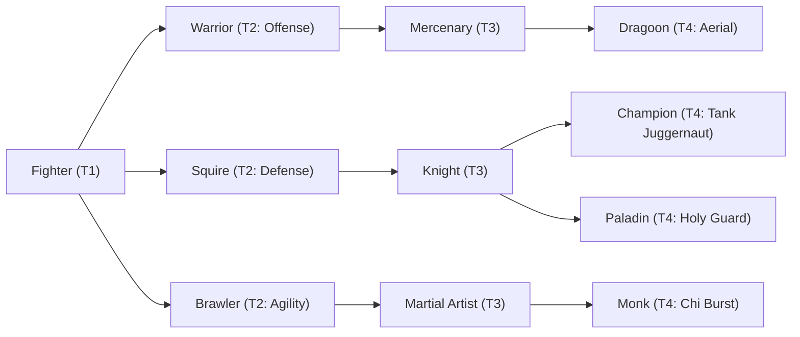

# 🛡️ Database Kelas: Paladin
> **Cabang:** `Jalur Fisik (Melee / Tank)` | **Tingkat:** `Tier 4` | **Batas Level:** `Lv. 1 – 50`

Kesatria suci yang memadukan kekuatan senjata dengan keyakinan, sumpah, dan perlindungan terhadap mereka yang lemah.

---

## 1. Profil & Identitas Peran
| Atribut Kelas | Rincian / Status |
| :--- | :--- |
| **Nama Resmi** | **Paladin** |
| **Class ID Database** | `CID: 29` |
| **Tier Penguasaan** | `Tier 4` *(Level Cap: 50)* |
| **Promosi Dari** | `Knight` |
| **Promosi Lanjutan** | `Holy Knight (Tier 5)` |
| **Peran Utama** | `Defensive Tank / Protector` |
| **Kelemahan Taktis** | *Lowest speed; defensive power comes at DPS cost.* |

## 2. Parameter Pertumbuhan & Karakteristik (Turn-Based RPG)

### A. 6 Base Stats (Atribut Dasar Kelas)
| STR | INT | DEX | LUK | AGI | VIT |
| :---: | :---: | :---: | :---: | :---: | :---: |
| **38** | **18** | **18** | **12** | **16** | **55** |

* **Peringkat Atribut Dasar:** `STR: A | INT: C | DEX: B | LUK: B | AGI: C | VIT: S+`
* **Pertumbuhan Stat Alami (Fixed Stat Growth per Class Level):** `+2 VIT, +1 STR, +1 INT, +1 DEX`
* **Kurva Kebutuhan EXP:** `Tier 4 [42, 32, 42, 42]`

### B. Stat Turunan Awal (Baseline Derived Stats)
*Nilai di bawah dihitung deterministik dari 6 Base Stats awal kelas menggunakan formula resmi Nusvanir (sebelum bonus perlengkapan & alokasi poin pemain):*

#### 1. Sumber Daya Vital & Tempur Utama
| Parameter | Nilai Baseline | Formula / Perhitungan Resmi |
| :--- | :---: | :--- |
| **Max HP** | `1065` | `Base 50 + (VIT 55 * 15) + (STR 38 * 5)` |
| **Max MP** | `164` | `Base 20 + (INT 18 * 8)` |
| **Max SP** | `371` | `Base 20 + (VIT 55 * 5) + (STR 38 * 2)` *(Preserved antar battle)* |
| **ATK** | `85` | `(STR 38 * 2) + (DEX 18 * 0.5)` *(Melee)* |
| **DEF** | `102` | `Base + (VIT 55 * 1.5) + (STR 38 * 0.5)` |
| **MAT** | `36` | `Base + (INT 18 * 2)` |
| **MDF** | `66` | `Base + (INT 18 * 1.2) + (VIT 55 * 0.8)` |
| **Action Speed** | `24` | `Base + (AGI 16 * 1.5)` |

#### 2. Presisi, Kritikal & Regenerasi Giliran (X-Param & S-Param)
| Parameter | Nilai (%) | Formula Perhitungan |
| :--- | :---: | :--- |
| **Hit Rate (HIT)** | `88.6%` | `0.85 + (DEX 18 * 0.002)` (Cap 100%) |
| **Evasion Rate (EVA)** | `5.8%` | `0.02 + (AGI 16 * 0.002) + (LUK 12 * 0.0005)` (Cap 80%) |
| **Critical Rate (CRI)** | `7.8%` | `0.03 + (DEX 18 * 0.002) + (LUK 12 * 0.001)` (Cap 85%) |
| **Critical Evasion (CEV)** | `7.3%` | `(LUK 12 * 0.0015) + (VIT 55 * 0.001)` |
| **Critical Damage (CDMG)** | `165.0%` | `1.5 + (STR 38 * 0.003) + (DEX 18 * 0.002)` |
| **Guard Efficiency (GRD)** | `127.5%` | `1.0 + (VIT 55 * 0.005)` *(Mitigasi saat bertahan)* |
| **HP Regen / Turn (HRG)** | `1.65%` | `VIT 55 * 0.0003` |
| **MP Regen / Turn (MRG)** | `0.54%` | `INT 18 * 0.0003` |
| **SP Regen / Turn (TRG)** | `4.74%` | `0.03 + (AGI 16 * 0.0004) + (VIT 55 * 0.0002)` |

### C. Karakteristik, Sasis & Peralatan
* **Innate Trait:** `Sacred Bastion`
* **Senjata yang Dapat Digunakan:** `Sword`
* **Zirah & Pelindung:** `Heavy Armor, Heavy Shield`
* **Tipe Skill yang Dibuka:** `Physical, Support, Ultimate, Transformation, Passive`

## 3. Daftar Lengkap Skill & Pembelajaran (Learnings)
*Seluruh skill di bawah ini otomatis terbuka saat mencapai Class Level yang ditentukan.*

| Level | Nama Skill | Tipe / Elemen | Biaya | Target | Formula / Efek Matematis | Deskripsi & Catatan |
| :---: | :--- | :--- | :---: | :--- | :--- | :--- |
| **1.0** | **Guardian of Nusvanir** | `Passive` / `None / Neutral` | `0 SP` | User | `-` | Max HP +12%, Holy Resistance +20%, Taunt effects last +1 turn |
| **1.0** | **Iron Provocation** | `Physical` / `Normal Attack` | `10 SP` | One Enemy | `Math.max(0, a.def * 1.3 - b.def * 0.2)` | a.def * 1.3 - b.def * 0.2; Taunt (2 turns) *(Efek: Add State 224 Taunt: 100%)* |
| **5.0** | **Bulwark of Light** | `Support` / `None / Neutral` | `14 SP` | All Allies | `-` | Party barrier = 10% Paladin Max HP for 2 turns | Party barrier equal to 10% of Paladin Max HP for 2 turns *(Efek: Apply FX State 342 (FX 1080 - Bulwark of Light) as specified)* |
| **10.0** | **Guardian's Resonating Vow** | `Passive` / `None / Neutral` | `0 SP` | User | `-` | When protecting an ally, damage taken -15% |
| **15.0** | **Bulwark Stance** | `Support` / `None / Neutral` | `16 SP` | User | `-` | DEF +30%, M.DEF +15%, AGI -10% (2 turns) *(Efek: Apply FX State 344 (FX 1082 - Bulwark Stance) as specified)* |
| **20.0** | **Holy Consecration** | `Physical` / `Normal Attack` | `22 SP` | All Enemies | `Math.max(0, a.def * 1.0 - b.mdf * 0.2)` | a.def * 1.0 - b.mdef * 0.2 |
| **25.0** | **Sanctuary of Light** | `Support` / `None / Neutral` | `20 SP` | User | `-` | Damage taken -30%; HP Regen 3% Max HP/turn (3 turns) | Damage taken -30% and HP Regen 3%/turn (3 turns) *(Efek: Apply FX State 345 (FX 1084 - Sanctuary of Light) as specified)* |
| **31.0** | **Aegis Retribution** | `Physical` / `Normal Attack` | `24 SP` | One Enemy | `Math.max(0, a.atk * 0.9 + a.def * 1.8 - b.def * 0.2)` | a.atk * 0.9 + a.def * 1.8 - b.def * 0.2 |
| **36.0** | **Absolute Fortitude** | `Passive` / `None / Neutral` | `0 SP` | User | `-` | Damage taken -10%; Stun and Knockback Resistance +30% |
| **40.0** | **Divine Citadel** | `Support` / `None / Neutral` | `35 SP` | All Allies | `-` | Party DEF +20%, M.DEF +20%, damage taken -10% (3 turns) *(Efek: Apply FX State 347 (FX 1087 - Divine Citadel) as specified)* |
| **42.0** | **Avatar of Guardian: Garuda** | `Transformation` / `None / Neutral` | `40 SP` | User | `-` | For 3 turns: DEF/M.DEF +55%, Max HP +20%, Regen 4% Max HP/turn; AGI -20%. | Garuda Guardian Form (3 turns). Cannot stack with other transformation states. *(Efek: Apply FX State 348 (FX 1088 - Avatar of Guardian: Garuda) as specified)* |
| **45.0** | **Garuda’s Divine Judgment** | `Ultimate` / `None / Neutral` | `50 SP` | All Enemies | `Math.max(0, (a.def + a.mdf) * 3.2 * (1 + 0.5 * (1 - a.hp/a.mhp)))` | (a.def + a.mdf) * 3.2 * (1 + 0.5 * (1 - a.hp/a.mhp)) | Sure Hit; low-HP scaling capped at +50%. |

---

## 4. Alur Evolusi & Percabangan Kelas
