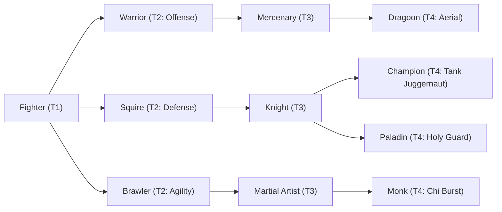

# 🛡️ Database Kelas: Monk
> **Cabang:** `Jalur Fisik (Melee / Tank)` | **Tingkat:** `Tier 4` | **Batas Level:** `Lv. 1 – 50`

Pertapa tempur yang menyelaraskan tubuh, pikiran, dan napas untuk melampaui batas kekuatan manusia biasa.

---

## 1. Profil & Identitas Peran
| Atribut Kelas | Rincian / Status |
| :--- | :--- |
| **Nama Resmi** | **Monk** |
| **Class ID Database** | `CID: 30` |
| **Tier Penguasaan** | `Tier 4` *(Level Cap: 50)* |
| **Promosi Dari** | `Martial Artist` |
| **Promosi Lanjutan** | `Brahma-Kera (Tier 5)` |
| **Peran Utama** | `Evasion / Chi Burst` |
| **Kelemahan Taktis** | *Avoidance-based defense; weaker against Sure Hit and sustained magic burst.* |

## 2. Parameter Pertumbuhan & Karakteristik (Turn-Based RPG)

### A. 6 Base Stats (Atribut Dasar Kelas)
| STR | INT | DEX | LUK | AGI | VIT |
| :---: | :---: | :---: | :---: | :---: | :---: |
| **45** | **14** | **24** | **15** | **45** | **28** |

* **Peringkat Atribut Dasar:** `STR: S | INT: C | DEX: A | LUK: B | AGI: S+ | VIT: A`
* **Pertumbuhan Stat Alami (Fixed Stat Growth per Class Level):** `+2 AGI, +1 STR, +1 INT, +1 DEX`
* **Kurva Kebutuhan EXP:** `Tier 4 [38, 28, 38, 38]`

### B. Stat Turunan Awal (Baseline Derived Stats)
*Nilai di bawah dihitung deterministik dari 6 Base Stats awal kelas menggunakan formula resmi Nusvanir (sebelum bonus perlengkapan & alokasi poin pemain):*

#### 1. Sumber Daya Vital & Tempur Utama
| Parameter | Nilai Baseline | Formula / Perhitungan Resmi |
| :--- | :---: | :--- |
| **Max HP** | `695` | `Base 50 + (VIT 28 * 15) + (STR 45 * 5)` |
| **Max MP** | `132` | `Base 20 + (INT 14 * 8)` |
| **Max SP** | `250` | `Base 20 + (VIT 28 * 5) + (STR 45 * 2)` *(Preserved antar battle)* |
| **ATK** | `102` | `(STR 45 * 2) + (DEX 24 * 0.5)` *(Melee)* |
| **DEF** | `64` | `Base + (VIT 28 * 1.5) + (STR 45 * 0.5)` |
| **MAT** | `28` | `Base + (INT 14 * 2)` |
| **MDF** | `39` | `Base + (INT 14 * 1.2) + (VIT 28 * 0.8)` |
| **Action Speed** | `68` | `Base + (AGI 45 * 1.5)` |

#### 2. Presisi, Kritikal & Regenerasi Giliran (X-Param & S-Param)
| Parameter | Nilai (%) | Formula Perhitungan |
| :--- | :---: | :--- |
| **Hit Rate (HIT)** | `89.8%` | `0.85 + (DEX 24 * 0.002)` (Cap 100%) |
| **Evasion Rate (EVA)** | `11.8%` | `0.02 + (AGI 45 * 0.002) + (LUK 15 * 0.0005)` (Cap 80%) |
| **Critical Rate (CRI)** | `9.3%` | `0.03 + (DEX 24 * 0.002) + (LUK 15 * 0.001)` (Cap 85%) |
| **Critical Evasion (CEV)** | `5.1%` | `(LUK 15 * 0.0015) + (VIT 28 * 0.001)` |
| **Critical Damage (CDMG)** | `168.3%` | `1.5 + (STR 45 * 0.003) + (DEX 24 * 0.002)` |
| **Guard Efficiency (GRD)** | `114.0%` | `1.0 + (VIT 28 * 0.005)` *(Mitigasi saat bertahan)* |
| **HP Regen / Turn (HRG)** | `0.84%` | `VIT 28 * 0.0003` |
| **MP Regen / Turn (MRG)** | `0.42%` | `INT 14 * 0.0003` |
| **SP Regen / Turn (TRG)** | `5.36%` | `0.03 + (AGI 45 * 0.0004) + (VIT 28 * 0.0002)` |

### C. Karakteristik, Sasis & Peralatan
* **Innate Trait:** `Enlightened Body`
* **Senjata yang Dapat Digunakan:** 03 Gloves, 04 Spear
* **Zirah & Pelindung:** 03 Light Armor
* **Tipe Skill yang Dibuka (Skill Types):** `03 Skill, 05 Ultimate` *(Skill pasif aktif otomatis via YEP_AutoPassiveStates)*

## 3. Daftar Lengkap Skill & Pembelajaran (Learnings)
*Seluruh skill di bawah ini otomatis terbuka saat mencapai Class Level yang ditentukan.*

| Level | Nama Skill | Tipe / Elemen | Biaya | Target | Formula / Efek Matematis | Deskripsi & Catatan |
| :---: | :--- | :--- | :---: | :--- | :--- | :--- |
| **1.0** | **Sang Hyang Blessing** | `Passive` / `01 Neutral` | `0 SP` | User | `-` | ATK +8%, M.DEF +8%, Holy Resistance +10% |
| **1.0** | **Flurry of Light Palms** | `03 Skill` / `01 Neutral` | `14 SP` | One Enemy | `Math.max(1, a.atk * 0.6 - b.def * 0.2)` | a.atk * 0.6 - b.def * 0.2 per hit (4 hits) |
| **5.0** | **Chi Palm Art: Buddha's Palm** | `03 Skill` / `01 Neutral` | `18 SP` | One Enemy | `Math.max(1, a.atk * 1.15 - b.def * 0.15)` | a.atk * 1.15 - b.def * 0.15 per hit (3 hits) |
| **10.0** | **Chi Mastery** | `Passive` / `01 Neutral` | `0 SP` | User | `-` | Max SP +15%, SP Charge Rate +10% |
| **15.0** | **Vortex Storm** | `03 Skill` / `05 Air` | `18 SP` | All Enemies | `Math.max(1, a.atk * 1.35 - b.def * 0.2)` | a.atk * 1.35 - b.def * 0.2 |
| **18.0** | **Temple Blessing: Four Paths** | `Passive` / `01 Neutral` | `0 SP` | User | `-` | Choose one path after learning: Tiger (+10% ATK), Crane (+10% AGI), Tortoise (+10% DEF), Serpent (+10% Crit Rate). Permanent; only one path active. |
| **20.0** | **Chi Hyper-Burst** | `03 Skill` / `01 Neutral` | `20 SP` | User | `-` | ATK +25%, AGI +15%, SP Regen 5% Max SP/turn (3 turns); damage taken +10% | ATK +25%, AGI +15%, SP Regen 5%/turn, damage taken +10% (3 turns) *(Efek: Apply FX State 352 (FX 1096 - Chi Hyper-Burst) as specified)* |
| **25.0** | **Meteor Barrage: Heavenly Ascension** | `03 Skill` / `01 Neutral` | `24 SP` | One Enemy | `Math.max(1, a.atk * 0.95 - b.def * 0.08)` | a.atk * 0.95 - b.def * 0.08 per hit (3 hits) |
| **30.0** | **Iron Body** | `03 Skill` / `01 Neutral` | `22 SP` | User | `-` | Damage taken -35%, Stun/Knockback Resistance +50%, AGI -20% (3 turns) *(Efek: Apply FX State 353 (FX 1098 - Iron Body) as specified)* |
| **32.0** | **Vital Chi Strike** | `03 Skill` / `01 Neutral` | `22 SP` | One Enemy | `Math.max(1, a.atk * 2.0 - b.def * 0.2)` | a.atk * 2.0 - b.def * 0.2 |
| **36.0** | **Chi Reflex** | `Passive` / `01 Neutral` | `0 SP` | User | `-` | Evasion +10%; when an attack misses, recover 2% Max SP |
| **40.0** | **Eight Trigrams Sixty-Four Palms** | `03 Skill` / `01 Neutral` | `36 SP` | One Enemy | `Math.max(1, a.atk * 0.5 - b.def * 0.05)` | a.atk * 0.5 - b.def * 0.05 per hit (8 hits) | Final hit has 30% chance to inflict Stun on non-Boss targets. |
| **42.0** | **Chi Life Transmutation** | `03 Skill` / `01 Neutral` | `0 SP` | User | `-` | Sacrifice HP equal to 20% of Max HP to restore SP equal to 50% of Max SP; cannot reduce HP below 1. | HP sacrifice: 20% Max HP → restore 50% Max SP; cannot reduce HP below 1. *(Efek: Apply FX State 355 (FX 1102 - Chi Life Transmutation) as specified)* |
| **45.0** | **Supreme Chi Burst: Void Annihilation** | `05 Ultimate` / `01 Neutral` | `50 SP` | One Enemy | `Math.max(1, a.atk * 4.8 + a.mat * 1.8)` | Consumes all current SP (minimum 50 SP). Damage = a.atk * 4.8 + a.mat * 1.8, then x(1 + 0.6 * currentSP/currentMaxSP) before consumption. | Consumes all current SP; maximum SP scaling bonus +60%. |

---

## 4. Alur Evolusi & Percabangan Kelas
