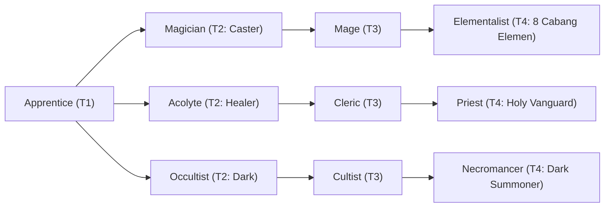

# 🛡️ Database Kelas: Apprentice
> **Cabang:** `Jalur Sihir (Magic / Support)` | **Tingkat:** `Tier 1` | **Batas Level:** `Lv. 1 – 10`

Pemula dalam seni sihir yang baru mempelajari cara memahami mana, mantra, dan aturan dasar kekuatan gaib.

---

## 1. Profil & Identitas Peran
| Atribut Kelas | Rincian / Status |
| :--- | :--- |
| **Nama Resmi** | **Apprentice** |
| **Class ID Database** | `CID: 10` |
| **Tier Penguasaan** | `Tier 1` *(Level Cap: 10)* |
| **Promosi Dari** | `—` |
| **Promosi Lanjutan** | `Magician, Acolyte, Occultist` |
| **Peran Utama** | `Inisiat Sihir Pemula` |
| **Kelemahan Taktis** | *Standar kelemahan arketipe* |

## 2. Parameter Pertumbuhan & Karakteristik (Turn-Based RPG)

### A. 6 Base Stats (Atribut Dasar Kelas)
| STR | INT | DEX | LUK | AGI | VIT |
| :---: | :---: | :---: | :---: | :---: | :---: |
| **1** | **9** | **5** | **4** | **3** | **3** |

* **Peringkat Atribut Dasar:** `STR: E | INT: A | DEX: B | LUK: C | AGI: C | VIT: D`
* **Pertumbuhan Stat Alami (Fixed Stat Growth per Class Level):** `+2 INT, +1 DEX`
* **Kurva Kebutuhan EXP:** `Tier 1 [25, 15, 20, 20]`

### B. Stat Turunan Awal (Baseline Derived Stats)
*Nilai di bawah dihitung deterministik dari 6 Base Stats awal kelas menggunakan formula resmi Nusvanir (sebelum bonus perlengkapan & alokasi poin pemain):*

#### 1. Sumber Daya Vital & Tempur Utama
| Parameter | Nilai Baseline | Formula / Perhitungan Resmi |
| :--- | :---: | :--- |
| **Max HP** | `100` | `Base 50 + (VIT 3 * 15) + (STR 1 * 5)` |
| **Max MP** | `92` | `Base 20 + (INT 9 * 8)` |
| **Max SP** | `37` | `Base 20 + (VIT 3 * 5) + (STR 1 * 2)` *(Preserved antar battle)* |
| **ATK** | `4` | `(STR 1 * 2) + (DEX 5 * 0.5)` *(Melee)* |
| **DEF** | `5` | `Base + (VIT 3 * 1.5) + (STR 1 * 0.5)` |
| **MAT** | `18` | `Base + (INT 9 * 2)` |
| **MDF** | `13` | `Base + (INT 9 * 1.2) + (VIT 3 * 0.8)` |
| **Action Speed** | `4` | `Base + (AGI 3 * 1.5)` |

#### 2. Presisi, Kritikal & Regenerasi Giliran (X-Param & S-Param)
| Parameter | Nilai (%) | Formula Perhitungan |
| :--- | :---: | :--- |
| **Hit Rate (HIT)** | `86.0%` | `0.85 + (DEX 5 * 0.002)` (Cap 100%) |
| **Evasion Rate (EVA)** | `2.8%` | `0.02 + (AGI 3 * 0.002) + (LUK 4 * 0.0005)` (Cap 80%) |
| **Critical Rate (CRI)** | `4.4%` | `0.03 + (DEX 5 * 0.002) + (LUK 4 * 0.001)` (Cap 85%) |
| **Critical Evasion (CEV)** | `0.9%` | `(LUK 4 * 0.0015) + (VIT 3 * 0.001)` |
| **Critical Damage (CDMG)** | `151.3%` | `1.5 + (STR 1 * 0.003) + (DEX 5 * 0.002)` |
| **Guard Efficiency (GRD)** | `101.5%` | `1.0 + (VIT 3 * 0.005)` *(Mitigasi saat bertahan)* |
| **HP Regen / Turn (HRG)** | `0.09%` | `VIT 3 * 0.0003` |
| **MP Regen / Turn (MRG)** | `0.27%` | `INT 9 * 0.0003` |
| **SP Regen / Turn (TRG)** | `3.18%` | `0.03 + (AGI 3 * 0.0004) + (VIT 3 * 0.0002)` |

### C. Karakteristik, Sasis & Peralatan
* **Innate Trait:** `—`
* **Senjata yang Dapat Digunakan:** `Staff, Rune`
* **Zirah & Pelindung:** `Magic Robe`
* **Tipe Skill yang Dibuka:** `Magic, Support, Passive`

## 3. Daftar Lengkap Skill & Pembelajaran (Learnings)
*Seluruh skill di bawah ini otomatis terbuka saat mencapai Class Level yang ditentukan.*

| Level | Nama Skill | Tipe / Elemen | Biaya | Target | Formula / Efek Matematis | Deskripsi & Catatan |
| :---: | :--- | :--- | :---: | :--- | :--- | :--- |
| **1** | **Heal** | `White Magic` / `Holy` | `12 MP` | 1 Ally | `Math.max(0, a.mat * 2.0 + a.int * 1.5)` | Menyalurkan energi spiritual untuk memulihkan luka diri atau sekutu. |
| **1** | **Fireball** | `Black Magic` / `Fire` | `10 MP` | 1 Target | `Math.max(0, a.mat * 1.4 - b.mdf * 0.4)` | Melontarkan gumpalan api magis ke arah musuh (Peluang Burn 20%). |
| **1** | **Spell Mastery** | `Passive` / `Neutral` | `0 MP` | Self | `-` | Pemahaman pola mantra dasar yang meningkatkan MP Regen (MRG). |
| **1** | **Elemental Mastery** | `Passive` / `Neutral` | `0 MP` | Self | `-` | Meningkatkan kapasitas Max MP dan efektivitas mantra elemen. |
| **3** | **Aqua Blast** | `Black Magic` / `Water` | `14 MP` | All Enemies | `Math.max(0, a.mat * 1.15 - b.mdf * 0.35)` | Gelombang air melingkar yang menekan posisi musuh. |
| **5** | **Fire Bolt** | `Black Magic` / `Fire` | `18 MP` | 1 Target | `Math.max(0, a.mat * 1.8 - b.mdf * 0.4)` | Tombak api pekat dengan daya tembus tinggi pada target tunggal. |
| **7** | **Sonic Boom** | `Black Magic` / `Sound` | `16 MP` | 1 Target | `Math.max(0, a.mat * 1.3 - b.mdf * 0.3)` | Gelombang kejut frekuensi tinggi yang dapat menyebabkan Paralyze (20%). |
| **9** | **Holy Veil** | `White Magic / Support` / `Holy` | `25 MP` | Self | `-` | Menciptakan perisai cahaya suci penahan serangan lawan. |

---

## 4. Alur Evolusi & Percabangan Kelas
