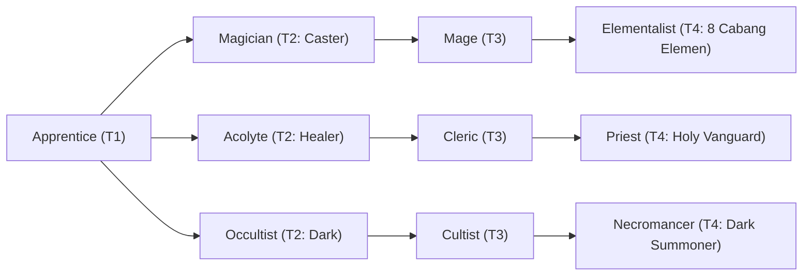

# 🛡️ Database Kelas: Apprentice
> **Cabang:** `Jalur Sihir (Magic / Support)` | **Tingkat:** `Tier 1` | **Batas Level:** `Lv. 1 – 10`

Pemula dalam seni sihir yang baru mempelajari cara memahami mana, mantra, dan aturan dasar kekuatan gaib.

---

## 1. Profil & Identitas Peran
| Atribut Kelas | Rincian / Status |
| :--- | :--- |
| **Nama Resmi** | **Apprentice** |
| **Class ID Database** | `CID: 10` |
| **Tier Penguasaan** | `Tier 1` *(Level Cap: 10)* |
| **Promosi Dari** | `—` |
| **Promosi Lanjutan** | `Magician, Acolyte, Occultist` |
| **Peran Utama** | `Inisiat Sihir Pemula` |
| **Kelemahan Taktis** | *Standar kelemahan arketipe* |

## 2. Parameter Pertumbuhan & Karakteristik (Turn-Based RPG)

### A. 6 Base Stats (Atribut Dasar Kelas)
| STR | INT | DEX | LUK | AGI | VIT |
| :---: | :---: | :---: | :---: | :---: | :---: |
| **1** | **9** | **5** | **4** | **3** | **3** |

* **Peringkat Atribut Dasar:** `STR: E | INT: A | DEX: B | LUK: C | AGI: C | VIT: D`
* **Pertumbuhan Stat Alami (Fixed Stat Growth per Class Level):** `+2 INT, +1 DEX`
* **Kurva Kebutuhan EXP:** `Tier 1 [25, 15, 20, 20]`

### B. Stat Turunan Awal (Baseline Derived Stats)
*Nilai di bawah dihitung deterministik dari 6 Base Stats awal kelas menggunakan formula resmi Nusvanir (sebelum bonus perlengkapan & alokasi poin pemain):*

#### 1. Sumber Daya Vital & Tempur Utama
| Parameter | Nilai Baseline | Formula / Perhitungan Resmi |
| :--- | :---: | :--- |
| **Max HP** | `100` | `Base 50 + (VIT 3 * 15) + (STR 1 * 5)` |
| **Max MP** | `92` | `Base 20 + (INT 9 * 8)` |
| **Max SP** | `37` | `Base 20 + (VIT 3 * 5) + (STR 1 * 2)` *(Preserved antar battle)* |
| **ATK** | `4` | `(STR 1 * 2) + (DEX 5 * 0.5)` *(Melee)* |
| **DEF** | `5` | `Base + (VIT 3 * 1.5) + (STR 1 * 0.5)` |
| **MAT** | `18` | `Base + (INT 9 * 2)` |
| **MDF** | `13` | `Base + (INT 9 * 1.2) + (VIT 3 * 0.8)` |
| **Action Speed** | `4` | `Base + (AGI 3 * 1.5)` |

#### 2. Presisi, Kritikal & Regenerasi Giliran (X-Param & S-Param)
| Parameter | Nilai (%) | Formula Perhitungan |
| :--- | :---: | :--- |
| **Hit Rate (HIT)** | `86.0%` | `0.85 + (DEX 5 * 0.002)` (Cap 100%) |
| **Evasion Rate (EVA)** | `2.8%` | `0.02 + (AGI 3 * 0.002) + (LUK 4 * 0.0005)` (Cap 80%) |
| **Critical Rate (CRI)** | `4.4%` | `0.03 + (DEX 5 * 0.002) + (LUK 4 * 0.001)` (Cap 85%) |
| **Critical Evasion (CEV)** | `0.9%` | `(LUK 4 * 0.0015) + (VIT 3 * 0.001)` |
| **Critical Damage (CDMG)** | `151.3%` | `1.5 + (STR 1 * 0.003) + (DEX 5 * 0.002)` |
| **Guard Efficiency (GRD)** | `101.5%` | `1.0 + (VIT 3 * 0.005)` *(Mitigasi saat bertahan)* |
| **HP Regen / Turn (HRG)** | `0.09%` | `VIT 3 * 0.0003` |
| **MP Regen / Turn (MRG)** | `0.27%` | `INT 9 * 0.0003` |
| **SP Regen / Turn (TRG)** | `3.18%` | `0.03 + (AGI 3 * 0.0004) + (VIT 3 * 0.0002)` |

### C. Karakteristik, Sasis & Peralatan
* **Innate Trait:** `—`
* **Senjata yang Dapat Digunakan (Weapon Types):** 06 Staff, 07 Rune
* **Zirah & Pelindung (Armor Types):** 01 Basic Clothes, 02 Magic Robe
* **Tipe Skill yang Dibuka (Skill Types):** `03 Skill, 05 Ultimate` *(Skill pasif aktif otomatis via YEP_AutoPassiveStates)*

## 3. Daftar Lengkap Skill & Pembelajaran (Learnings)
*Seluruh skill di bawah ini otomatis terbuka saat mencapai Class Level yang ditentukan.*

| Level | Nama Skill | Skill Type | MP / SP Cost | Scope | Hit Type / Repeat | Damage (Type, Element, Formula, Crit) | Effects & Description |
| :---: | :--- | :--- | :---: | :--- | :--- | :--- | :--- |
| **Lv 1** | **Arcane Bolt** | `02 Black Magic` | `5 MP / 0 SP` | 1 Enemy | Magical Attack / 1 | **Type:** HP Damage **Element:** 01 Neutral **Formula:** `Math.max(1, (a.mat * 1.3) - (b.mdf * 0.65))` **Crit:** No | **Efek:** - **Deskripsi:** Proyektil energi sihir murni jarak jauh yang stabil untuk menyerang musuh secara aman. |
| **Lv 4** | **Mind Focus** | `Passive` | `0 MP / 0 SP` | None | Certain Hit / 1 | **Type:** None **Formula:** None | **Efek:** Auto-Passive State [0301+] (MP Regen +2%, Max MP +10%) **Deskripsi:** Latihan meditasi dasar untuk memperluas kapasitas dan pemulihan energi mental. |
| **Lv 7** | **Aether Barrier** | `01 White Magic` | `15 MP / 0 SP` | The User | Certain Hit / 1 | **Type:** None **Formula:** None | **Efek:** Add State: [0301+] Aether Barrier 100% (MDF +20%, 3 Turns) **Deskripsi:** Membentuk perisai pelindung magis suci untuk meredam serangan mematikan yang masuk. |
| **Lv 10** | **Elemental Burst** | `05 Ultimate` | `25 MP / 0 SP` | All Enemies | Magical Attack / 1 | **Type:** HP Damage **Element:** 01 Neutral **Formula:** `Math.max(1, (a.mat * 1.8) - (b.mdf * 0.65))` **Crit:** No | **Efek:** Add State: [0207] Paralyze 30% (2 Turns) **Deskripsi:** Ledakan energi magis area luas yang memicu kekacauan elemen pada seluruh musuh di medan laga. |

---

## 4. Alur Evolusi & Percabangan Kelas
