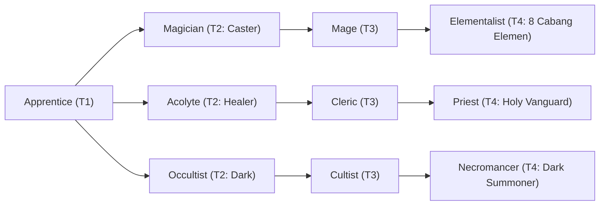

# 🛡️ Database Kelas: Magician
> **Cabang:** `Jalur Sihir (Magic / Support)` | **Tingkat:** `Tier 2` | **Batas Level:** `Lv. 1 – 30`

Penyihir terlatih yang mengubah pengetahuan arcane menjadi mantra untuk menyerang, bertahan, atau mengendalikan keadaan.

---

## 1. Profil & Identitas Peran
| Atribut Kelas | Rincian / Status |
| :--- | :--- |
| **Nama Resmi** | **Magician** |
| **Class ID Database** | `CID: 31` |
| **Tier Penguasaan** | `Tier 2` *(Level Cap: 30)* |
| **Promosi Dari** | `—` |
| **Promosi Lanjutan** | `Mage` |
| **Peran Utama** | `General Elemental Caster` |
| **Kelemahan Taktis** | *Fragile physical chassis.* |

## 2. Parameter Pertumbuhan & Karakteristik (Turn-Based RPG)

### A. 6 Base Stats (Atribut Dasar Kelas)
| STR | INT | DEX | LUK | AGI | VIT |
| :---: | :---: | :---: | :---: | :---: | :---: |
| **2** | **18** | **10** | **6** | **6** | **5** |

* **Peringkat Atribut Dasar:** `STR: E | INT: A | DEX: B | LUK: C | AGI: C | VIT: D`
* **Pertumbuhan Stat Alami (Fixed Stat Growth per Class Level):** `+2 INT, +1 DEX`
* **Kurva Kebutuhan EXP:** `Tier 2 [30, 20, 30, 30]`

### B. Stat Turunan Awal (Baseline Derived Stats)
*Nilai di bawah dihitung deterministik dari 6 Base Stats awal kelas menggunakan formula resmi Nusvanir (sebelum bonus perlengkapan & alokasi poin pemain):*

#### 1. Sumber Daya Vital & Tempur Utama
| Parameter | Nilai Baseline | Formula / Perhitungan Resmi |
| :--- | :---: | :--- |
| **Max HP** | `135` | `Base 50 + (VIT 5 * 15) + (STR 2 * 5)` |
| **Max MP** | `164` | `Base 20 + (INT 18 * 8)` |
| **Max SP** | `49` | `Base 20 + (VIT 5 * 5) + (STR 2 * 2)` *(Preserved antar battle)* |
| **ATK** | `9` | `(STR 2 * 2) + (DEX 10 * 0.5)` *(Melee)* |
| **DEF** | `8` | `Base + (VIT 5 * 1.5) + (STR 2 * 0.5)` |
| **MAT** | `36` | `Base + (INT 18 * 2)` |
| **MDF** | `26` | `Base + (INT 18 * 1.2) + (VIT 5 * 0.8)` |
| **Action Speed** | `9` | `Base + (AGI 6 * 1.5)` |

#### 2. Presisi, Kritikal & Regenerasi Giliran (X-Param & S-Param)
| Parameter | Nilai (%) | Formula Perhitungan |
| :--- | :---: | :--- |
| **Hit Rate (HIT)** | `87.0%` | `0.85 + (DEX 10 * 0.002)` (Cap 100%) |
| **Evasion Rate (EVA)** | `3.5%` | `0.02 + (AGI 6 * 0.002) + (LUK 6 * 0.0005)` (Cap 80%) |
| **Critical Rate (CRI)** | `5.6%` | `0.03 + (DEX 10 * 0.002) + (LUK 6 * 0.001)` (Cap 85%) |
| **Critical Evasion (CEV)** | `1.4%` | `(LUK 6 * 0.0015) + (VIT 5 * 0.001)` |
| **Critical Damage (CDMG)** | `152.6%` | `1.5 + (STR 2 * 0.003) + (DEX 10 * 0.002)` |
| **Guard Efficiency (GRD)** | `102.5%` | `1.0 + (VIT 5 * 0.005)` *(Mitigasi saat bertahan)* |
| **HP Regen / Turn (HRG)** | `0.15%` | `VIT 5 * 0.0003` |
| **MP Regen / Turn (MRG)** | `0.54%` | `INT 18 * 0.0003` |
| **SP Regen / Turn (TRG)** | `3.34%` | `0.03 + (AGI 6 * 0.0004) + (VIT 5 * 0.0002)` |

### C. Karakteristik, Sasis & Peralatan
* **Innate Trait:** `Arcane Aptitude`
* **Senjata yang Dapat Digunakan:** `Staff, Rune`
* **Zirah & Pelindung:** `Magic Robe`
* **Tipe Skill yang Dibuka:** `Black Magic, Support, Ultimate, Passive`

## 3. Daftar Lengkap Skill & Pembelajaran (Learnings)
*Seluruh skill di bawah ini otomatis terbuka saat mencapai Class Level yang ditentukan.*

| Level | Nama Skill | Tipe / Elemen | Biaya | Target | Formula / Efek Matematis | Deskripsi & Catatan |
| :---: | :--- | :--- | :---: | :--- | :--- | :--- |
| **1.0** | **Flame Spark** | `Black Magic` / `Fire` | `8 MP` | One Enemy | `Math.max(0, a.mat * 1.4 - b.mdf * 0.4)` | a.mat * 1.4 - b.mdf * 0.4 (Burn 30%) *(Efek: Add State 201 Burn: 30%)* |
| **3.0** | **Frost Chill** | `Black Magic` / `Ice` | `8 MP` | One Enemy | `Math.max(0, a.mat * 1.3 - b.mdf * 0.4)` | a.mat * 1.3 - b.mdf * 0.4 (Chill 40%) *(Efek: Add State 205 Chill: 40%)* |
| **8.0** | **Mana Amplification** | `Passive` / `None / Neutral` | `0 SP` | User | `-` | Mana Regen +3% Max MP/turn & Max MP +12% |
| **12.0** | **Lightning Bolt** | `Black Magic` / `Lightning` | `12 MP` | One Enemy | `Math.max(0, a.mat * 1.6 - b.mdf * 0.4)` | a.mat * 1.6 - b.mdf * 0.4 (Paralyze 20%) *(Efek: Add State 207 Paralyze: 20%)* |
| **17.0** | **Magic Barrier** | `Support` / `None / Neutral` | `10 MP` | User | `-` | Damage taken -15% (physical and magical, 3 turns) | Physical/Magic Damage taken -15% (3 turns) *(Efek: Apply FX State 357 (FX 1108 - Magic Barrier) as specified)* |
| **22.0** | **Elemental Mastery** | `Passive` / `None / Neutral` | `0 SP` | User | `-` | Elemental damage +10% |
| **26.0** | **Mud Pit** | `Black Magic` / `Earth` | `14 MP` | One Enemy | `Math.max(0, a.mat * 1.2 - b.mdf * 0.4)` | a.mat * 1.2 - b.mdf * 0.4 (Root 40%) *(Efek: Add State 209 Root: 40%)* |
| **30.0** | **Elemental Storm** | `Ultimate` / `None / Neutral` | `30 MP` | All Enemies | `Math.max(0, a.mat * 1.8 - b.mdf * 0.3)` | a.mat * 1.8 - b.mdf * 0.3 (AoE) |

---

## 4. Alur Evolusi & Percabangan Kelas
