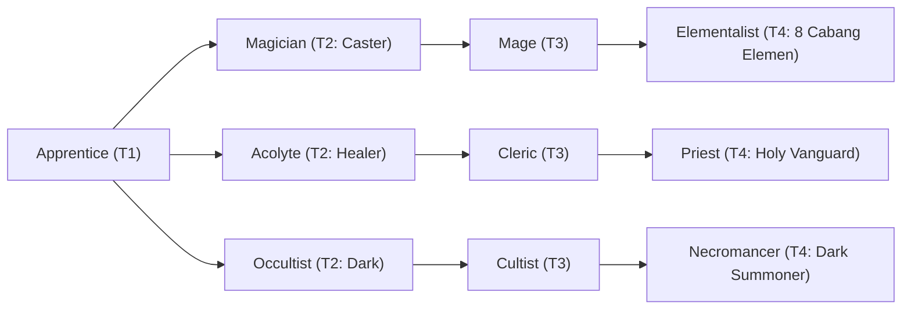

# 🛡️ Database Kelas: Acolyte
> **Cabang:** `Jalur Sihir (Magic / Support)` | **Tingkat:** `Tier 2` | **Batas Level:** `Lv. 1 – 30`

Pelayan muda jalan suci yang belajar menyalurkan doa, pemulihan, dan perlindungan melalui keyakinannya.

---

## 1. Profil & Identitas Peran
| Atribut Kelas | Rincian / Status |
| :--- | :--- |
| **Nama Resmi** | **Acolyte** |
| **Class ID Database** | `CID: 32` |
| **Tier Penguasaan** | `Tier 2` *(Level Cap: 30)* |
| **Promosi Dari** | `—` |
| **Promosi Lanjutan** | `Cleric` |
| **Peran Utama** | `Healer / Holy Support` |
| **Kelemahan Taktis** | *Low offensive pressure outside Holy/Undead matchups.* |

## 2. Parameter Pertumbuhan & Karakteristik (Turn-Based RPG)

### A. 6 Base Stats (Atribut Dasar Kelas)
| STR | INT | DEX | LUK | AGI | VIT |
| :---: | :---: | :---: | :---: | :---: | :---: |
| **3** | **16** | **6** | **7** | **5** | **10** |

* **Peringkat Atribut Dasar:** `STR: E | INT: A | DEX: C | LUK: B | AGI: C | VIT: C`
* **Pertumbuhan Stat Alami (Fixed Stat Growth per Class Level):** `+2 INT, +1 VIT`
* **Kurva Kebutuhan EXP:** `Tier 2 [30, 20, 30, 30]`

### B. Stat Turunan Awal (Baseline Derived Stats)
*Nilai di bawah dihitung deterministik dari 6 Base Stats awal kelas menggunakan formula resmi Nusvanir (sebelum bonus perlengkapan & alokasi poin pemain):*

#### 1. Sumber Daya Vital & Tempur Utama
| Parameter | Nilai Baseline | Formula / Perhitungan Resmi |
| :--- | :---: | :--- |
| **Max HP** | `215` | `Base 50 + (VIT 10 * 15) + (STR 3 * 5)` |
| **Max MP** | `148` | `Base 20 + (INT 16 * 8)` |
| **Max SP** | `76` | `Base 20 + (VIT 10 * 5) + (STR 3 * 2)` *(Preserved antar battle)* |
| **ATK** | `9` | `(STR 3 * 2) + (DEX 6 * 0.5)` *(Melee)* |
| **DEF** | `16` | `Base + (VIT 10 * 1.5) + (STR 3 * 0.5)` |
| **MAT** | `32` | `Base + (INT 16 * 2)` |
| **MDF** | `27` | `Base + (INT 16 * 1.2) + (VIT 10 * 0.8)` |
| **Action Speed** | `8` | `Base + (AGI 5 * 1.5)` |

#### 2. Presisi, Kritikal & Regenerasi Giliran (X-Param & S-Param)
| Parameter | Nilai (%) | Formula Perhitungan |
| :--- | :---: | :--- |
| **Hit Rate (HIT)** | `86.2%` | `0.85 + (DEX 6 * 0.002)` (Cap 100%) |
| **Evasion Rate (EVA)** | `3.4%` | `0.02 + (AGI 5 * 0.002) + (LUK 7 * 0.0005)` (Cap 80%) |
| **Critical Rate (CRI)** | `4.9%` | `0.03 + (DEX 6 * 0.002) + (LUK 7 * 0.001)` (Cap 85%) |
| **Critical Evasion (CEV)** | `2.1%` | `(LUK 7 * 0.0015) + (VIT 10 * 0.001)` |
| **Critical Damage (CDMG)** | `152.1%` | `1.5 + (STR 3 * 0.003) + (DEX 6 * 0.002)` |
| **Guard Efficiency (GRD)** | `105.0%` | `1.0 + (VIT 10 * 0.005)` *(Mitigasi saat bertahan)* |
| **HP Regen / Turn (HRG)** | `0.30%` | `VIT 10 * 0.0003` |
| **MP Regen / Turn (MRG)** | `0.48%` | `INT 16 * 0.0003` |
| **SP Regen / Turn (TRG)** | `3.40%` | `0.03 + (AGI 5 * 0.0004) + (VIT 10 * 0.0002)` |

### C. Karakteristik, Sasis & Peralatan
* **Innate Trait:** `Devoted Spirit`
* **Senjata yang Dapat Digunakan:** `Staff, Rune`
* **Zirah & Pelindung:** `Magic Robe`
* **Tipe Skill yang Dibuka:** `White Magic, Ultimate, Passive`

## 3. Daftar Lengkap Skill & Pembelajaran (Learnings)
*Seluruh skill di bawah ini otomatis terbuka saat mencapai Class Level yang ditentukan.*

| Level | Nama Skill | Tipe / Elemen | Biaya | Target | Formula / Efek Matematis | Deskripsi & Catatan |
| :---: | :--- | :--- | :---: | :--- | :--- | :--- |
| **1.0** | **Revitalize** | `White Magic` / `Holy` | `12 MP` | Custom Ally/Enemy Target | `-` | Ally: a.mat * 1.6 + 35 healing. Undead: a.mat * 1.4 - b.mdf * 0.4 | Restores HP to an ally or damages Undead. |
| **3.0** | **Holy Protection** | `Passive` / `None / Neutral` | `0 SP` | User | `-` | M.DEF +8%; Poison/Curse/Silence Resistance +20% | Status: Poison; Curse; Silence |
| **8.0** | **Purify** | `White Magic` / `None / Neutral` | `10 MP` | One Ally | `-` | Removes Poison, Curse, Blind and Silence from 1 ally | Cleanse Poison, Curse, Blind and Silence | Status: Poison; Curse; Blind; Silence *(Efek: Remove State 203 Poison: 100% | Remove State 225 Curse: 100% | Remove State 212 Blind: 100% | Remove State 213 Silence: 100%)* |
| **12.0** | **Blessing** | `White Magic` / `None / Neutral` | `12 MP` | One Ally | `-` | ATK & M.ATK +12% (3 turns) *(Efek: Apply FX State 360 (FX 1115 - Blessing) as specified)* |
| **17.0** | **Divine Grace** | `Passive` / `None / Neutral` | `0 SP` | User | `-` | Healing Power +12% |
| **22.0** | **Sanctuary** | `White Magic` / `Holy` | `18 MP` | Custom Mixed Scope | `-` | Party: Regen 4% Max HP/turn (3 turns). Undead: a.mat * 0.8 - b.mdf * 0.2 | Party Regen 4% Max HP/turn for 3 turns *(Efek: Apply FX State 362 (FX 1117 - Sanctuary) as specified)* |
| **26.0** | **Armor of Light** | `White Magic` / `None / Neutral` | `15 MP` | One Ally | `-` | DEF & M.DEF +20% (2 turns) *(Efek: Apply FX State 363 (FX 1118 - Armor of Light) as specified)* |
| **30.0** | **Grand Resurgence** | `Ultimate` / `Holy` | `35 MP` | Custom Mixed Scope | `-` | Party: a.mat * 1.8 + 45 healing and cleanses 5 negative states. Undead: a.mat * 2.6 - b.mdf * 0.3 | Party heal + cleanse; deals Holy damage to Undead. |

---

## 4. Alur Evolusi & Percabangan Kelas
