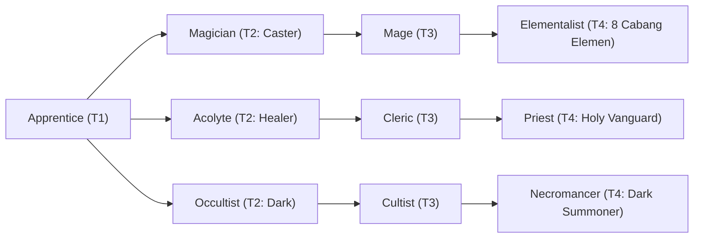

# 🛡️ Database Kelas: Occultist
> **Cabang:** `Jalur Sihir (Magic / Support)` | **Tingkat:** `Tier 2` | **Batas Level:** `Lv. 1 – 30`

Praktisi ilmu terlarang yang mencari kekuatan dari ritual, rahasia kuno, dan pengetahuan yang dihindari kebanyakan orang.

---

## 1. Profil & Identitas Peran
| Atribut Kelas | Rincian / Status |
| :--- | :--- |
| **Nama Resmi** | **Occultist** |
| **Class ID Database** | `CID: 33` |
| **Tier Penguasaan** | `Tier 2` *(Level Cap: 30)* |
| **Promosi Dari** | `—` |
| **Promosi Lanjutan** | `Cultist` |
| **Peran Utama** | `Dark Caster / Early Summon` |
| **Kelemahan Taktis** | *Lower HP/DEF and vulnerable during setup.* |

## 2. Parameter Pertumbuhan & Karakteristik (Turn-Based RPG)

### A. 6 Base Stats (Atribut Dasar Kelas)
| STR | INT | DEX | LUK | AGI | VIT |
| :---: | :---: | :---: | :---: | :---: | :---: |
| **2** | **17** | **7** | **11** | **5** | **6** |

* **Peringkat Atribut Dasar:** `STR: E | INT: A | DEX: C | LUK: A | AGI: C | VIT: D`
* **Pertumbuhan Stat Alami (Fixed Stat Growth per Class Level):** `+2 INT, +1 LUK`
* **Kurva Kebutuhan EXP:** `Tier 2 [30, 20, 30, 30]`

### B. Stat Turunan Awal (Baseline Derived Stats)
*Nilai di bawah dihitung deterministik dari 6 Base Stats awal kelas menggunakan formula resmi Nusvanir (sebelum bonus perlengkapan & alokasi poin pemain):*

#### 1. Sumber Daya Vital & Tempur Utama
| Parameter | Nilai Baseline | Formula / Perhitungan Resmi |
| :--- | :---: | :--- |
| **Max HP** | `150` | `Base 50 + (VIT 6 * 15) + (STR 2 * 5)` |
| **Max MP** | `156` | `Base 20 + (INT 17 * 8)` |
| **Max SP** | `54` | `Base 20 + (VIT 6 * 5) + (STR 2 * 2)` *(Preserved antar battle)* |
| **ATK** | `8` | `(STR 2 * 2) + (DEX 7 * 0.5)` *(Melee)* |
| **DEF** | `10` | `Base + (VIT 6 * 1.5) + (STR 2 * 0.5)` |
| **MAT** | `34` | `Base + (INT 17 * 2)` |
| **MDF** | `25` | `Base + (INT 17 * 1.2) + (VIT 6 * 0.8)` |
| **Action Speed** | `8` | `Base + (AGI 5 * 1.5)` |

#### 2. Presisi, Kritikal & Regenerasi Giliran (X-Param & S-Param)
| Parameter | Nilai (%) | Formula Perhitungan |
| :--- | :---: | :--- |
| **Hit Rate (HIT)** | `86.4%` | `0.85 + (DEX 7 * 0.002)` (Cap 100%) |
| **Evasion Rate (EVA)** | `3.5%` | `0.02 + (AGI 5 * 0.002) + (LUK 11 * 0.0005)` (Cap 80%) |
| **Critical Rate (CRI)** | `5.5%` | `0.03 + (DEX 7 * 0.002) + (LUK 11 * 0.001)` (Cap 85%) |
| **Critical Evasion (CEV)** | `2.2%` | `(LUK 11 * 0.0015) + (VIT 6 * 0.001)` |
| **Critical Damage (CDMG)** | `152.0%` | `1.5 + (STR 2 * 0.003) + (DEX 7 * 0.002)` |
| **Guard Efficiency (GRD)** | `103.0%` | `1.0 + (VIT 6 * 0.005)` *(Mitigasi saat bertahan)* |
| **HP Regen / Turn (HRG)** | `0.18%` | `VIT 6 * 0.0003` |
| **MP Regen / Turn (MRG)** | `0.51%` | `INT 17 * 0.0003` |
| **SP Regen / Turn (TRG)** | `3.32%` | `0.03 + (AGI 5 * 0.0004) + (VIT 6 * 0.0002)` |

### C. Karakteristik, Sasis & Peralatan
* **Innate Trait:** `Forbidden Affinity`
* **Senjata yang Dapat Digunakan:** 06 Staff, 07 Rune
* **Zirah & Pelindung:** 02 Magic Robe
* **Tipe Skill yang Dibuka (Skill Types):** `02 Black Magic, 04 Summon, 05 Ultimate` *(Skill pasif aktif otomatis via YEP_AutoPassiveStates)*

## 3. Daftar Lengkap Skill & Pembelajaran (Learnings)
*Seluruh skill di bawah ini otomatis terbuka saat mencapai Class Level yang ditentukan.*

| Level | Nama Skill | Tipe / Elemen | Biaya | Target | Formula / Efek Matematis | Deskripsi & Catatan |
| :---: | :--- | :--- | :---: | :--- | :--- | :--- |
| **1.0** | **Dark Energy** | `02 Black Magic` / `11 Dark` | `8 MP` | One Enemy | `Math.max(1, a.mat * 1.4 - b.mdf * 0.4)` | a.mat * 1.4 - b.mdf * 0.4 (Curse 25%) *(Efek: Add State 225 Curse: 25%)* |
| **3.0** | **Jenggala** | `04 Summon` / `01 Neutral` | `15 MP` | User | `-` | Summons 1 random Jenggala companion for 3 turns | Summons one random Jenggala companion for 3 turns. *(Efek: Apply FX State 364 (FX 1121 - Jenggala) as specified)* |
| **8.0** | **Blood Pact** | `Passive` / `01 Neutral` | `0 SP` | User | `-` | M.ATK +12%; Max HP -5% |
| **12.0** | **Life Drain** | `02 Black Magic` / `11 Dark` | `14 MP` | One Enemy | `Math.max(1, a.mat * 1.7 - b.mdf * 0.4)` | a.mat * 1.7 - b.mdf * 0.4; restores 35% of damage dealt | Restores 35% of damage dealt as HP |
| **17.0** | **Abyssal Shroud** | `02 Black Magic` / `11 Dark` | `12 MP` | User | `-` | Damage taken -20% (physical and magical, 2 turns) | Physical/Magic Damage taken -20% (2 turns) *(Efek: Apply FX State 366 (FX 1124 - Abyssal Shroud) as specified)* |
| **22.0** | **Soul Harvest** | `Passive` / `01 Neutral` | `0 SP` | User | `-` | Restore 6% Max MP when an enemy is defeated |
| **26.0** | **Abyssal Chains** | `02 Black Magic` / `11 Dark` | `16 MP` | One Enemy | `Math.max(1, a.mat * 1.2 - b.mdf * 0.4)` | a.mat * 1.2 - b.mdf * 0.4 |
| **30.0** | **Soul Rupture** | `05 Ultimate` / `11 Dark` | `35 MP` | All Enemies | `Math.max(1, a.mat * 2.0 - b.mdf * 0.6)` | a.mat * 2.0 - b.mdf * 0.6 |

---

## 4. Alur Evolusi & Percabangan Kelas
