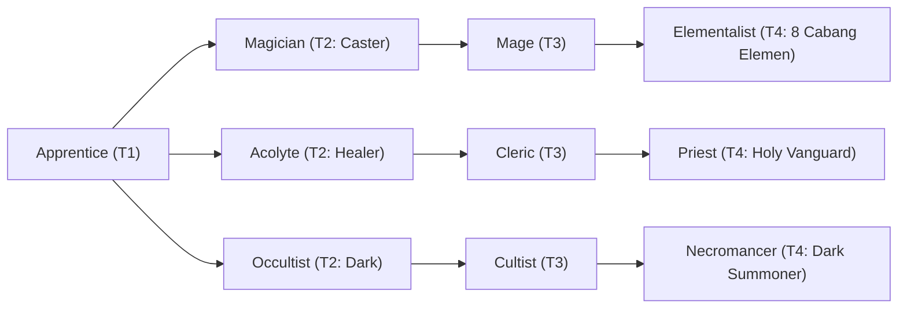

# 🛡️ Database Kelas: Mage
> **Cabang:** `Jalur Sihir (Magic / Support)` | **Tingkat:** `Tier 3` | **Batas Level:** `Lv. 1 – 40`

Penyihir berpengalaman yang memahami arus mana dan mampu membentuknya menjadi sihir yang jauh lebih kuat dan rumit.

---

## 1. Profil & Identitas Peran
| Atribut Kelas | Rincian / Status |
| :--- | :--- |
| **Nama Resmi** | **Mage** |
| **Class ID Database** | `CID: 34` |
| **Tier Penguasaan** | `Tier 3` *(Level Cap: 40)* |
| **Promosi Dari** | `Magician` |
| **Promosi Lanjutan** | `Elementalist (8 Cabang)` |
| **Peran Utama** | `Advanced Elemental Caster` |
| **Kelemahan Taktis** | *High MP dependence and physical fragility.* |

## 2. Parameter Pertumbuhan & Karakteristik (Turn-Based RPG)

### A. 6 Base Stats (Atribut Dasar Kelas)
| STR | INT | DEX | LUK | AGI | VIT |
| :---: | :---: | :---: | :---: | :---: | :---: |
| **4** | **36** | **18** | **10** | **12** | **12** |

* **Peringkat Atribut Dasar:** `STR: E | INT: S | DEX: A | LUK: B | AGI: C | VIT: C`
* **Pertumbuhan Stat Alami (Fixed Stat Growth per Class Level):** `+2 INT, +1 DEX, +1 VIT`
* **Kurva Kebutuhan EXP:** `Tier 3 [35, 25, 35, 35]`

### B. Stat Turunan Awal (Baseline Derived Stats)
*Nilai di bawah dihitung deterministik dari 6 Base Stats awal kelas menggunakan formula resmi Nusvanir (sebelum bonus perlengkapan & alokasi poin pemain):*

#### 1. Sumber Daya Vital & Tempur Utama
| Parameter | Nilai Baseline | Formula / Perhitungan Resmi |
| :--- | :---: | :--- |
| **Max HP** | `250` | `Base 50 + (VIT 12 * 15) + (STR 4 * 5)` |
| **Max MP** | `308` | `Base 20 + (INT 36 * 8)` |
| **Max SP** | `88` | `Base 20 + (VIT 12 * 5) + (STR 4 * 2)` *(Preserved antar battle)* |
| **ATK** | `17` | `(STR 4 * 2) + (DEX 18 * 0.5)` *(Melee)* |
| **DEF** | `20` | `Base + (VIT 12 * 1.5) + (STR 4 * 0.5)` |
| **MAT** | `72` | `Base + (INT 36 * 2)` |
| **MDF** | `53` | `Base + (INT 36 * 1.2) + (VIT 12 * 0.8)` |
| **Action Speed** | `18` | `Base + (AGI 12 * 1.5)` |

#### 2. Presisi, Kritikal & Regenerasi Giliran (X-Param & S-Param)
| Parameter | Nilai (%) | Formula Perhitungan |
| :--- | :---: | :--- |
| **Hit Rate (HIT)** | `88.6%` | `0.85 + (DEX 18 * 0.002)` (Cap 100%) |
| **Evasion Rate (EVA)** | `4.9%` | `0.02 + (AGI 12 * 0.002) + (LUK 10 * 0.0005)` (Cap 80%) |
| **Critical Rate (CRI)** | `7.6%` | `0.03 + (DEX 18 * 0.002) + (LUK 10 * 0.001)` (Cap 85%) |
| **Critical Evasion (CEV)** | `2.7%` | `(LUK 10 * 0.0015) + (VIT 12 * 0.001)` |
| **Critical Damage (CDMG)** | `154.8%` | `1.5 + (STR 4 * 0.003) + (DEX 18 * 0.002)` |
| **Guard Efficiency (GRD)** | `106.0%` | `1.0 + (VIT 12 * 0.005)` *(Mitigasi saat bertahan)* |
| **HP Regen / Turn (HRG)** | `0.36%` | `VIT 12 * 0.0003` |
| **MP Regen / Turn (MRG)** | `1.08%` | `INT 36 * 0.0003` |
| **SP Regen / Turn (TRG)** | `3.72%` | `0.03 + (AGI 12 * 0.0004) + (VIT 12 * 0.0002)` |

### C. Karakteristik, Sasis & Peralatan
* **Innate Trait:** `High Arcana`
* **Senjata yang Dapat Digunakan:** 06 Staff, 07 Rune
* **Zirah & Pelindung:** 02 Magic Robe
* **Tipe Skill yang Dibuka (Skill Types):** `02 Black Magic, 05 Ultimate` *(Skill pasif aktif otomatis via YEP_AutoPassiveStates)*

## 3. Daftar Lengkap Skill & Pembelajaran (Learnings)
*Seluruh skill di bawah ini otomatis terbuka saat mencapai Class Level yang ditentukan.*

| Level | Nama Skill | Tipe / Elemen | Biaya | Target | Formula / Efek Matematis | Deskripsi & Catatan |
| :---: | :--- | :--- | :---: | :--- | :--- | :--- |
| **1.0** | **Flame Burst** | `02 Black Magic` / `02 Fire` | `12 MP` | One Enemy | `Math.max(1, a.mat * 1.9 - b.mdf * 0.4)` | a.mat * 1.9 - b.mdf * 0.4 (Burn 50%) *(Efek: Add State 201 Burn: 50%)* |
| **1.0** | **Tidal Surge** | `02 Black Magic` / `03 Water` | `12 MP` | One Enemy | `Math.max(1, a.mat * 1.9 - b.mdf * 0.4)` | a.mat * 1.9 - b.mdf * 0.4 (Soaked 40%) *(Efek: Add State 218 Soaked: 40%)* |
| **1.0** | **Gale Slash** | `02 Black Magic` / `05 Air` | `12 MP` | One Enemy | `Math.max(1, a.mat * 1.8 - b.mdf * 0.4)` | a.mat * 1.8 - b.mdf * 0.4 (Float 40%) *(Efek: Add State 221 Float: 40%)* |
| **1.0** | **Earthquake** | `02 Black Magic` / `04 Earth` | `12 MP` | One Enemy | `Math.max(1, a.mat * 1.9 - b.mdf * 0.4)` | a.mat * 1.9 - b.mdf * 0.4 (Root 35%) *(Efek: Add State 209 Root: 35%)* |
| **4.0** | **Arcane Elemental Mastery** | `Passive` / `01 Neutral` | `0 SP` | User | `-` | Elemental Magic Damage +20% |
| **9.0** | **Mana Shield** | `02 Black Magic` / `01 Neutral` | `16 MP` | User | `-` | Absorbs 30% of incoming damage using MP; 3 turns | 30% of incoming damage is redirected to MP for 3 turns *(Efek: Apply FX State 369 (FX 1133 - Mana Shield) as specified)* |
| **14.0** | **Shock Wave** | `02 Black Magic` / `01 Neutral` | `18 MP` | One Enemy | `Math.max(1, a.mat * 2.2 - b.mdf * 0.3)` | a.mat * 2.2 - b.mdf * 0.3 (Paralyze 25%) *(Efek: Add State 207 Paralyze: 25%)* |
| **14.0** | **Glacial Spear** | `02 Black Magic` / `07 Ice` | `18 MP` | One Enemy | `Math.max(1, a.mat * 2.2 - b.mdf * 0.3)` | a.mat * 2.2 - b.mdf * 0.3 (Chill 35%) *(Efek: Add State 205 Chill: 35%)* |
| **14.0** | **Razor Shell** | `02 Black Magic` / `01 Neutral` | `16 MP` | User | `-` | Absorbs 35% physical damage and reflects 20% of blocked melee damage for 2 turns | Physical Damage Absorption 35%; melee reflect 20% (2 turns) *(Efek: Apply FX State 370 (FX 1136 - Razor Shell) as specified)* |
| **14.0** | **Echo Blast** | `02 Black Magic` / `01 Neutral` | `18 MP` | All Enemies | `Math.max(1, a.mat * 1.2 - b.mdf * 0.4)` | a.mat * 1.2 - b.mdf * 0.4 |
| **19.0** | **Ether Conduit** | `Passive` / `01 Neutral` | `0 SP` | User | `-` | Ignore 15% M.DEF; MP Regen 3% Max MP/turn |
| **25.0** | **Prismatic Storm** | `02 Black Magic` / `01 Neutral` | `45 MP` | All Enemies | `Math.max(1, a.mat * 1.5 - b.mdf * 0.3)` | a.mat * 1.5 - b.mdf * 0.3 per hit (2 hits; alternating elements) |
| **31.0** | **Time Distortion** | `02 Black Magic` / `01 Neutral` | `30 MP` | All Enemies | `-` | Enemy AGI -30%; user gains Extra Turn once. Cooldown 5 turns. | Enemy AGI -30%; grants one Extra Turn to user; cooldown 5 turns. *(Efek: Apply FX State 372 (FX 1140 - Time Distortion) as specified)* |
| **36.0** | **Sorcerer's Rigor** | `Passive` / `01 Neutral` | `0 SP` | User | `-` | Max MP +25%, M.ATK +15%, 15% Double Cast Chance |
| **40.0** | **Arcane Meteorfall** | `05 Ultimate` / `01 Neutral` | `75 MP` | All Enemies | `Math.max(1, a.mat * 1.65 - b.mdf * 0.10)` | a.mat * 1.65 - b.mdf * 0.10 per hit (3 hits; ignores 15% M.DEF) | Ignores 20% M.DEF |

---

## 4. Alur Evolusi & Percabangan Kelas
