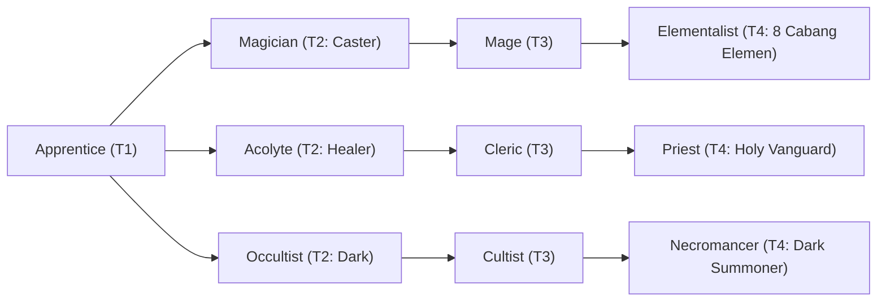

# 🛡️ Database Kelas: Cleric
> **Cabang:** `Jalur Sihir (Magic / Support)` | **Tingkat:** `Tier 3` | **Batas Level:** `Lv. 1 – 40`

Rohaniwan pengembara yang membawa penyembuhan, doa, dan perlindungan bagi mereka yang berjuang di sisinya.

---

## 1. Profil & Identitas Peran
| Atribut Kelas | Rincian / Status |
| :--- | :--- |
| **Nama Resmi** | **Cleric** |
| **Class ID Database** | `CID: 35` |
| **Tier Penguasaan** | `Tier 3` *(Level Cap: 40)* |
| **Promosi Dari** | `Acolyte` |
| **Promosi Lanjutan** | `Priest` |
| **Peran Utama** | `Healer / Cleanse / Protection` |
| **Kelemahan Taktis** | *Moderate offense; resource management matters.* |

## 2. Parameter Pertumbuhan & Karakteristik (Turn-Based RPG)

### A. 6 Base Stats (Atribut Dasar Kelas)
| STR | INT | DEX | LUK | AGI | VIT |
| :---: | :---: | :---: | :---: | :---: | :---: |
| **6** | **32** | **12** | **12** | **10** | **22** |

* **Peringkat Atribut Dasar:** `STR: D | INT: S | DEX: B | LUK: B | AGI: C | VIT: A`
* **Pertumbuhan Stat Alami (Fixed Stat Growth per Class Level):** `+2 INT, +1 VIT, +1 LUK`
* **Kurva Kebutuhan EXP:** `Tier 3 [35, 25, 35, 35]`

### B. Stat Turunan Awal (Baseline Derived Stats)
*Nilai di bawah dihitung deterministik dari 6 Base Stats awal kelas menggunakan formula resmi Nusvanir (sebelum bonus perlengkapan & alokasi poin pemain):*

#### 1. Sumber Daya Vital & Tempur Utama
| Parameter | Nilai Baseline | Formula / Perhitungan Resmi |
| :--- | :---: | :--- |
| **Max HP** | `410` | `Base 50 + (VIT 22 * 15) + (STR 6 * 5)` |
| **Max MP** | `276` | `Base 20 + (INT 32 * 8)` |
| **Max SP** | `142` | `Base 20 + (VIT 22 * 5) + (STR 6 * 2)` *(Preserved antar battle)* |
| **ATK** | `18` | `(STR 6 * 2) + (DEX 12 * 0.5)` *(Melee)* |
| **DEF** | `36` | `Base + (VIT 22 * 1.5) + (STR 6 * 0.5)` |
| **MAT** | `64` | `Base + (INT 32 * 2)` |
| **MDF** | `56` | `Base + (INT 32 * 1.2) + (VIT 22 * 0.8)` |
| **Action Speed** | `15` | `Base + (AGI 10 * 1.5)` |

#### 2. Presisi, Kritikal & Regenerasi Giliran (X-Param & S-Param)
| Parameter | Nilai (%) | Formula Perhitungan |
| :--- | :---: | :--- |
| **Hit Rate (HIT)** | `87.4%` | `0.85 + (DEX 12 * 0.002)` (Cap 100%) |
| **Evasion Rate (EVA)** | `4.6%` | `0.02 + (AGI 10 * 0.002) + (LUK 12 * 0.0005)` (Cap 80%) |
| **Critical Rate (CRI)** | `6.6%` | `0.03 + (DEX 12 * 0.002) + (LUK 12 * 0.001)` (Cap 85%) |
| **Critical Evasion (CEV)** | `4.0%` | `(LUK 12 * 0.0015) + (VIT 22 * 0.001)` |
| **Critical Damage (CDMG)** | `154.2%` | `1.5 + (STR 6 * 0.003) + (DEX 12 * 0.002)` |
| **Guard Efficiency (GRD)** | `111.0%` | `1.0 + (VIT 22 * 0.005)` *(Mitigasi saat bertahan)* |
| **HP Regen / Turn (HRG)** | `0.66%` | `VIT 22 * 0.0003` |
| **MP Regen / Turn (MRG)** | `0.96%` | `INT 32 * 0.0003` |
| **SP Regen / Turn (TRG)** | `3.84%` | `0.03 + (AGI 10 * 0.0004) + (VIT 22 * 0.0002)` |

### C. Karakteristik, Sasis & Peralatan
* **Innate Trait:** `Consecrated Discipline`
* **Senjata yang Dapat Digunakan:** `Staff, Rune`
* **Zirah & Pelindung:** `Magic Robe`
* **Tipe Skill yang Dibuka:** `White Magic, Support, Ultimate, Passive`

## 3. Daftar Lengkap Skill & Pembelajaran (Learnings)
*Seluruh skill di bawah ini otomatis terbuka saat mencapai Class Level yang ditentukan.*

| Level | Nama Skill | Tipe / Elemen | Biaya | Target | Formula / Efek Matematis | Deskripsi & Catatan |
| :---: | :--- | :--- | :---: | :--- | :--- | :--- |
| **1.0** | **Smite of Conviction** | `White Magic` / `Holy` | `12 MP` | One Enemy | `Math.max(0, a.mat * 1.7 - b.mdf * 0.4)` | a.mat * 1.7 - b.mdf * 0.4 |
| **4.0** | **Holy Blessing** | `Passive` / `None / Neutral` | `0 SP` | User | `-` | M.DEF +15%; Poison/Curse/Silence/Chaos Resistance +30% | Status: Poison; Curse; Silence |
| **9.0** | **Sanctified Cleansing** | `White Magic` / `Holy` | `16 MP` | Custom Ally/Enemy Target | `-` | Ally: heal a.mat * 1.3 and cleanse 3 negative states. Enemy: a.mat * 1.3 - b.mdf * 0.8 | Ally heal + cleanse; offensive Holy damage against enemy. |
| **14.0** | **Sacred Sanctuary** | `Support` / `None / Neutral` | `24 MP` | All Allies | `-` | Party HP Regen 5% Max HP/turn & M.DEF +15% (3 turns) | Party Regen + M.DEF buff (3 turns). *(Efek: Apply FX State 375 (FX 1146 - Sacred Sanctuary) as specified)* |
| **19.0** | **Devout Resolve** | `Passive` / `None / Neutral` | `0 SP` | User | `-` | MP Cost -10%, Silence & Confusion Immunity |
| **25.0** | **Turn Undead** | `White Magic` / `Holy` | `18 MP` | One Enemy | `Math.max(0, a.mat * 2.5 - b.mdf * 0.2)` | a.mat * 2.5 - b.mdf * 0.2; deals x1.25 damage to Undead | Deals +25% damage to Undead |
| **25.0** | **Raise** | `White Magic` / `None / Neutral` | `35 MP` | One Ally (Dead) | `-` | Revive 1 fallen ally with 35% HP | Revives one fallen ally with 35% Max HP *(Efek: Apply FX State 377 (FX 1149 - Raise) as specified)* |
| **31.0** | **Aegis of Faith** | `Support` / `None / Neutral` | `18 MP` | One Ally | `-` | DEF & M.DEF +25% (3 turns) *(Efek: Apply FX State 378 (FX 1150 - Aegis of Faith) as specified)* |
| **36.0** | **Holy Aura** | `Passive` / `None / Neutral` | `0 SP` | User | `-` | When healing an ally, that ally gains DEF/M.DEF +8% for 2 turns; does not stack |
| **40.0** | **Miracle Intervention** | `Ultimate` / `Holy` | `80 MP` | All Allies | `-` | Restores 55% Max HP and 30% Max MP to all allies; damage taken -40% for 1 turn | Party emergency recovery; damage taken -40% for 1 turn. Cooldown 4 turns. *(Efek: Apply FX State 380 (FX 1152 - Miracle Intervention) as specified)* |

---

## 4. Alur Evolusi & Percabangan Kelas
