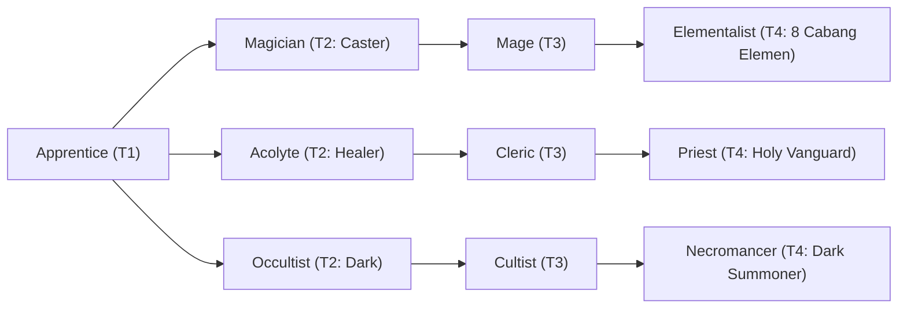

# 🛡️ Database Kelas: Cultist
> **Cabang:** `Jalur Sihir (Magic / Support)` | **Tingkat:** `Tier 3` | **Batas Level:** `Lv. 1 – 40`

Pengikut ajaran terlarang yang menukar batas moral dengan pengetahuan, ritual, dan kekuatan dari sumber yang berbahaya.

---

## 1. Profil & Identitas Peran
| Atribut Kelas | Rincian / Status |
| :--- | :--- |
| **Nama Resmi** | **Cultist** |
| **Class ID Database** | `CID: 36` |
| **Tier Penguasaan** | `Tier 3` *(Level Cap: 40)* |
| **Promosi Dari** | `Occultist` |
| **Promosi Lanjutan** | `Necromancer` |
| **Peran Utama** | `Dark Summoner / Sacrifice` |
| **Kelemahan Taktis** | *Lowest durability among Tier 3 casters; summon setup costs tempo/HP.* |

## 2. Parameter Pertumbuhan & Karakteristik (Turn-Based RPG)

### A. 6 Base Stats (Atribut Dasar Kelas)
| STR | INT | DEX | LUK | AGI | VIT |
| :---: | :---: | :---: | :---: | :---: | :---: |
| **4** | **34** | **14** | **20** | **10** | **14** |

* **Peringkat Atribut Dasar:** `STR: E | INT: S | DEX: B | LUK: S | AGI: C | VIT: C`
* **Pertumbuhan Stat Alami (Fixed Stat Growth per Class Level):** `+2 INT, +1 LUK, +1 VIT`
* **Kurva Kebutuhan EXP:** `Tier 3 [35, 25, 35, 35]`

### B. Stat Turunan Awal (Baseline Derived Stats)
*Nilai di bawah dihitung deterministik dari 6 Base Stats awal kelas menggunakan formula resmi Nusvanir (sebelum bonus perlengkapan & alokasi poin pemain):*

#### 1. Sumber Daya Vital & Tempur Utama
| Parameter | Nilai Baseline | Formula / Perhitungan Resmi |
| :--- | :---: | :--- |
| **Max HP** | `280` | `Base 50 + (VIT 14 * 15) + (STR 4 * 5)` |
| **Max MP** | `292` | `Base 20 + (INT 34 * 8)` |
| **Max SP** | `98` | `Base 20 + (VIT 14 * 5) + (STR 4 * 2)` *(Preserved antar battle)* |
| **ATK** | `15` | `(STR 4 * 2) + (DEX 14 * 0.5)` *(Melee)* |
| **DEF** | `23` | `Base + (VIT 14 * 1.5) + (STR 4 * 0.5)` |
| **MAT** | `68` | `Base + (INT 34 * 2)` |
| **MDF** | `52` | `Base + (INT 34 * 1.2) + (VIT 14 * 0.8)` |
| **Action Speed** | `15` | `Base + (AGI 10 * 1.5)` |

#### 2. Presisi, Kritikal & Regenerasi Giliran (X-Param & S-Param)
| Parameter | Nilai (%) | Formula Perhitungan |
| :--- | :---: | :--- |
| **Hit Rate (HIT)** | `87.8%` | `0.85 + (DEX 14 * 0.002)` (Cap 100%) |
| **Evasion Rate (EVA)** | `5.0%` | `0.02 + (AGI 10 * 0.002) + (LUK 20 * 0.0005)` (Cap 80%) |
| **Critical Rate (CRI)** | `7.8%` | `0.03 + (DEX 14 * 0.002) + (LUK 20 * 0.001)` (Cap 85%) |
| **Critical Evasion (CEV)** | `4.4%` | `(LUK 20 * 0.0015) + (VIT 14 * 0.001)` |
| **Critical Damage (CDMG)** | `154.0%` | `1.5 + (STR 4 * 0.003) + (DEX 14 * 0.002)` |
| **Guard Efficiency (GRD)** | `107.0%` | `1.0 + (VIT 14 * 0.005)` *(Mitigasi saat bertahan)* |
| **HP Regen / Turn (HRG)** | `0.42%` | `VIT 14 * 0.0003` |
| **MP Regen / Turn (MRG)** | `1.02%` | `INT 34 * 0.0003` |
| **SP Regen / Turn (TRG)** | `3.68%` | `0.03 + (AGI 10 * 0.0004) + (VIT 14 * 0.0002)` |

### C. Karakteristik, Sasis & Peralatan
* **Innate Trait:** `Abyssal Initiation`
* **Senjata yang Dapat Digunakan:** 06 Staff, 07 Rune
* **Zirah & Pelindung:** 02 Magic Robe
* **Tipe Skill yang Dibuka (Skill Types):** `02 Black Magic, 04 Summon, 05 Ultimate` *(Skill pasif aktif otomatis via YEP_AutoPassiveStates)*

## 3. Daftar Lengkap Skill & Pembelajaran (Learnings)
*Seluruh skill di bawah ini otomatis terbuka saat mencapai Class Level yang ditentukan.*

| Level | Nama Skill | Tipe / Elemen | Biaya | Target | Formula / Efek Matematis | Deskripsi & Catatan |
| :---: | :--- | :--- | :---: | :--- | :--- | :--- |
| **1.0** | **Abyssal Life Drain** | `02 Black Magic` / `11 Dark` | `15 MP` | One Enemy | `Math.max(1, a.mat * 1.7 - b.mdf * 0.4)` | a.mat * 1.7 - b.mdf * 0.4; restores 35% of damage dealt |
| **1.0** | **Blood Sacrifice Pact** | `Passive` / `11 Dark` | `0 SP` | User | `-` | When HP falls below 50%, M.ATK +15% and damage taken +10% |
| **4.0** | **Soul Extract** | `02 Black Magic` / `01 Neutral` | `12 MP` | One Enemy | `-` | Captures a defeated Jenggala-type enemy's soul; 30% chance on non-boss targets | 30% chance to capture a defeated Jenggala-type enemy's soul; bosses are immune |
| **9.0** | **Mana Corruption** | `02 Black Magic` / `01 Neutral` | `0 SP` | User | `-` | Consumes 20% current MP to gain 20% Max SP equivalent as temporary dark energy for 3 turns | Converts 20% current MP into a 20% resource boost for 3 turns; cannot exceed Max SP |
| **12.0** | **Jenggala's Vow** | `Passive` / `11 Dark` | `0 SP` | Custom Mixed Scope | `-` | Jenggala summons gain +10% HP and +10% damage; caster damage taken +5% while a summon is active |
| **14.0** | **Umbral Veil** | `02 Black Magic` / `11 Dark` | `10 MP` | User | `-` | Evasion +40% and damage taken -20% for 2 turns | Evasion +40%; damage taken -20% (2 turns) *(Efek: Apply FX State 383 (FX 1158 - Umbral Veil) as specified)* |
| **19.0** | **Summon: Bhuta Dread-Mercenary** | `04 Summon` / `11 Dark` | `0 SP` | All Enemies | `Math.max(1, a.mat * 1.8 - b.mdf * 0.3)` | a.mat * 1.8 - b.mdf * 0.3 | Summons 1 Bhuta Dread-Mercenary for 4 turns; maximum 2 active Bhuta. |
| **22.0** | **Summon: Bhuta Hollow-Knight** | `04 Summon` / `01 Neutral` | `0 SP` | Custom Mixed Scope | `-` | Hollow-Knight grants party DEF +15% for 3 turns; summon lasts 4 turns | Summons a defensive Bhuta for 4 turns; party DEF +15% while active. *(Efek: Apply FX State 384 (FX 1160 - Summon: Bhuta Hollow-Knight) as specified)* |
| **25.0** | **Summon: Bhuta Fallen-Cleric** | `04 Summon` / `11 Dark` | `0 SP` | All Allies | `-` | Heals all allies for a.mat * 1.0 once on summon; summon lasts 4 turns | Summons a Fallen-Cleric for 4 turns; heals the party once on summon. *(Efek: Apply FX State 385 (FX 1161 - Summon: Bhuta Fallen-Cleric) as specified)* |
| **28.0** | **Summon: Bhuta Plague-Rogue** | `04 Summon` / `11 Dark` | `0 SP` | All Enemies | `Math.max(1, a.mat * 1.7 - b.mdf * 0.2)` | a.mat * 1.7 - b.mdf * 0.2; Poison 50% | Summons a Plague-Rogue for 4 turns; maximum 2 active Bhuta. *(Efek: Add State 203 Poison: 100%)* |
| **31.0** | **Dark Purgatory** | `02 Black Magic` / `11 Dark` | `25 MP` | All Enemies | `Math.max(1, a.mat * 1.8 - b.mdf * 0.3)` | a.mat * 1.8 - b.mdf * 0.3 |
| **36.0** | **Abyss Conduit** | `Passive` / `11 Dark` | `0 SP` | User | `-` | Dark damage +15%; when a summon is defeated, recover 5% Max MP |
| **40.0** | **Blood Pact: Demon Commander** | `05 Ultimate` / `11 Dark` | `0 SP` | Custom Mixed Scope | `-` | Costs 30% Current HP. Summons one selected Demon Commander for 3 turns; caster gains Commander Link while active. | Summons 1 selected Demon Commander for 3 turns. Maximum 1 Commander. Commander Link: caster damage +15% while commander is active. *(Efek: Apply FX State 387 (FX 1165 - Blood Pact: Demon Commander) as specified)* |
| **40.0** | **Luciferus (Pride)** | `05 Ultimate` / `11 Dark` | `0 SP` | All Enemies | `Math.max(1, a.mat * 2.2 - b.mdf * 0.1)` | a.mat * 2.2 - b.mdf * 0.1 (3 Hits) |
| **40.0** | **Mamon (Greed)** | `05 Ultimate` / `11 Dark` | `0 SP` | All Enemies | `Math.max(1, a.mat * 2.4 - b.mdf * 0.2)` | a.mat * 2.4 - b.mdf * 0.2 |
| **40.0** | **Vraka (Wrath)** | `05 Ultimate` / `11 Dark` | `0 SP` | One Enemy | `Math.max(1, (a.atk + a.mat) * 2.2 - (b.def + b.mdf) * 0.2)` | (a.atk + a.mat) * 2.2 - (b.def + b.mdf) * 0.2 |
| **40.0** | **Asmodea (Lust)** | `05 Ultimate` / `11 Dark` | `0 SP` | All Enemies | `Math.max(1, a.mat * 1.8 - b.mdf * 0.4)` | a.mat * 1.8 - b.mdf * 0.4 |
| **40.0** | **Beelzebub (Gluttony)** | `05 Ultimate` / `11 Dark` | `0 SP` | All Enemies | `Math.max(1, a.mat * 2.2 - b.mdf * 0.2)` | a.mat * 2.2 - b.mdf * 0.2; restores 10% damage as HP |
| **40.0** | **Belphegor (Sloth)** | `05 Ultimate` / `11 Dark` | `0 SP` | All Enemies | `Math.max(1, a.mat * 2.0 - b.mdf * 0.3)` | a.mat * 2.0 - b.mdf * 0.3 |
| **40.0** | **Leviathanus (Envy)** | `05 Ultimate` / `11 Dark` | `0 SP` | All Enemies | `Math.max(1, a.mat * 2.2 - b.mdf * 0.2)` | a.mat * 2.2 - b.mdf * 0.2; steals 1 positive buff from target | Removes 1 positive buff from target |

---

## 4. Alur Evolusi & Percabangan Kelas
