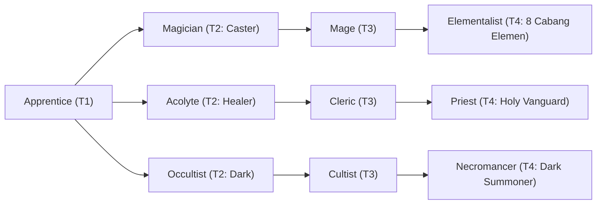

# 🛡️ Database Kelas: Priest
> **Cabang:** `Jalur Sihir (Magic / Support)` | **Tingkat:** `Tier 4` | **Batas Level:** `Lv. 1 – 50`

Rohaniwan tinggi yang menguasai doa dan mukjizat untuk menyembuhkan, melindungi, dan menuntun para pengikutnya.

---

## 1. Profil & Identitas Peran
| Atribut Kelas | Rincian / Status |
| :--- | :--- |
| **Nama Resmi** | **Priest** |
| **Class ID Database** | `CID: 45` |
| **Tier Penguasaan** | `Tier 4` *(Level Cap: 50)* |
| **Promosi Dari** | `Cleric` |
| **Promosi Lanjutan** | `High Priest (Tier 5)` |
| **Peran Utama** | `Endgame Healer / Holy Protector` |
| **Kelemahan Taktis** | *Low physical pressure and slow casting chassis.* |

## 2. Parameter Pertumbuhan & Karakteristik (Turn-Based RPG)

### A. 6 Base Stats (Atribut Dasar Kelas)
| STR | INT | DEX | LUK | AGI | VIT |
| :---: | :---: | :---: | :---: | :---: | :---: |
| **10** | **52** | **20** | **18** | **18** | **40** |

* **Peringkat Atribut Dasar:** `STR: D | INT: S+ | DEX: A | LUK: A | AGI: B | VIT: S`
* **Pertumbuhan Stat Alami (Fixed Stat Growth per Class Level):** `+2 INT, +2 VIT, +1 LUK`
* **Kurva Kebutuhan EXP:** `Tier 4 [40, 30, 40, 40]`

### B. Stat Turunan Awal (Baseline Derived Stats)
*Nilai di bawah dihitung deterministik dari 6 Base Stats awal kelas menggunakan formula resmi Nusvanir (sebelum bonus perlengkapan & alokasi poin pemain):*

#### 1. Sumber Daya Vital & Tempur Utama
| Parameter | Nilai Baseline | Formula / Perhitungan Resmi |
| :--- | :---: | :--- |
| **Max HP** | `700` | `Base 50 + (VIT 40 * 15) + (STR 10 * 5)` |
| **Max MP** | `436` | `Base 20 + (INT 52 * 8)` |
| **Max SP** | `240` | `Base 20 + (VIT 40 * 5) + (STR 10 * 2)` *(Preserved antar battle)* |
| **ATK** | `30` | `(STR 10 * 2) + (DEX 20 * 0.5)` *(Melee)* |
| **DEF** | `65` | `Base + (VIT 40 * 1.5) + (STR 10 * 0.5)` |
| **MAT** | `104` | `Base + (INT 52 * 2)` |
| **MDF** | `94` | `Base + (INT 52 * 1.2) + (VIT 40 * 0.8)` |
| **Action Speed** | `27` | `Base + (AGI 18 * 1.5)` |

#### 2. Presisi, Kritikal & Regenerasi Giliran (X-Param & S-Param)
| Parameter | Nilai (%) | Formula Perhitungan |
| :--- | :---: | :--- |
| **Hit Rate (HIT)** | `89.0%` | `0.85 + (DEX 20 * 0.002)` (Cap 100%) |
| **Evasion Rate (EVA)** | `6.5%` | `0.02 + (AGI 18 * 0.002) + (LUK 18 * 0.0005)` (Cap 80%) |
| **Critical Rate (CRI)** | `8.8%` | `0.03 + (DEX 20 * 0.002) + (LUK 18 * 0.001)` (Cap 85%) |
| **Critical Evasion (CEV)** | `6.7%` | `(LUK 18 * 0.0015) + (VIT 40 * 0.001)` |
| **Critical Damage (CDMG)** | `157.0%` | `1.5 + (STR 10 * 0.003) + (DEX 20 * 0.002)` |
| **Guard Efficiency (GRD)** | `120.0%` | `1.0 + (VIT 40 * 0.005)` *(Mitigasi saat bertahan)* |
| **HP Regen / Turn (HRG)** | `1.20%` | `VIT 40 * 0.0003` |
| **MP Regen / Turn (MRG)** | `1.56%` | `INT 52 * 0.0003` |
| **SP Regen / Turn (TRG)** | `4.52%` | `0.03 + (AGI 18 * 0.0004) + (VIT 40 * 0.0002)` |

### C. Karakteristik, Sasis & Peralatan
* **Innate Trait:** `Sacred Vessel`
* **Senjata yang Dapat Digunakan:** 06 Staff, 07 Rune
* **Zirah & Pelindung:** 02 Magic Robe, 01 Basic Clothes
* **Tipe Skill yang Dibuka (Skill Types):** `01 White Magic, 05 Ultimate` *(Skill pasif aktif otomatis via YEP_AutoPassiveStates)*

## 3. Daftar Lengkap Skill & Pembelajaran (Learnings)
*Seluruh skill di bawah ini otomatis terbuka saat mencapai Class Level yang ditentukan.*

| Level | Nama Skill | Tipe / Elemen | Biaya | Target | Formula / Efek Matematis | Deskripsi & Catatan |
| :---: | :--- | :--- | :---: | :--- | :--- | :--- |
| **1.0** | **Sacred Consecration** | `Passive` / `01 Neutral` | `0 SP` | User | `-` | - |
| **1.0** | **Divine Exorcism** | `01 White Magic` / `10 Holy` | `12 SP` | One Enemy | `Math.max(1, a.mat * 2.2 - b.mdf * 0.15)` | a.matk * 2.2 - b.mdef * 0.15 | Priority +1; ignores 20% M.DEF; +50% damage vs Undead/Drakhtar. No Instant Death against Bosses. |
| **4.0** | **Radiant Salvation** | `01 White Magic` / `10 Holy` | `18 SP` | One Ally | `Math.max(1, a.mat * 2.5 + a.level * 5)` | a.matk * 2.5 + a.level * 5 |
| **9.0** | **Aegis Maxima** | `01 White Magic` / `10 Holy` | `22 SP` | All Allies | `-` | Party damage taken -60% for 1 turn | Priority +5; party damage taken -60% for 1 turn. Cooldown 4 turns; can be dispelled. *(Efek: Apply FX State 424 (FX 1249 - Aegis Maxima) as specified)* |
| **14.0** | **Holy Nova** | `01 White Magic` / `10 Holy` | `24 SP` | Field / Custom Scope | `-` | Party Regen 5% Max HP/turn for 3 turns; Undead/Dark enemies take 4% Max HP damage per turn (Boss cap 2%) | Holy Field (3 turns): heals allies and damages Undead/Dark enemies. *(Efek: Apply FX State 425 (FX 1250 - Holy Nova) as specified)* |
| **18.0** | **Divine Gift** | `Passive` / `01 Neutral` | `0 SP` | User | `-` | - |
| **23.0** | **Holy Barrier** | `Passive` / `01 Neutral` | `0 SP` | All Allies | `-` | - |
| **27.0** | **Sanctified Absolution** | `01 White Magic` / `01 Neutral` | `30 SP` | All Allies | `-` | Cleanses up to 5 negative states/debuffs from all allies; Status Resistance +25% for 2 turns | Mass cleanse + temporary status resistance. *(Efek: Apply FX State 428 (FX 1253 - Sanctified Absolution) as specified)* |
| **33.0** | **Holy Infusion** | `01 White Magic` / `01 Neutral` | `35 SP` | All Allies | `-` | - |
| **37.0** | **Martyr's Faith** | `Passive` / `01 Neutral` | `0 SP` | User | `-` | - |
| **39.0** | **Celestial Grace** | `01 White Magic` / `01 Neutral` | `32 SP` | All Allies | `-` | Party Regen 8% Max HP/turn for 3 turns | Strong party regeneration for 3 turns; does not stack with itself. *(Efek: Apply FX State 430 (FX 1256 - Celestial Grace) as specified)* |
| **42.0** | **Resurrection** | `01 White Magic` / `10 Holy` | `40 SP` | One Ally (Dead) | `-` | Revives 1 fallen ally with 70% Max HP | Revive 1 ally at 70% HP; grants damage taken -20% for 1 turn. *(Efek: Apply FX State 431 (FX 1257 - Resurrection) as specified)* |
| **45.0** | **Avatar of Light** | `05 Ultimate` / `10 Holy` | `60 SP` | User | `-` | Transformation 3 turns: healing +50%, Holy damage +30%, damage taken -30%, Status Resistance +50%; Dark damage taken +25%. | Avatar of Light (3 turns). Afterward: SP -30% and Healing Power -25% for 2 turns. *(Efek: Apply FX State 432 (FX 1258 - Avatar of Light) as specified)* |

---

## 4. Alur Evolusi & Percabangan Kelas
