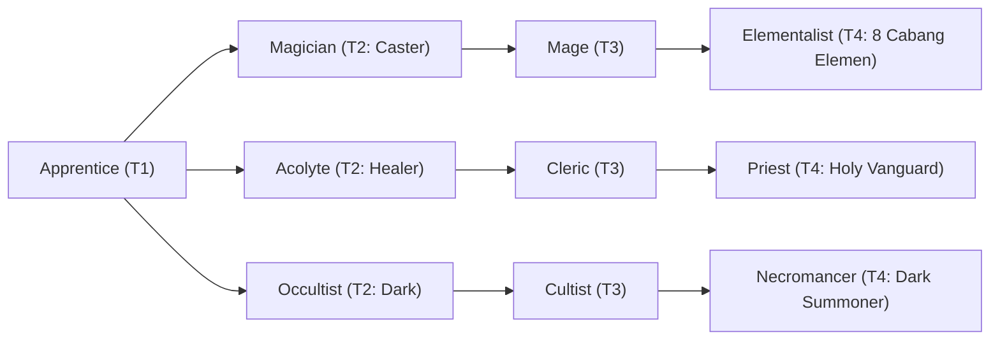

# 🛡️ Database Kelas: Necromancer
> **Cabang:** `Jalur Sihir (Magic / Support)` | **Tingkat:** `Tier 4` | **Batas Level:** `Lv. 1 – 50`

Penyihir kematian yang mempelajari jiwa, jasad, dan ikatan antara kehidupan serta dunia setelah kematian.

---

## 1. Profil & Identitas Peran
| Atribut Kelas | Rincian / Status |
| :--- | :--- |
| **Nama Resmi** | **Necromancer** |
| **Class ID Database** | `CID: 46` |
| **Tier Penguasaan** | `Tier 4` *(Level Cap: 50)* |
| **Promosi Dari** | `Cultist` |
| **Promosi Lanjutan** | `Warlock / Death Knight (Tier 5)` |
| **Peran Utama** | `Endgame Summoner / Dark Resource` |
| **Kelemahan Taktis** | *Very low HP/DEF; summons and resources must protect the caster.* |

## 2. Parameter Pertumbuhan & Karakteristik (Turn-Based RPG)

### A. 6 Base Stats (Atribut Dasar Kelas)
| STR | INT | DEX | LUK | AGI | VIT |
| :---: | :---: | :---: | :---: | :---: | :---: |
| **8** | **56** | **22** | **32** | **16** | **24** |

* **Peringkat Atribut Dasar:** `STR: E | INT: S+ | DEX: A | LUK: S+ | AGI: C | VIT: B`
* **Pertumbuhan Stat Alami (Fixed Stat Growth per Class Level):** `+2 INT, +2 LUK, +1 VIT`
* **Kurva Kebutuhan EXP:** `Tier 4 [40, 30, 40, 40]`

### B. Stat Turunan Awal (Baseline Derived Stats)
*Nilai di bawah dihitung deterministik dari 6 Base Stats awal kelas menggunakan formula resmi Nusvanir (sebelum bonus perlengkapan & alokasi poin pemain):*

#### 1. Sumber Daya Vital & Tempur Utama
| Parameter | Nilai Baseline | Formula / Perhitungan Resmi |
| :--- | :---: | :--- |
| **Max HP** | `450` | `Base 50 + (VIT 24 * 15) + (STR 8 * 5)` |
| **Max MP** | `468` | `Base 20 + (INT 56 * 8)` |
| **Max SP** | `156` | `Base 20 + (VIT 24 * 5) + (STR 8 * 2)` *(Preserved antar battle)* |
| **ATK** | `27` | `(STR 8 * 2) + (DEX 22 * 0.5)` *(Melee)* |
| **DEF** | `40` | `Base + (VIT 24 * 1.5) + (STR 8 * 0.5)` |
| **MAT** | `112` | `Base + (INT 56 * 2)` |
| **MDF** | `86` | `Base + (INT 56 * 1.2) + (VIT 24 * 0.8)` |
| **Action Speed** | `24` | `Base + (AGI 16 * 1.5)` |

#### 2. Presisi, Kritikal & Regenerasi Giliran (X-Param & S-Param)
| Parameter | Nilai (%) | Formula Perhitungan |
| :--- | :---: | :--- |
| **Hit Rate (HIT)** | `89.4%` | `0.85 + (DEX 22 * 0.002)` (Cap 100%) |
| **Evasion Rate (EVA)** | `6.8%` | `0.02 + (AGI 16 * 0.002) + (LUK 32 * 0.0005)` (Cap 80%) |
| **Critical Rate (CRI)** | `10.6%` | `0.03 + (DEX 22 * 0.002) + (LUK 32 * 0.001)` (Cap 85%) |
| **Critical Evasion (CEV)** | `7.2%` | `(LUK 32 * 0.0015) + (VIT 24 * 0.001)` |
| **Critical Damage (CDMG)** | `156.8%` | `1.5 + (STR 8 * 0.003) + (DEX 22 * 0.002)` |
| **Guard Efficiency (GRD)** | `112.0%` | `1.0 + (VIT 24 * 0.005)` *(Mitigasi saat bertahan)* |
| **HP Regen / Turn (HRG)** | `0.72%` | `VIT 24 * 0.0003` |
| **MP Regen / Turn (MRG)** | `1.68%` | `INT 56 * 0.0003` |
| **SP Regen / Turn (TRG)** | `4.12%` | `0.03 + (AGI 16 * 0.0004) + (VIT 24 * 0.0002)` |

### C. Karakteristik, Sasis & Peralatan
* **Innate Trait:** `Gravebound Scholar`
* **Senjata yang Dapat Digunakan:** 06 Staff, 07 Rune
* **Zirah & Pelindung:** 02 Magic Robe
* **Tipe Skill yang Dibuka (Skill Types):** `02 Black Magic, 04 Summon, 05 Ultimate` *(Skill pasif aktif otomatis via YEP_AutoPassiveStates)*

## 3. Daftar Lengkap Skill & Pembelajaran (Learnings)
*Seluruh skill di bawah ini otomatis terbuka saat mencapai Class Level yang ditentukan.*

| Level | Nama Skill | Tipe / Elemen | Biaya | Target | Formula / Efek Matematis | Deskripsi & Catatan |
| :---: | :--- | :--- | :---: | :--- | :--- | :--- |
| **Passive (Contract)** | **Covenant of Demon Commanders (Luciferus)** | `Passive` / `None / Neutral` | `0 SP` | User | `-` | Unlocks this Demon Commander as a selectable contract. Only one Commander may be active at a time. | Passive: Unlocks one selectable Demon Commander contract; no direct combat stat bonus. |
| **Passive (Contract)** | **Covenant of Demon Commanders (Mamon)** | `Passive` / `None / Neutral` | `0 SP` | User | `-` | Unlocks this Demon Commander as a selectable contract. Only one Commander may be active at a time. | Passive: Unlocks one selectable Demon Commander contract; no direct combat stat bonus. |
| **Passive (Contract)** | **Covenant of Demon Commanders (Vraka)** | `Passive` / `None / Neutral` | `0 SP` | User | `-` | Unlocks this Demon Commander as a selectable contract. Only one Commander may be active at a time. | Passive: Unlocks one selectable Demon Commander contract; no direct combat stat bonus. |
| **Passive (Contract)** | **Covenant of Demon Commanders (Asmodea)** | `Passive` / `None / Neutral` | `0 SP` | User | `-` | Unlocks this Demon Commander as a selectable contract. Only one Commander may be active at a time. | Passive: Unlocks one selectable Demon Commander contract; no direct combat stat bonus. |
| **Passive (Contract)** | **Covenant of Demon Commanders (Beelzebub)** | `Passive` / `None / Neutral` | `0 SP` | User | `-` | Unlocks this Demon Commander as a selectable contract. Only one Commander may be active at a time. | Passive: Unlocks one selectable Demon Commander contract; no direct combat stat bonus. |
| **Passive (Contract)** | **Covenant of Demon Commanders (Belphegor)** | `Passive` / `None / Neutral` | `0 SP` | User | `-` | Unlocks this Demon Commander as a selectable contract. Only one Commander may be active at a time. | Passive: Unlocks one selectable Demon Commander contract; no direct combat stat bonus. |
| **Passive (Contract)** | **Covenant of Demon Commanders (Leviathanus)** | `Passive` / `None / Neutral` | `0 SP` | User | `-` | Unlocks this Demon Commander as a selectable contract. Only one Commander may be active at a time. | Passive: Unlocks one selectable Demon Commander contract; no direct combat stat bonus. |
| **1.0** | **Soul Slavery** | `02 Black Magic` / `01 Neutral` | `20 MP` | One Enemy | `-` | Capture weakened non-Boss enemy below 30% HP; 50% success. On success gain 1 Soul (max 4). | Soul resource maximum 4. Bosses cannot be captured. |
| **4.0** | **Life Sacrifice** | `04 Summon` / `01 Neutral` | `0 SP` | Summon Target | `-` | Sacrifice 10% caster Max HP to restore 30% summon Max HP | Sacrifice 10% caster Max HP to heal a summon for 30% of its Max HP *(Efek: Apply FX State 440 (FX 1267 - Life Sacrifice) as specified)* |
| **7.0** | **Soul Siphon** | `02 Black Magic` / `01 Neutral` | `0 SP` | Summon Target | `-` | Sacrifice one active summon to restore 20% Max MP and gain 1 Soul | Dismisses one summon; restores 20% Max MP and grants 1 Soul *(Efek: Apply FX State 441 (FX 1268 - Soul Siphon) as specified)* |
| **9.0** | **Jenggala Horde** | `02 Black Magic` / `11 Dark` | `0 SP` | All Enemies | `Math.max(1, a.mat * 1.6 - b.mdf * 0.2)` | a.mat * 1.6 - b.mdf * 0.2 |
| **12.0** | **Necrotic Mana Corruption** | `02 Black Magic` / `01 Neutral` | `0 SP` | User | `-` | Consumes 20% current MP; restores 25% Max HP | Converts MP into emergency healing; restores 25% Max HP *(Efek: Apply FX State 442 (FX 1270 - Necrotic Mana Corruption) as specified)* |
| **14.0** | **Bhuta Manifestation: Vanguard (Undead Wyrm-Dragoon)** | `04 Summon` / `11 Dark` | `0 SP` | Field / Custom Scope | `Math.max(1, a.atk * 1.8 - b.def * 0.25)` | a.atk * 1.8 - b.def * 0.25 | Summons one Vanguard Bhuta for 4 turns; maximum 2 active summons. |
| **14.0** | **Bhuta Manifestation: Vanguard (Fallen Champion)** | `04 Summon` / `11 Dark` | `0 SP` | Field / Custom Scope | `Math.max(1, a.atk * 2.0 - b.def * 0.2)` | a.atk * 2.0 - b.def * 0.2 | Summons one Vanguard Bhuta for 4 turns; maximum 2 active summons. |
| **14.0** | **Bhuta Manifestation: Vanguard (Asura Monk)** | `04 Summon` / `11 Dark` | `0 SP` | Field / Custom Scope | `Math.max(1, a.atk * 0.65 - b.def * 0.2)` | a.atk * 0.65 - b.def * 0.2 per hit (4 hits) | Summons one Vanguard Bhuta for 4 turns; maximum 2 active summons. |
| **14.0** | **Bhuta Manifestation: Vanguard (Plague Assassin)** | `04 Summon` / `11 Dark` | `0 SP` | Field / Custom Scope | `Math.max(1, a.atk * 1.7 - b.def * 0.0)` | a.atk * 1.7 - b.def * 0.0 (Crit guaranteed) | Summons one Vanguard Bhuta for 4 turns; maximum 2 active summons. |
| **19.0** | **Necrotic Mastery** | `Passive` / `11 Dark` | `0 SP` | User | `-` | Dark Magic Damage +15%, Max MP +10%, summon costs reduced by 15% | Passive: Dark Magic Damage +15%, Max MP +10%, summon costs reduced by 15%; maximum 2 active summons. |
| **25.0** | **Bhuta Manifestation: Sanctuary (Hollow Paladin)** | `04 Summon` / `01 Neutral` | `0 SP` | Field / Custom Scope | `-` | Grants party DEF +12% and draws enemy attention for 1 turn | Summons one Sanctuary Bhuta for 4 turns; maximum 2 active summons. |
| **25.0** | **Bhuta Manifestation: Sanctuary (Dark Priest)** | `04 Summon` / `11 Dark` | `0 SP` | Field / Custom Scope | `-` | Heals all allies for a.mat * 0.9 + 20 on summon | Summons one Sanctuary Bhuta for 4 turns; maximum 2 active summons. *(Efek: Apply FX State 444 (FX 1277 - Bhuta Manifestation: Sanctuary (Dark Priest)) as specified)* |
| **25.0** | **Bhuta Manifestation: Sanctuary (Abyssal Elementalist)** | `04 Summon` / `11 Dark` | `0 SP` | Field / Custom Scope | `Math.max(1, a.mat * 1.6 - b.mdf * 0.3)` | a.mat * 1.6 - b.mdf * 0.3 | Summons one Sanctuary Bhuta for 4 turns; maximum 2 active summons. |
| **25.0** | **Bhuta Manifestation: Sanctuary (Spectral Sniper)** | `04 Summon` / `11 Dark` | `0 SP` | Field / Custom Scope | `Math.max(1, a.atk * 2.0 - b.def * 0.0)` | a.atk * 2.0 - b.def * 0.0 (Sure Hit) | Summons one Sanctuary Bhuta for 4 turns; maximum 2 active summons. |
| **31.0** | **Dual Demon Commander Contract** | `Passive` / `01 Neutral` | `0 SP` | Custom Mixed Scope | `-` | Unlocks a second Commander contract option; only one Demon Commander may be active at a time. | Passive: Can equip two Commander contract options, but only one Commander can be active at a time. |
| **36.0** | **Corpse Desecration** | `02 Black Magic` / `11 Dark` | `0 SP` | All Enemies | `Math.max(1, a.mat * 2.0 - b.mdf * 0.2)` | a.mat * 2.0 - b.mdf * 0.2; +15% damage if at least one summon is active | +15% damage while a summon is active; Curse 50%. |
| **45.0** | **Summon Demon Lord Sangrahal** | `05 Ultimate` / `11 Dark` | `0 SP` | Field / Custom Scope | `Math.max(1, a.mat * 8.0 - b.mdf * 0.0)` | a.mat * 8.0 - b.mdf * 0.0 | Consumes 4 Souls and 25% Max HP to summon Sangrahal for 4 turns. Only one Demon Lord can exist at a time; if caster dies, summon ends. |

---

## 4. Alur Evolusi & Percabangan Kelas
