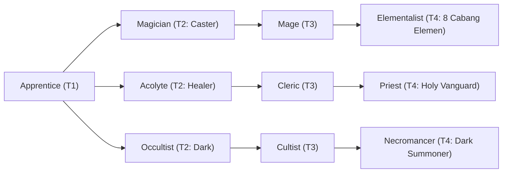

# 🛡️ Database Kelas: Elementalist - Pyromancer
> **Cabang:** `Jalur Sihir (Magic / Support)` | **Tingkat:** `Tier 4` | **Batas Level:** `Lv. 1 – 50`

Penyihir unsur api yang membentuk bara, panas, dan ledakan menjadi senjata di medan pertempuran.

---

## 1. Profil & Identitas Peran
| Atribut Kelas | Rincian / Status |
| :--- | :--- |
| **Nama Resmi** | **Elementalist - Pyromancer** |
| **Class ID Database** | `CID: 37` |
| **Tier Penguasaan** | `Tier 4` *(Level Cap: 50)* |
| **Promosi Dari** | `Mage` |
| **Promosi Lanjutan** | `Archmage (Tier 5)` |
| **Peran Utama** | `Fire Burst / Burn` |
| **Kelemahan Taktis** | *Very fragile physically; burst-focused.* |

## 2. Parameter Pertumbuhan & Karakteristik (Turn-Based RPG)

### A. 6 Base Stats (Atribut Dasar Kelas)
| STR | INT | DEX | LUK | AGI | VIT |
| :---: | :---: | :---: | :---: | :---: | :---: |
| **8** | **60** | **25** | **15** | **22** | **25** |

* **Peringkat Atribut Dasar:** `STR: E | INT: S+ | DEX: A | LUK: B | AGI: B | VIT: B`
* **Pertumbuhan Stat Alami (Fixed Stat Growth per Class Level):** `+3 INT, +1 DEX, +1 VIT`
* **Kurva Kebutuhan EXP:** `Tier 4 [40, 30, 40, 40]`

### B. Stat Turunan Awal (Baseline Derived Stats)
*Nilai di bawah dihitung deterministik dari 6 Base Stats awal kelas menggunakan formula resmi Nusvanir (sebelum bonus perlengkapan & alokasi poin pemain):*

#### 1. Sumber Daya Vital & Tempur Utama
| Parameter | Nilai Baseline | Formula / Perhitungan Resmi |
| :--- | :---: | :--- |
| **Max HP** | `465` | `Base 50 + (VIT 25 * 15) + (STR 8 * 5)` |
| **Max MP** | `500` | `Base 20 + (INT 60 * 8)` |
| **Max SP** | `161` | `Base 20 + (VIT 25 * 5) + (STR 8 * 2)` *(Preserved antar battle)* |
| **ATK** | `28` | `(STR 8 * 2) + (DEX 25 * 0.5)` *(Melee)* |
| **DEF** | `42` | `Base + (VIT 25 * 1.5) + (STR 8 * 0.5)` |
| **MAT** | `120` | `Base + (INT 60 * 2)` |
| **MDF** | `92` | `Base + (INT 60 * 1.2) + (VIT 25 * 0.8)` |
| **Action Speed** | `33` | `Base + (AGI 22 * 1.5)` |

#### 2. Presisi, Kritikal & Regenerasi Giliran (X-Param & S-Param)
| Parameter | Nilai (%) | Formula Perhitungan |
| :--- | :---: | :--- |
| **Hit Rate (HIT)** | `90.0%` | `0.85 + (DEX 25 * 0.002)` (Cap 100%) |
| **Evasion Rate (EVA)** | `7.2%` | `0.02 + (AGI 22 * 0.002) + (LUK 15 * 0.0005)` (Cap 80%) |
| **Critical Rate (CRI)** | `9.5%` | `0.03 + (DEX 25 * 0.002) + (LUK 15 * 0.001)` (Cap 85%) |
| **Critical Evasion (CEV)** | `4.8%` | `(LUK 15 * 0.0015) + (VIT 25 * 0.001)` |
| **Critical Damage (CDMG)** | `157.4%` | `1.5 + (STR 8 * 0.003) + (DEX 25 * 0.002)` |
| **Guard Efficiency (GRD)** | `112.5%` | `1.0 + (VIT 25 * 0.005)` *(Mitigasi saat bertahan)* |
| **HP Regen / Turn (HRG)** | `0.75%` | `VIT 25 * 0.0003` |
| **MP Regen / Turn (MRG)** | `1.80%` | `INT 60 * 0.0003` |
| **SP Regen / Turn (TRG)** | `4.38%` | `0.03 + (AGI 22 * 0.0004) + (VIT 25 * 0.0002)` |

### C. Karakteristik, Sasis & Peralatan
* **Innate Trait:** `Emberborn Chassis`
* **Senjata yang Dapat Digunakan:** 06 Staff, 07 Rune
* **Zirah & Pelindung:** 02 Magic Robe
* **Tipe Skill yang Dibuka (Skill Types):** `02 Black Magic, 05 Ultimate` *(Skill pasif aktif otomatis via YEP_AutoPassiveStates)*

## 3. Daftar Lengkap Skill & Pembelajaran (Learnings)
*Seluruh skill di bawah ini otomatis terbuka saat mencapai Class Level yang ditentukan.*

| Level | Nama Skill | Tipe / Elemen | Biaya | Target | Formula / Efek Matematis | Deskripsi & Catatan |
| :---: | :--- | :--- | :---: | :--- | :--- | :--- |
| **1.0** | **Heart of Flame** | `Passive` / `02 Fire` | `0 SP` | User | `-` | Fire elemental damage +25%; fire damage taken -50%; Burn Immunity. |
| **1.0** | **Incinerate** | `02 Black Magic` / `02 Fire` | `12 SP` | One Enemy | `Math.max(1, a.mat * 2.1 - b.mdf * 0.2)` | a.mat * 2.1 - b.mdf * 0.2 (Burn 70%) *(Efek: Add State 201 Burn: 70%)* |
| **5.0** | **Blazing Surge** | `02 Black Magic` / `02 Fire` | `20 SP` | All Enemies | `Math.max(1, a.mat * 1.4 - b.mdf * 0.3)` | a.matk * 1.4 - b.mdef * 0.3 |
| **12.0** | **Flame Eater** | `Passive` / `01 Neutral` | `0 SP` | User | `-` | - |
| **18.0** | **Scorching Pillars** | `02 Black Magic` / `02 Fire` | `24 SP` | All Enemies (exact 3 targets need plugin) | `Math.max(1, a.mat * 0.8 - b.mdf * 0.2)` | a.mat * 0.8 - b.mdf * 0.2 |
| **22.0** | **Flame Barrier** | `02 Black Magic` / `02 Fire` | `26 SP` | All Allies | `-` | Party Fire/Elemental Damage taken -40% for 3 turns; attacker suffers Burn 20% | Party elemental damage taken -40% (3 turns); fire attackers have 20% Burn chance *(Efek: Apply FX State 390 (FX 1178 - Flame Barrier) as specified)* |
| **28.0** | **Magma Eruption** | `02 Black Magic` / `02 Fire` | `32 SP` | All Enemies | `Math.max(1, a.mat * 1.3 - b.mdf * 0.2)` | a.matk * 1.3 - b.mdef * 0.2 per hit |
| **35.0** | **Blaze Resonance** | `02 Black Magic` / `02 Fire` | `30 SP` | User | `-` | Fire Damage +20%; Burn chance +15%; damage taken +10% (3 turns) | Fire amplification stance (3 turns); damage taken +10%. *(Efek: Apply FX State 391 (FX 1180 - Blaze Resonance) as specified)* |
| **45.0** | **Hellfire Inferno** | `05 Ultimate` / `02 Fire` | `55 SP` | One Enemy | `Math.max(1, a.mat * 8.5)` | Base: a.matk * 8.5. If Burn: Damage x1.5 + 3% Instant Death (Non-Boss). If Severe Burn: Damage x2.5 + 10% Instant Death (Non-Boss). | Status: Burn; Severe Burn |

---

## 4. Alur Evolusi & Percabangan Kelas
