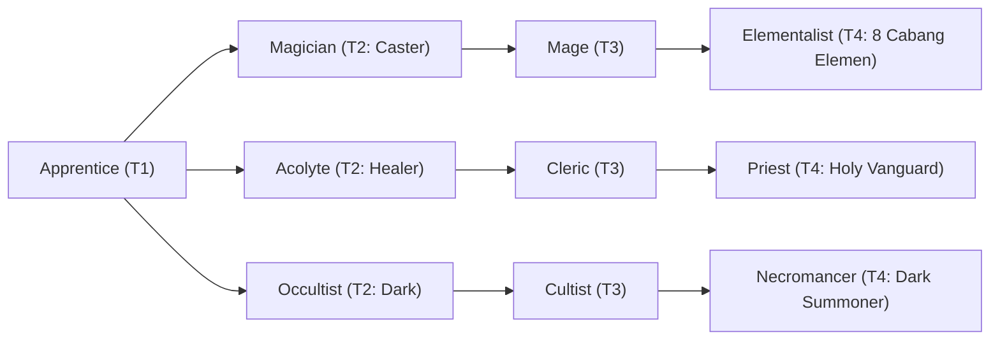

# 🛡️ Database Kelas: Elementalist - Hydromancer
> **Cabang:** `Jalur Sihir (Magic / Support)` | **Tingkat:** `Tier 4` | **Batas Level:** `Lv. 1 – 50`

Penyihir unsur air yang menguasai aliran, tekanan, dan sifat pemulihan dari kekuatan Tirta.

---

## 1. Profil & Identitas Peran
| Atribut Kelas | Rincian / Status |
| :--- | :--- |
| **Nama Resmi** | **Elementalist - Hydromancer** |
| **Class ID Database** | `CID: 38` |
| **Tier Penguasaan** | `Tier 4` *(Level Cap: 50)* |
| **Promosi Dari** | `Mage` |
| **Promosi Lanjutan** | `Archmage (Tier 5)` |
| **Peran Utama** | `Sustain / Water Control` |
| **Kelemahan Taktis** | *Slower and less bursty; power is spread into sustain/control.* |

## 2. Parameter Pertumbuhan & Karakteristik (Turn-Based RPG)

### A. 6 Base Stats (Atribut Dasar Kelas)
| STR | INT | DEX | LUK | AGI | VIT |
| :---: | :---: | :---: | :---: | :---: | :---: |
| **8** | **56** | **22** | **16** | **20** | **32** |

* **Peringkat Atribut Dasar:** `STR: E | INT: S+ | DEX: A | LUK: B | AGI: B | VIT: A`
* **Pertumbuhan Stat Alami (Fixed Stat Growth per Class Level):** `+3 INT, +1 VIT, +1 DEX`
* **Kurva Kebutuhan EXP:** `Tier 4 [40, 30, 40, 40]`

### B. Stat Turunan Awal (Baseline Derived Stats)
*Nilai di bawah dihitung deterministik dari 6 Base Stats awal kelas menggunakan formula resmi Nusvanir (sebelum bonus perlengkapan & alokasi poin pemain):*

#### 1. Sumber Daya Vital & Tempur Utama
| Parameter | Nilai Baseline | Formula / Perhitungan Resmi |
| :--- | :---: | :--- |
| **Max HP** | `570` | `Base 50 + (VIT 32 * 15) + (STR 8 * 5)` |
| **Max MP** | `468` | `Base 20 + (INT 56 * 8)` |
| **Max SP** | `196` | `Base 20 + (VIT 32 * 5) + (STR 8 * 2)` *(Preserved antar battle)* |
| **ATK** | `27` | `(STR 8 * 2) + (DEX 22 * 0.5)` *(Melee)* |
| **DEF** | `52` | `Base + (VIT 32 * 1.5) + (STR 8 * 0.5)` |
| **MAT** | `112` | `Base + (INT 56 * 2)` |
| **MDF** | `93` | `Base + (INT 56 * 1.2) + (VIT 32 * 0.8)` |
| **Action Speed** | `30` | `Base + (AGI 20 * 1.5)` |

#### 2. Presisi, Kritikal & Regenerasi Giliran (X-Param & S-Param)
| Parameter | Nilai (%) | Formula Perhitungan |
| :--- | :---: | :--- |
| **Hit Rate (HIT)** | `89.4%` | `0.85 + (DEX 22 * 0.002)` (Cap 100%) |
| **Evasion Rate (EVA)** | `6.8%` | `0.02 + (AGI 20 * 0.002) + (LUK 16 * 0.0005)` (Cap 80%) |
| **Critical Rate (CRI)** | `9.0%` | `0.03 + (DEX 22 * 0.002) + (LUK 16 * 0.001)` (Cap 85%) |
| **Critical Evasion (CEV)** | `5.6%` | `(LUK 16 * 0.0015) + (VIT 32 * 0.001)` |
| **Critical Damage (CDMG)** | `156.8%` | `1.5 + (STR 8 * 0.003) + (DEX 22 * 0.002)` |
| **Guard Efficiency (GRD)** | `116.0%` | `1.0 + (VIT 32 * 0.005)` *(Mitigasi saat bertahan)* |
| **HP Regen / Turn (HRG)** | `0.96%` | `VIT 32 * 0.0003` |
| **MP Regen / Turn (MRG)** | `1.68%` | `INT 56 * 0.0003` |
| **SP Regen / Turn (TRG)** | `4.44%` | `0.03 + (AGI 20 * 0.0004) + (VIT 32 * 0.0002)` |

### C. Karakteristik, Sasis & Peralatan
* **Innate Trait:** `Tidal Attunement`
* **Senjata yang Dapat Digunakan:** 06 Staff, 07 Rune
* **Zirah & Pelindung:** 02 Magic Robe
* **Tipe Skill yang Dibuka (Skill Types):** `02 Black Magic, 05 Ultimate` *(Skill pasif aktif otomatis via YEP_AutoPassiveStates)*

## 3. Daftar Lengkap Skill & Pembelajaran (Learnings)
*Seluruh skill di bawah ini otomatis terbuka saat mencapai Class Level yang ditentukan.*

| Level | Nama Skill | Tipe / Elemen | Biaya | Target | Formula / Efek Matematis | Deskripsi & Catatan |
| :---: | :--- | :--- | :---: | :--- | :--- | :--- |
| **1.0** | **Heart of Tides** | `Passive` / `03 Water` | `0 SP` | User | `-` | Water elemental damage +25%; water damage taken -50%; Chill Immunity. |
| **1.0** | **Aqua Jet** | `02 Black Magic` / `03 Water` | `12 SP` | One Enemy | `Math.max(1, a.mat * 1.9 - b.mdf * 0.2)` | a.mat * 1.9 - b.mdef * 0.2 (Soaked 50%) *(Efek: Add State 218 Soaked: 50%)* |
| **5.0** | **Abyssal Current** | `02 Black Magic` / `03 Water` | `20 SP` | All Enemies | `Math.max(1, a.mat * 1.2 - b.mdf * 0.3)` | a.mat * 1.2 - b.mdef * 0.3 (Soaked 40%) *(Efek: Add State 218 Soaked: 40%)* |
| **12.0** | **Oceanic Mantle** | `Passive` / `03 Water` | `0 SP` | User | `-` | Burn/Chill/Freeze Immunity; Magic damage taken -10%; Regen 3% Max HP/turn during Rain. | Status: Burn; Chill; Freeze |
| **18.0** | **Aqua Prism** | `02 Black Magic` / `03 Water` | `26 SP` | All Allies | `-` | Heals all allies for a.mat * 1.0; grants 12% Max HP shield for 3 turns | Party heal 1.0x MAT; 12% Max HP shield (3 turns) *(Efek: Apply FX State 394 (FX 1186 - Aqua Prism) as specified)* |
| **22.0** | **Stormcall** | `02 Black Magic` / `01 Neutral` | `24 SP` | User | `-` | Creates Rain weather for exactly 3 turns | Rain weather (3 turns) |
| **28.0** | **Geyser Spout** | `02 Black Magic` / `03 Water` | `32 SP` | All Enemies (exact 3 targets need plugin) | `Math.max(1, a.mat * 1.1 - b.mdf * 0.2)` | a.mat * 1.1 - b.mdef * 0.2 | 40% chance to create Rain for 2 turns |
| **35.0** | **Tidal Resonance** | `02 Black Magic` / `01 Neutral` | `30 SP` | User | `-` | Magic SP cost -15%; DEF/M.DEF +10%; party regen 4% Max HP/turn (3 turns) | Tidal Resonance (3 turns): magic SP cost -15%, DEF/M.DEF +10%, party regen 4% Max HP/turn. *(Efek: Apply FX State 395 (FX 1189 - Tidal Resonance) as specified)* |
| **45.0** | **Tsunami** | `05 Ultimate` / `03 Water` | `55 SP` | All Enemies | `Math.max(1, a.mat * 8.0)` | Base: a.matk * 8.0. During Rain: Damage x1.5. |

---

## 4. Alur Evolusi & Percabangan Kelas
