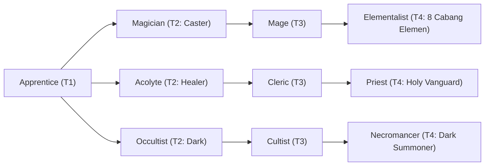

# 🛡️ Database Kelas: Elementalist - Geomancer
> **Cabang:** `Jalur Sihir (Magic / Support)` | **Tingkat:** `Tier 4` | **Batas Level:** `Lv. 1 – 50`

Penyihir unsur bumi yang memanggil batu, tanah, dan kekuatan daratan untuk melindungi atau menghancurkan.

---

## 1. Profil & Identitas Peran
| Atribut Kelas | Rincian / Status |
| :--- | :--- |
| **Nama Resmi** | **Elementalist - Geomancer** |
| **Class ID Database** | `CID: 39` |
| **Tier Penguasaan** | `Tier 4` *(Level Cap: 50)* |
| **Promosi Dari** | `Mage` |
| **Promosi Lanjutan** | `Archmage / Shaman (Tier 5)` |
| **Peran Utama** | `Durable Control Caster` |
| **Kelemahan Taktis** | *Very slow; vulnerable to fast pressure and non-DEF-based damage.* |

## 2. Parameter Pertumbuhan & Karakteristik (Turn-Based RPG)

### A. 6 Base Stats (Atribut Dasar Kelas)
| STR | INT | DEX | LUK | AGI | VIT |
| :---: | :---: | :---: | :---: | :---: | :---: |
| **14** | **54** | **18** | **14** | **16** | **42** |

* **Peringkat Atribut Dasar:** `STR: C | INT: S+ | DEX: B | LUK: B | AGI: C | VIT: S`
* **Pertumbuhan Stat Alami (Fixed Stat Growth per Class Level):** `+2 INT, +2 VIT, +1 STR`
* **Kurva Kebutuhan EXP:** `Tier 4 [40, 30, 40, 40]`

### B. Stat Turunan Awal (Baseline Derived Stats)
*Nilai di bawah dihitung deterministik dari 6 Base Stats awal kelas menggunakan formula resmi Nusvanir (sebelum bonus perlengkapan & alokasi poin pemain):*

#### 1. Sumber Daya Vital & Tempur Utama
| Parameter | Nilai Baseline | Formula / Perhitungan Resmi |
| :--- | :---: | :--- |
| **Max HP** | `750` | `Base 50 + (VIT 42 * 15) + (STR 14 * 5)` |
| **Max MP** | `452` | `Base 20 + (INT 54 * 8)` |
| **Max SP** | `258` | `Base 20 + (VIT 42 * 5) + (STR 14 * 2)` *(Preserved antar battle)* |
| **ATK** | `37` | `(STR 14 * 2) + (DEX 18 * 0.5)` *(Melee)* |
| **DEF** | `70` | `Base + (VIT 42 * 1.5) + (STR 14 * 0.5)` |
| **MAT** | `108` | `Base + (INT 54 * 2)` |
| **MDF** | `98` | `Base + (INT 54 * 1.2) + (VIT 42 * 0.8)` |
| **Action Speed** | `24` | `Base + (AGI 16 * 1.5)` |

#### 2. Presisi, Kritikal & Regenerasi Giliran (X-Param & S-Param)
| Parameter | Nilai (%) | Formula Perhitungan |
| :--- | :---: | :--- |
| **Hit Rate (HIT)** | `88.6%` | `0.85 + (DEX 18 * 0.002)` (Cap 100%) |
| **Evasion Rate (EVA)** | `5.9%` | `0.02 + (AGI 16 * 0.002) + (LUK 14 * 0.0005)` (Cap 80%) |
| **Critical Rate (CRI)** | `8.0%` | `0.03 + (DEX 18 * 0.002) + (LUK 14 * 0.001)` (Cap 85%) |
| **Critical Evasion (CEV)** | `6.3%` | `(LUK 14 * 0.0015) + (VIT 42 * 0.001)` |
| **Critical Damage (CDMG)** | `157.8%` | `1.5 + (STR 14 * 0.003) + (DEX 18 * 0.002)` |
| **Guard Efficiency (GRD)** | `121.0%` | `1.0 + (VIT 42 * 0.005)` *(Mitigasi saat bertahan)* |
| **HP Regen / Turn (HRG)** | `1.26%` | `VIT 42 * 0.0003` |
| **MP Regen / Turn (MRG)** | `1.62%` | `INT 54 * 0.0003` |
| **SP Regen / Turn (TRG)** | `4.48%` | `0.03 + (AGI 16 * 0.0004) + (VIT 42 * 0.0002)` |

### C. Karakteristik, Sasis & Peralatan
* **Innate Trait:** `Stonebound Chassis`
* **Senjata yang Dapat Digunakan:** `Staff`
* **Zirah & Pelindung:** `Magic Robe`
* **Tipe Skill yang Dibuka:** `Black Magic, Support, Ultimate, Passive`

## 3. Daftar Lengkap Skill & Pembelajaran (Learnings)
*Seluruh skill di bawah ini otomatis terbuka saat mencapai Class Level yang ditentukan.*

| Level | Nama Skill | Tipe / Elemen | Biaya | Target | Formula / Efek Matematis | Deskripsi & Catatan |
| :---: | :--- | :--- | :---: | :--- | :--- | :--- |
| **1.0** | **Heart of Stone** | `Passive` / `Earth` | `0 SP` | User | `-` | Earth Damage +25%, DEF +20%, Stun/Knockback Resistance +30% |
| **1.0** | **Rock Bullet** | `Black Magic` / `Earth` | `12 SP` | One Enemy | `Math.max(0, a.mat * 2.1 - b.mdf * 0.2)` | a.mat * 2.1 - b.mdef * 0.2 |
| **5.0** | **Tectonic Tremor** | `Black Magic` / `Earth` | `20 SP` | All Enemies | `Math.max(0, a.mat * 1.3 - b.mdf * 0.3)` | a.mat * 1.3 - b.mdef * 0.3 |
| **12.0** | **Earthen Resonance** | `Passive` / `Earth` | `0 SP` | User | `-` | Magic SP cost -20%; Electric damage taken -50% |
| **18.0** | **Stone Pillars** | `Black Magic` / `Earth` | `26 SP` | All Enemies (exact 3 targets need plugin) | `Math.max(0, a.mat * 1.0 - b.mdf * 0.2)` | a.mat * 1.0 - b.mdef * 0.2 |
| **22.0** | **Granite Rampart** | `Support` / `Earth` | `24 SP` | User | `-` | DEF +45%; reflects 10% of incoming physical damage (3 turns) | DEF +45%; physical damage reflection 10% (3 turns) *(Efek: Apply FX State 398 (FX 1196 - Granite Rampart) as specified)* |
| **25.0** | **Gravity** | `Support` / `None / Neutral` | `22 SP` | Field / Custom Scope | `-` | All battlefield: AGI -25%, Flying/Float targets lose Float for 2 turns | AGI -25% globally; removes Float from affected targets for 2 turns *(Efek: Remove State 221 Float: 100% | Apply FX State 399 (FX 1197 - Gravity) as specified)* |
| **28.0** | **Tectonic Fracture** | `Black Magic` / `Earth` | `32 SP` | All Enemies | `Math.max(0, a.mat * 1.3 - b.mdf * 0.2)` | a.mat * 1.3 - b.mdef * 0.2 per hit (2 hits) |
| **45.0** | **Continental Cataclysm** | `Ultimate` / `Earth` | `55 SP` | All Enemies | `Math.max(0, a.mat * 7.5 - b.mdf * 0.0)` | a.mat * 7.5 - b.mdf * 0.0 | Sure Hit; ignores 50% M.DEF; Vulnerable 100% (2 turns); Petrify 20% on non-Boss targets. *(Efek: Add State 220 Petrify: 20%)* |

---

## 4. Alur Evolusi & Percabangan Kelas
