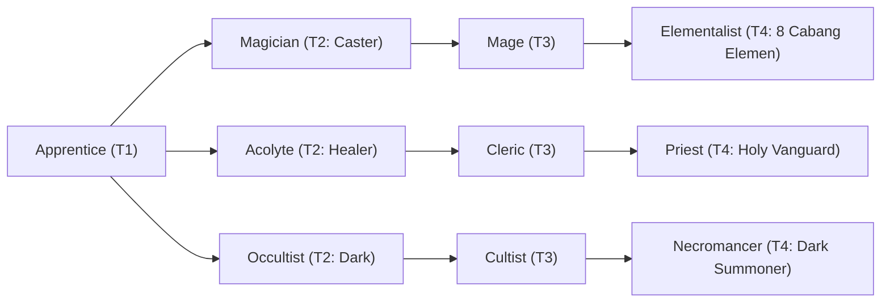

# 🛡️ Database Kelas: Elementalist - Aeromancer
> **Cabang:** `Jalur Sihir (Magic / Support)` | **Tingkat:** `Tier 4` | **Batas Level:** `Lv. 1 – 50`

Penyihir unsur angin yang memanfaatkan arus udara, kecepatan, dan tekanan untuk mengubah jalannya pertempuran.

---

## 1. Profil & Identitas Peran
| Atribut Kelas | Rincian / Status |
| :--- | :--- |
| **Nama Resmi** | **Elementalist - Aeromancer** |
| **Class ID Database** | `CID: 40` |
| **Tier Penguasaan** | `Tier 4` *(Level Cap: 50)* |
| **Promosi Dari** | `Mage` |
| **Promosi Lanjutan** | `Archmage (Tier 5)` |
| **Peran Utama** | `Fast Evasive Caster` |
| **Kelemahan Taktis** | *Lowest physical durability; Sure Hit counters evasion.* |

## 2. Parameter Pertumbuhan & Karakteristik (Turn-Based RPG)

### A. 6 Base Stats (Atribut Dasar Kelas)
| STR | INT | DEX | LUK | AGI | VIT |
| :---: | :---: | :---: | :---: | :---: | :---: |
| **8** | **56** | **25** | **16** | **36** | **20** |

* **Peringkat Atribut Dasar:** `STR: E | INT: S+ | DEX: A | LUK: B | AGI: S | VIT: C`
* **Pertumbuhan Stat Alami (Fixed Stat Growth per Class Level):** `+3 INT, +2 AGI`
* **Kurva Kebutuhan EXP:** `Tier 4 [40, 30, 40, 40]`

### B. Stat Turunan Awal (Baseline Derived Stats)
*Nilai di bawah dihitung deterministik dari 6 Base Stats awal kelas menggunakan formula resmi Nusvanir (sebelum bonus perlengkapan & alokasi poin pemain):*

#### 1. Sumber Daya Vital & Tempur Utama
| Parameter | Nilai Baseline | Formula / Perhitungan Resmi |
| :--- | :---: | :--- |
| **Max HP** | `390` | `Base 50 + (VIT 20 * 15) + (STR 8 * 5)` |
| **Max MP** | `468` | `Base 20 + (INT 56 * 8)` |
| **Max SP** | `136` | `Base 20 + (VIT 20 * 5) + (STR 8 * 2)` *(Preserved antar battle)* |
| **ATK** | `28` | `(STR 8 * 2) + (DEX 25 * 0.5)` *(Melee)* |
| **DEF** | `34` | `Base + (VIT 20 * 1.5) + (STR 8 * 0.5)` |
| **MAT** | `112` | `Base + (INT 56 * 2)` |
| **MDF** | `83` | `Base + (INT 56 * 1.2) + (VIT 20 * 0.8)` |
| **Action Speed** | `54` | `Base + (AGI 36 * 1.5)` |

#### 2. Presisi, Kritikal & Regenerasi Giliran (X-Param & S-Param)
| Parameter | Nilai (%) | Formula Perhitungan |
| :--- | :---: | :--- |
| **Hit Rate (HIT)** | `90.0%` | `0.85 + (DEX 25 * 0.002)` (Cap 100%) |
| **Evasion Rate (EVA)** | `10.0%` | `0.02 + (AGI 36 * 0.002) + (LUK 16 * 0.0005)` (Cap 80%) |
| **Critical Rate (CRI)** | `9.6%` | `0.03 + (DEX 25 * 0.002) + (LUK 16 * 0.001)` (Cap 85%) |
| **Critical Evasion (CEV)** | `4.4%` | `(LUK 16 * 0.0015) + (VIT 20 * 0.001)` |
| **Critical Damage (CDMG)** | `157.4%` | `1.5 + (STR 8 * 0.003) + (DEX 25 * 0.002)` |
| **Guard Efficiency (GRD)** | `110.0%` | `1.0 + (VIT 20 * 0.005)` *(Mitigasi saat bertahan)* |
| **HP Regen / Turn (HRG)** | `0.60%` | `VIT 20 * 0.0003` |
| **MP Regen / Turn (MRG)** | `1.68%` | `INT 56 * 0.0003` |
| **SP Regen / Turn (TRG)** | `4.84%` | `0.03 + (AGI 36 * 0.0004) + (VIT 20 * 0.0002)` |

### C. Karakteristik, Sasis & Peralatan
* **Innate Trait:** `Gale-Blessed Chassis`
* **Senjata yang Dapat Digunakan:** `Staff, Rune`
* **Zirah & Pelindung:** `Magic Robe`
* **Tipe Skill yang Dibuka:** `Black Magic, Support, Ultimate, Passive`

## 3. Daftar Lengkap Skill & Pembelajaran (Learnings)
*Seluruh skill di bawah ini otomatis terbuka saat mencapai Class Level yang ditentukan.*

| Level | Nama Skill | Tipe / Elemen | Biaya | Target | Formula / Efek Matematis | Deskripsi & Catatan |
| :---: | :--- | :--- | :---: | :--- | :--- | :--- |
| **1.0** | **Heart of Gale** | `Passive` / `Wind` | `0 SP` | User | `-` | Wind Damage +25%, AGI +25%, Evasion +20% |
| **1.0** | **Aero Slash** | `Black Magic` / `Wind` | `12 SP` | One Enemy | `Math.max(0, a.mat * 2.1 - b.mdf * 0.2)` | a.mat * 2.1 - b.mdef * 0.2 (Float 50%) *(Efek: Add State 221 Float: 50%)* |
| **5.0** | **Gale Force** | `Black Magic` / `Wind` | `20 SP` | All Enemies | `Math.max(0, a.mat * 1.3 - b.mdf * 0.3)` | a.mat * 1.3 - b.mdef * 0.3 |
| **12.0** | **Wind Walker** | `Passive` / `None / Neutral` | `0 SP` | User | `-` | Permanent Float; Ground immunity; Magic Crit Rate +10% |
| **18.0** | **Vacuum Slash** | `Black Magic` / `Wind` | `26 SP` | All Enemies (exact 3 targets need plugin) | `Math.max(0, a.mat * 1.0 - b.mdf * 0.2 per target)` | a.mat * 1.0 - b.mdef * 0.2 per target |
| **22.0** | **Tailwind** | `Support` / `None / Neutral` | `24 SP` | All Allies | `-` | Party AGI +30%, Evasion +15% (3 turns) *(Efek: Apply FX State 402 (FX 1205 - Tailwind) as specified)* |
| **25.0** | **Eye of the Storm** | `Support` / `Wind` | `22 SP` | User | `-` | Magic SP cost -20%; vs Float targets: Magic Crit +30%, Crit Damage +20% (3 turns) | Magic SP Cost -20%; vs Float: Magic Crit +30%, Crit Damage +20% (3 turns) *(Efek: Apply FX State 403 (FX 1206 - Eye of the Storm) as specified)* |
| **28.0** | **Zephyr Lift** | `Support` / `None / Neutral` | `22 SP` | All Allies | `-` | Party Float + Evasion +20% for 2 turns | Party Float and Evasion +20% (2 turns) *(Efek: Add State 221 Float: 100% | Apply FX State 404 (FX 1207 - Zephyr Lift) as specified)* |
| **32.0** | **Vortex Strike** | `Black Magic` / `Wind` | `32 SP` | All Enemies | `Math.max(0, a.mat * 1.25 - b.mdf * 0.2)` | a.mat * 1.25 - b.mdef * 0.2 per hit (2 hits) |
| **45.0** | **Celestial Maelstrom** | `Ultimate` / `Wind` | `55 SP` | All Enemies | `Math.max(0, a.mat * 7.5 - b.mdf * 0.0)` | a.mat * 7.5 - b.mdf * 0.0; x1.5 vs Float | Sure Hit; Silence 70%, Blind 70%; destroys barriers. Bosses receive reduced CC chance. | Status: Damage x1.5 if target is in Float state *(Efek: Add State 212 Blind: 70% | Add State 213 Silence: 70%)* |

---

## 4. Alur Evolusi & Percabangan Kelas
