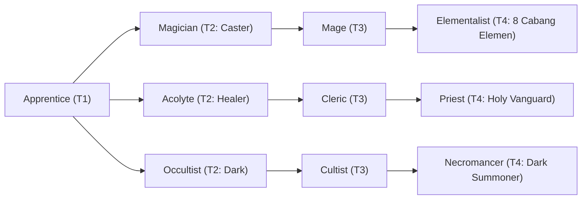

# 🛡️ Database Kelas: Elementalist - Electromancer
> **Cabang:** `Jalur Sihir (Magic / Support)` | **Tingkat:** `Tier 4` | **Batas Level:** `Lv. 1 – 50`

Penyihir unsur petir yang menyalurkan kilat dan muatan listrik menjadi serangan cepat dan berbahaya.

---

## 1. Profil & Identitas Peran
| Atribut Kelas | Rincian / Status |
| :--- | :--- |
| **Nama Resmi** | **Elementalist - Electromancer** |
| **Class ID Database** | `CID: 41` |
| **Tier Penguasaan** | `Tier 4` *(Level Cap: 50)* |
| **Promosi Dari** | `Mage` |
| **Promosi Lanjutan** | `Archmage (Tier 5)` |
| **Peran Utama** | `Fast Burst / Stack Caster` |
| **Kelemahan Taktis** | *Fragile and setup-dependent for peak stack burst.* |

## 2. Parameter Pertumbuhan & Karakteristik (Turn-Based RPG)

### A. 6 Base Stats (Atribut Dasar Kelas)
| STR | INT | DEX | LUK | AGI | VIT |
| :---: | :---: | :---: | :---: | :---: | :---: |
| **8** | **62** | **26** | **18** | **28** | **18** |

* **Peringkat Atribut Dasar:** `STR: E | INT: S+ | DEX: A | LUK: A | AGI: A | VIT: C`
* **Pertumbuhan Stat Alami (Fixed Stat Growth per Class Level):** `+3 INT, +1 AGI, +1 DEX`
* **Kurva Kebutuhan EXP:** `Tier 4 [40, 30, 40, 40]`

### B. Stat Turunan Awal (Baseline Derived Stats)
*Nilai di bawah dihitung deterministik dari 6 Base Stats awal kelas menggunakan formula resmi Nusvanir (sebelum bonus perlengkapan & alokasi poin pemain):*

#### 1. Sumber Daya Vital & Tempur Utama
| Parameter | Nilai Baseline | Formula / Perhitungan Resmi |
| :--- | :---: | :--- |
| **Max HP** | `360` | `Base 50 + (VIT 18 * 15) + (STR 8 * 5)` |
| **Max MP** | `516` | `Base 20 + (INT 62 * 8)` |
| **Max SP** | `126` | `Base 20 + (VIT 18 * 5) + (STR 8 * 2)` *(Preserved antar battle)* |
| **ATK** | `29` | `(STR 8 * 2) + (DEX 26 * 0.5)` *(Melee)* |
| **DEF** | `31` | `Base + (VIT 18 * 1.5) + (STR 8 * 0.5)` |
| **MAT** | `124` | `Base + (INT 62 * 2)` |
| **MDF** | `89` | `Base + (INT 62 * 1.2) + (VIT 18 * 0.8)` |
| **Action Speed** | `42` | `Base + (AGI 28 * 1.5)` |

#### 2. Presisi, Kritikal & Regenerasi Giliran (X-Param & S-Param)
| Parameter | Nilai (%) | Formula Perhitungan |
| :--- | :---: | :--- |
| **Hit Rate (HIT)** | `90.2%` | `0.85 + (DEX 26 * 0.002)` (Cap 100%) |
| **Evasion Rate (EVA)** | `8.5%` | `0.02 + (AGI 28 * 0.002) + (LUK 18 * 0.0005)` (Cap 80%) |
| **Critical Rate (CRI)** | `10.0%` | `0.03 + (DEX 26 * 0.002) + (LUK 18 * 0.001)` (Cap 85%) |
| **Critical Evasion (CEV)** | `4.5%` | `(LUK 18 * 0.0015) + (VIT 18 * 0.001)` |
| **Critical Damage (CDMG)** | `157.6%` | `1.5 + (STR 8 * 0.003) + (DEX 26 * 0.002)` |
| **Guard Efficiency (GRD)** | `109.0%` | `1.0 + (VIT 18 * 0.005)` *(Mitigasi saat bertahan)* |
| **HP Regen / Turn (HRG)** | `0.54%` | `VIT 18 * 0.0003` |
| **MP Regen / Turn (MRG)** | `1.86%` | `INT 62 * 0.0003` |
| **SP Regen / Turn (TRG)** | `4.48%` | `0.03 + (AGI 28 * 0.0004) + (VIT 18 * 0.0002)` |

### C. Karakteristik, Sasis & Peralatan
* **Innate Trait:** `Stormwired Chassis`
* **Senjata yang Dapat Digunakan:** `Staff, Rune`
* **Zirah & Pelindung:** `Magic Robe`
* **Tipe Skill yang Dibuka:** `Black Magic, Support, Ultimate, Passive`

## 3. Daftar Lengkap Skill & Pembelajaran (Learnings)
*Seluruh skill di bawah ini otomatis terbuka saat mencapai Class Level yang ditentukan.*

| Level | Nama Skill | Tipe / Elemen | Biaya | Target | Formula / Efek Matematis | Deskripsi & Catatan |
| :---: | :--- | :--- | :---: | :--- | :--- | :--- |
| **1.0** | **Lightning Essence** | `Passive` / `Lightning` | `0 SP` | User | `-` | Lightning Damage +25%, AGI +20%, 15% Paralyze chance when casting electric magic |
| **1.0** | **Flash Zap** | `Black Magic` / `Lightning` | `12 SP` | One Enemy | `Math.max(0, a.mat * 2.1 - b.mdf * 0.2)` | a.mat * 2.1 - b.mdef * 0.2 (Priority +3) |
| **5.0** | **Chain Lightning** | `Black Magic` / `Lightning` | `22 SP` | All Enemies | `Math.max(0, a.mat * 1.3 - b.mdf * 0.3)` | a.mat * 1.3 - b.mdef * 0.3; each jump after the first deals 15% less damage |
| **12.0** | **Conductors** | `Passive` / `Lightning` | `0 SP` | User | `-` | Lightning Damage +15%; Metal accuracy against user -20%; Sleep Immunity; physical attackers have 15% Shock chance |
| **18.0** | **Plasma Burst** | `Black Magic` / `Lightning` | `28 SP` | All Enemies (exact 3 targets need plugin) | `Math.max(0, a.mat * 1.2 - b.mdf * 0.2)` | a.mat * 1.2 - b.mdef * 0.2; ignores 20% M.DEF; x1.75 vs Shock |
| **22.0** | **Voltage Charge** | `Support` / `Lightning` | `24 SP` | User | `-` | Max 5 stacks. Each stack: Lightning Damage +15%, SP cost +8%. Electric skills consume all stacks and gain +10% bonus damage per stack. | Voltage stacks max 5; +15% Lightning Damage and +8% SP Cost per stack; consumed by electric skills for +10% bonus damage per stack. *(Efek: Apply FX State 407 (FX 1215 - Voltage Charge) as specified)* |
| **25.0** | **Volt Phantom** | `Support` / `Lightning` | `20 SP` | User | `-` | Sacrifice 15% Max HP. Decoy has 20% caster Max HP, absorbs 80% incoming damage, lasts up to 3 turns; destroyed decoy grants 1 Voltage stack. | Lightning Decoy: 20% caster Max HP, absorbs 80% damage, 3 turns; grants 1 Voltage stack when destroyed. *(Efek: Apply FX State 408 (FX 1216 - Volt Phantom) as specified)* |
| **28.0** | **Thunder's Wrath** | `Black Magic` / `Lightning` | `34 SP` | All Enemies | `Math.max(0, a.mat * 1.25 - b.mdf * 0.2)` | a.mat * 1.25 - b.mdef * 0.2 per hit (2 hits) | Generates 1 Voltage stack per cast; Sure Hit during Rain |
| **45.0** | **Fulmination** | `Ultimate` / `Lightning` | `55 SP` | All Enemies | `Math.max(0, a.mat * 7.5 - b.mdf * 0.0)` | a.mat * 7.5 - b.mdf * 0.0 | Sure Hit; removes up to 2 positive buffs; Shock 100% on non-Bosses and 50% on Bosses. *(Efek: Add State 219 Shock: 100%)* |

---

## 4. Alur Evolusi & Percabangan Kelas
