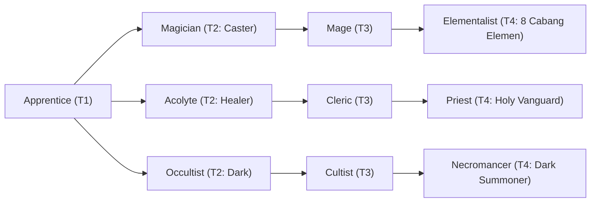

# 🛡️ Database Kelas: Elementalist - Cryomancer
> **Cabang:** `Jalur Sihir (Magic / Support)` | **Tingkat:** `Tier 4` | **Batas Level:** `Lv. 1 – 50`

Penyihir unsur es yang mengendalikan dingin, embun beku, dan kristal untuk melemahkan atau membekukan lawan.

---

## 1. Profil & Identitas Peran
| Atribut Kelas | Rincian / Status |
| :--- | :--- |
| **Nama Resmi** | **Elementalist - Cryomancer** |
| **Class ID Database** | `CID: 42` |
| **Tier Penguasaan** | `Tier 4` *(Level Cap: 50)* |
| **Promosi Dari** | `Mage` |
| **Promosi Lanjutan** | `Archmage (Tier 5)` |
| **Peran Utama** | `Control / Freeze Caster` |
| **Kelemahan Taktis** | *Balanced defense but relies on Chill/Freeze setup.* |

## 2. Parameter Pertumbuhan & Karakteristik (Turn-Based RPG)

### A. 6 Base Stats (Atribut Dasar Kelas)
| STR | INT | DEX | LUK | AGI | VIT |
| :---: | :---: | :---: | :---: | :---: | :---: |
| **8** | **56** | **22** | **16** | **20** | **32** |

* **Peringkat Atribut Dasar:** `STR: E | INT: S+ | DEX: A | LUK: B | AGI: B | VIT: A`
* **Pertumbuhan Stat Alami (Fixed Stat Growth per Class Level):** `+3 INT, +1 VIT, +1 DEX`
* **Kurva Kebutuhan EXP:** `Tier 4 [40, 30, 40, 40]`

### B. Stat Turunan Awal (Baseline Derived Stats)
*Nilai di bawah dihitung deterministik dari 6 Base Stats awal kelas menggunakan formula resmi Nusvanir (sebelum bonus perlengkapan & alokasi poin pemain):*

#### 1. Sumber Daya Vital & Tempur Utama
| Parameter | Nilai Baseline | Formula / Perhitungan Resmi |
| :--- | :---: | :--- |
| **Max HP** | `570` | `Base 50 + (VIT 32 * 15) + (STR 8 * 5)` |
| **Max MP** | `468` | `Base 20 + (INT 56 * 8)` |
| **Max SP** | `196` | `Base 20 + (VIT 32 * 5) + (STR 8 * 2)` *(Preserved antar battle)* |
| **ATK** | `27` | `(STR 8 * 2) + (DEX 22 * 0.5)` *(Melee)* |
| **DEF** | `52` | `Base + (VIT 32 * 1.5) + (STR 8 * 0.5)` |
| **MAT** | `112` | `Base + (INT 56 * 2)` |
| **MDF** | `93` | `Base + (INT 56 * 1.2) + (VIT 32 * 0.8)` |
| **Action Speed** | `30` | `Base + (AGI 20 * 1.5)` |

#### 2. Presisi, Kritikal & Regenerasi Giliran (X-Param & S-Param)
| Parameter | Nilai (%) | Formula Perhitungan |
| :--- | :---: | :--- |
| **Hit Rate (HIT)** | `89.4%` | `0.85 + (DEX 22 * 0.002)` (Cap 100%) |
| **Evasion Rate (EVA)** | `6.8%` | `0.02 + (AGI 20 * 0.002) + (LUK 16 * 0.0005)` (Cap 80%) |
| **Critical Rate (CRI)** | `9.0%` | `0.03 + (DEX 22 * 0.002) + (LUK 16 * 0.001)` (Cap 85%) |
| **Critical Evasion (CEV)** | `5.6%` | `(LUK 16 * 0.0015) + (VIT 32 * 0.001)` |
| **Critical Damage (CDMG)** | `156.8%` | `1.5 + (STR 8 * 0.003) + (DEX 22 * 0.002)` |
| **Guard Efficiency (GRD)** | `116.0%` | `1.0 + (VIT 32 * 0.005)` *(Mitigasi saat bertahan)* |
| **HP Regen / Turn (HRG)** | `0.96%` | `VIT 32 * 0.0003` |
| **MP Regen / Turn (MRG)** | `1.68%` | `INT 56 * 0.0003` |
| **SP Regen / Turn (TRG)** | `4.44%` | `0.03 + (AGI 20 * 0.0004) + (VIT 32 * 0.0002)` |

### C. Karakteristik, Sasis & Peralatan
* **Innate Trait:** `Glacial Attunement`
* **Senjata yang Dapat Digunakan:** 06 Staff, 07 Rune
* **Zirah & Pelindung:** 02 Magic Robe
* **Tipe Skill yang Dibuka (Skill Types):** `02 Black Magic, 05 Ultimate` *(Skill pasif aktif otomatis via YEP_AutoPassiveStates)*

## 3. Daftar Lengkap Skill & Pembelajaran (Learnings)
*Seluruh skill di bawah ini otomatis terbuka saat mencapai Class Level yang ditentukan.*

| Level | Nama Skill | Tipe / Elemen | Biaya | Target | Formula / Efek Matematis | Deskripsi & Catatan |
| :---: | :--- | :--- | :---: | :--- | :--- | :--- |
| **1.0** | **Glacial Core** | `Passive` / `07 Ice` | `0 SP` | User | `-` | Ice Damage +25%; Chill/Freeze resistance +30% | Status: Chill; Freeze |
| **1.0** | **Glacial Needle** | `02 Black Magic` / `07 Ice` | `12 SP` | One Enemy | `Math.max(1, a.mat * 1.9 - b.mdf * 0.2)` | a.mat * 1.9 - b.mdef * 0.2 (Chill 60%) *(Efek: Add State 205 Chill: 60%)* |
| **5.0** | **Frost Breath** | `02 Black Magic` / `07 Ice` | `22 SP` | All Enemies | `Math.max(1, a.mat * 1.3 - b.mdf * 0.3)` | a.mat * 1.3 - b.mdef * 0.3 |
| **12.0** | **Snow Cloak** | `Passive` / `07 Ice` | `0 SP` | User | `-` | Evasion +25%; damage taken from chilled targets -15% | Status: Chill |
| **18.0** | **Shatter Lance** | `02 Black Magic` / `07 Ice` | `28 SP` | One Enemy | `Math.max(1, a.mat * 2.3 - b.mdf * 0.1)` | a.mat * 2.3 - b.mdef * 0.1; +25% damage vs Frozen targets | +25% damage against Frozen targets |
| **22.0** | **Aurora Veil** | `02 Black Magic` / `07 Ice` | `24 SP` | User | `-` | Magic Damage taken -25%; Chill attackers 30% chance (3 turns) | Magic Damage taken -25%; attackers have 30% Chill chance (3 turns) *(Efek: Apply FX State 411 (FX 1224 - Aurora Veil) as specified)* |
| **25.0** | **Ice Mirror Illusion** | `02 Black Magic` / `01 Neutral` | `22 SP` | User | `-` | Evasion +50% for 3 turns; first avoided attack deals 1.5x MATK Ice counter | Evasion +50%; first avoided attack triggers an Ice counter (3 turns) *(Efek: Apply FX State 412 (FX 1225 - Ice Mirror Illusion) as specified)* |
| **28.0** | **Avalanche Call** | `02 Black Magic` / `07 Ice` | `32 SP` | All Enemies (exact 3 targets need plugin) | `Math.max(1, a.mat * 1.2 - b.mdf * 0.2)` | a.mat * 1.2 - b.mdef * 0.2 per hit (2 hits) |
| **45.0** | **Eternal Ice Age** | `05 Ultimate` / `07 Ice` | `55 SP` | All Enemies | `Math.max(1, a.mat * 7.5 - b.mdf * 0.0)` | a.mat * 7.5 - b.mdf * 0.0 | Sure Hit; Chill 100%; Freeze 35% on non-Bosses and 15% on Bosses. *(Efek: Add State 205 Chill: 100% | Add State 206 Freeze: 35%)* |

---

## 4. Alur Evolusi & Percabangan Kelas
