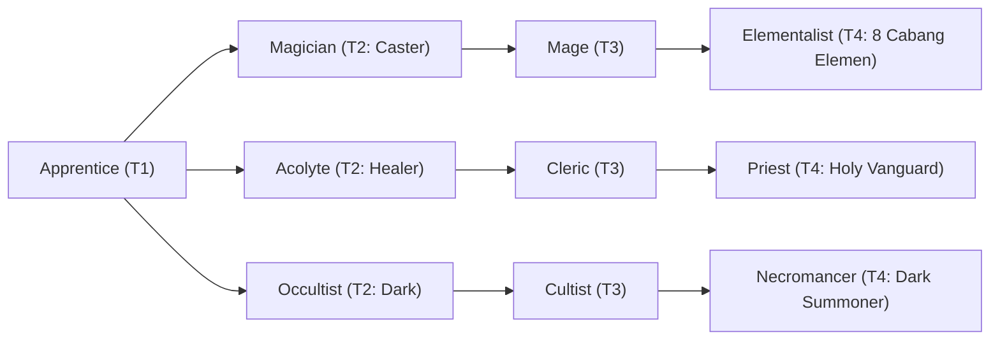

# 🛡️ Database Kelas: Elementalist - Ferromancer
> **Cabang:** `Jalur Sihir (Magic / Support)` | **Tingkat:** `Tier 4` | **Batas Level:** `Lv. 1 – 50`

Penyihir unsur logam yang mampu memengaruhi besi, baja, dan logam lain melalui kendali mana yang terlatih.

---

## 1. Profil & Identitas Peran
| Atribut Kelas | Rincian / Status |
| :--- | :--- |
| **Nama Resmi** | **Elementalist - Ferromancer** |
| **Class ID Database** | `CID: 43` |
| **Tier Penguasaan** | `Tier 4` *(Level Cap: 50)* |
| **Promosi Dari** | `Mage` |
| **Promosi Lanjutan** | `Archmage (Tier 5)` |
| **Peran Utama** | `Armored Battle Caster` |
| **Kelemahan Taktis** | *Extremely slow; easy to out-tempo despite high DEF.* |

## 2. Parameter Pertumbuhan & Karakteristik (Turn-Based RPG)

### A. 6 Base Stats (Atribut Dasar Kelas)
| STR | INT | DEX | LUK | AGI | VIT |
| :---: | :---: | :---: | :---: | :---: | :---: |
| **18** | **52** | **20** | **14** | **16** | **40** |

* **Peringkat Atribut Dasar:** `STR: B | INT: S | DEX: B | LUK: B | AGI: C | VIT: S`
* **Pertumbuhan Stat Alami (Fixed Stat Growth per Class Level):** `+2 INT, +2 VIT, +1 STR`
* **Kurva Kebutuhan EXP:** `Tier 4 [40, 30, 40, 40]`

### B. Stat Turunan Awal (Baseline Derived Stats)
*Nilai di bawah dihitung deterministik dari 6 Base Stats awal kelas menggunakan formula resmi Nusvanir (sebelum bonus perlengkapan & alokasi poin pemain):*

#### 1. Sumber Daya Vital & Tempur Utama
| Parameter | Nilai Baseline | Formula / Perhitungan Resmi |
| :--- | :---: | :--- |
| **Max HP** | `740` | `Base 50 + (VIT 40 * 15) + (STR 18 * 5)` |
| **Max MP** | `436` | `Base 20 + (INT 52 * 8)` |
| **Max SP** | `256` | `Base 20 + (VIT 40 * 5) + (STR 18 * 2)` *(Preserved antar battle)* |
| **ATK** | `46` | `(STR 18 * 2) + (DEX 20 * 0.5)` *(Melee)* |
| **DEF** | `69` | `Base + (VIT 40 * 1.5) + (STR 18 * 0.5)` |
| **MAT** | `104` | `Base + (INT 52 * 2)` |
| **MDF** | `94` | `Base + (INT 52 * 1.2) + (VIT 40 * 0.8)` |
| **Action Speed** | `24` | `Base + (AGI 16 * 1.5)` |

#### 2. Presisi, Kritikal & Regenerasi Giliran (X-Param & S-Param)
| Parameter | Nilai (%) | Formula Perhitungan |
| :--- | :---: | :--- |
| **Hit Rate (HIT)** | `89.0%` | `0.85 + (DEX 20 * 0.002)` (Cap 100%) |
| **Evasion Rate (EVA)** | `5.9%` | `0.02 + (AGI 16 * 0.002) + (LUK 14 * 0.0005)` (Cap 80%) |
| **Critical Rate (CRI)** | `8.4%` | `0.03 + (DEX 20 * 0.002) + (LUK 14 * 0.001)` (Cap 85%) |
| **Critical Evasion (CEV)** | `6.1%` | `(LUK 14 * 0.0015) + (VIT 40 * 0.001)` |
| **Critical Damage (CDMG)** | `159.4%` | `1.5 + (STR 18 * 0.003) + (DEX 20 * 0.002)` |
| **Guard Efficiency (GRD)** | `120.0%` | `1.0 + (VIT 40 * 0.005)` *(Mitigasi saat bertahan)* |
| **HP Regen / Turn (HRG)** | `1.20%` | `VIT 40 * 0.0003` |
| **MP Regen / Turn (MRG)** | `1.56%` | `INT 52 * 0.0003` |
| **SP Regen / Turn (TRG)** | `4.44%` | `0.03 + (AGI 16 * 0.0004) + (VIT 40 * 0.0002)` |

### C. Karakteristik, Sasis & Peralatan
* **Innate Trait:** `Ironbound Chassis`
* **Senjata yang Dapat Digunakan:** 06 Staff, 07 Rune
* **Zirah & Pelindung:** 02 Magic Robe, 01 Basic Clothes
* **Tipe Skill yang Dibuka (Skill Types):** `02 Black Magic, 05 Ultimate` *(Skill pasif aktif otomatis via YEP_AutoPassiveStates)*

## 3. Daftar Lengkap Skill & Pembelajaran (Learnings)
*Seluruh skill di bawah ini otomatis terbuka saat mencapai Class Level yang ditentukan.*

| Level | Nama Skill | Tipe / Elemen | Biaya | Target | Formula / Efek Matematis | Deskripsi & Catatan |
| :---: | :--- | :--- | :---: | :--- | :--- | :--- |
| **1.0** | **Ferrous Dominance** | `Passive` / `08 Steel` | `0 SP` | All Enemies | `-` | Metal Damage +20%; DEF +15%; gains Polarity mechanic |
| **1.0** | **North Pole Charge** | `02 Black Magic` / `08 Steel` | `12 SP` | One Enemy | `Math.max(1, a.mat * 1.5 + a.def * 0.35 - b.def * 0.2)` | a.mat * 1.5 + a.def * 0.35 - b.def * 0.2 |
| **5.0** | **South Pole Charge** | `02 Black Magic` / `08 Steel` | `12 SP` | One Enemy | `Math.max(1, a.mat * 1.5 + a.def * 0.35 - b.def * 0.2)` | a.mat * 1.5 + a.def * 0.35 - b.def * 0.2 |
| **12.0** | **Ironclad Bastion** | `Passive` / `08 Steel` | `0 SP` | User | `-` | DEF +20%; physical damage taken -10% |
| **18.0** | **Polar Collision** | `02 Black Magic` / `08 Steel` | `26 SP` | All Enemies | `Math.max(1, a.mat * 1.7 + a.def * 0.45 - b.def * 0.2)` | a.mat * 1.7 + a.def * 0.45 - b.def * 0.2 |
| **22.0** | **Iron Fortress** | `02 Black Magic` / `08 Steel` | `24 SP` | All Allies | `-` | Party damage taken -35% for 1 turn | Party Damage Taken -35% (1 turn) *(Efek: Apply FX State 415 (FX 1233 - Iron Fortress) as specified)* |
| **25.0** | **Magnetic Repulsion** | `02 Black Magic` / `01 Neutral` | `22 SP` | User | `-` | Physical Evasion +30%, knockback/forced movement immunity (3 turns) | Physical Evasion +30%; forced-movement immunity (3 turns) *(Efek: Apply FX State 416 (FX 1234 - Magnetic Repulsion) as specified)* |
| **28.0** | **Sanguine Cleave** | `02 Black Magic` / `08 Steel` | `30 SP` | All Enemies | `Math.max(1, a.mat * 1.2 + a.def * 0.35 - b.def * 0.3)` | a.mat * 1.2 + a.def * 0.35 - b.def * 0.3 |
| **45.0** | **Iron Colossus** | `05 Ultimate` / `08 Steel` | `55 SP` | User | `-` | Transformation 3 turns: DEF +60%, M.DEF +30%, ATK +20%, AGI -25%; attacks gain Metal element | Iron Colossus: DEF +60%, M.DEF +30%, ATK +20%, AGI -25%, Metal element (3 turns) *(Efek: Apply FX State 417 (FX 1236 - Iron Colossus) as specified)* |

---

## 4. Alur Evolusi & Percabangan Kelas
