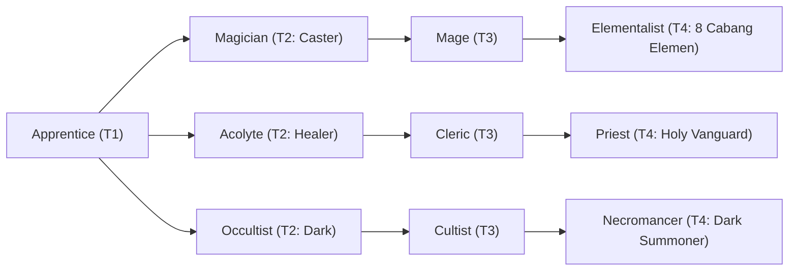

# 🛡️ Database Kelas: Elementalist - Echomancer
> **Cabang:** `Jalur Sihir (Magic / Support)` | **Tingkat:** `Tier 4` | **Batas Level:** `Lv. 1 – 50`

Penyihir gema yang menjadikan suara, resonansi, dan getaran sebagai medium untuk sihir yang tidak biasa.

---

## 1. Profil & Identitas Peran
| Atribut Kelas | Rincian / Status |
| :--- | :--- |
| **Nama Resmi** | **Elementalist - Echomancer** |
| **Class ID Database** | `CID: 44` |
| **Tier Penguasaan** | `Tier 4` *(Level Cap: 50)* |
| **Promosi Dari** | `Mage` |
| **Promosi Lanjutan** | `Archmage (Tier 5)` |
| **Peran Utama** | `Accuracy / Sonic Utility` |
| **Kelemahan Taktis** | *Utility-heavy; lower raw burst than Pyro/Electro.* |

## 2. Parameter Pertumbuhan & Karakteristik (Turn-Based RPG)

### A. 6 Base Stats (Atribut Dasar Kelas)
| STR | INT | DEX | LUK | AGI | VIT |
| :---: | :---: | :---: | :---: | :---: | :---: |
| **8** | **58** | **28** | **18** | **26** | **22** |

* **Peringkat Atribut Dasar:** `STR: E | INT: S+ | DEX: A+ | LUK: A | AGI: A | VIT: B`
* **Pertumbuhan Stat Alami (Fixed Stat Growth per Class Level):** `+3 INT, +1 DEX, +1 AGI`
* **Kurva Kebutuhan EXP:** `Tier 4 [40, 30, 40, 40]`

### B. Stat Turunan Awal (Baseline Derived Stats)
*Nilai di bawah dihitung deterministik dari 6 Base Stats awal kelas menggunakan formula resmi Nusvanir (sebelum bonus perlengkapan & alokasi poin pemain):*

#### 1. Sumber Daya Vital & Tempur Utama
| Parameter | Nilai Baseline | Formula / Perhitungan Resmi |
| :--- | :---: | :--- |
| **Max HP** | `420` | `Base 50 + (VIT 22 * 15) + (STR 8 * 5)` |
| **Max MP** | `484` | `Base 20 + (INT 58 * 8)` |
| **Max SP** | `146` | `Base 20 + (VIT 22 * 5) + (STR 8 * 2)` *(Preserved antar battle)* |
| **ATK** | `30` | `(STR 8 * 2) + (DEX 28 * 0.5)` *(Melee)* |
| **DEF** | `37` | `Base + (VIT 22 * 1.5) + (STR 8 * 0.5)` |
| **MAT** | `116` | `Base + (INT 58 * 2)` |
| **MDF** | `87` | `Base + (INT 58 * 1.2) + (VIT 22 * 0.8)` |
| **Action Speed** | `39` | `Base + (AGI 26 * 1.5)` |

#### 2. Presisi, Kritikal & Regenerasi Giliran (X-Param & S-Param)
| Parameter | Nilai (%) | Formula Perhitungan |
| :--- | :---: | :--- |
| **Hit Rate (HIT)** | `90.6%` | `0.85 + (DEX 28 * 0.002)` (Cap 100%) |
| **Evasion Rate (EVA)** | `8.1%` | `0.02 + (AGI 26 * 0.002) + (LUK 18 * 0.0005)` (Cap 80%) |
| **Critical Rate (CRI)** | `10.4%` | `0.03 + (DEX 28 * 0.002) + (LUK 18 * 0.001)` (Cap 85%) |
| **Critical Evasion (CEV)** | `4.9%` | `(LUK 18 * 0.0015) + (VIT 22 * 0.001)` |
| **Critical Damage (CDMG)** | `158.0%` | `1.5 + (STR 8 * 0.003) + (DEX 28 * 0.002)` |
| **Guard Efficiency (GRD)** | `111.0%` | `1.0 + (VIT 22 * 0.005)` *(Mitigasi saat bertahan)* |
| **HP Regen / Turn (HRG)** | `0.66%` | `VIT 22 * 0.0003` |
| **MP Regen / Turn (MRG)** | `1.74%` | `INT 58 * 0.0003` |
| **SP Regen / Turn (TRG)** | `4.48%` | `0.03 + (AGI 26 * 0.0004) + (VIT 22 * 0.0002)` |

### C. Karakteristik, Sasis & Peralatan
* **Innate Trait:** `Resonant Mind`
* **Senjata yang Dapat Digunakan:** `Staff, Rune`
* **Zirah & Pelindung:** `Magic Robe`
* **Tipe Skill yang Dibuka:** `Black Magic, Support, Ultimate, Passive`

## 3. Daftar Lengkap Skill & Pembelajaran (Learnings)
*Seluruh skill di bawah ini otomatis terbuka saat mencapai Class Level yang ditentukan.*

| Level | Nama Skill | Tipe / Elemen | Biaya | Target | Formula / Efek Matematis | Deskripsi & Catatan |
| :---: | :--- | :--- | :---: | :--- | :--- | :--- |
| **1.0** | **Sonic Resonance** | `Passive` / `Sonic` | `0 SP` | User | `-` | Sonic Damage +25%; Hit Rate +10%; Silence Resistance +30% |
| **1.0** | **Sonar Ping** | `Black Magic` / `Sonic` | `10 SP` | One Enemy | `Math.max(0, a.mat * 1.5 - b.mdf * 0.1)` | a.mat * 1.5 - b.mdf * 0.1; ignores 30% M.DEF | Ignores 30% M.DEF |
| **5.0** | **Ultrasonic Pulse** | `Black Magic` / `Sonic` | `22 SP` | All Enemies | `Math.max(0, a.mat * 1.3 - b.mdf * 0.3)` | a.mat * 1.3 - b.mdf * 0.3 |
| **12.0** | **Active Echolocation** | `Passive` / `None / Neutral` | `0 SP` | User | `-` | Hit Rate +15%; reveals Stealth; Sonic skills ignore 15% Evasion |
| **18.0** | **Super Sonic Blast** | `Black Magic` / `Sonic` | `28 SP` | All Enemies (exact 3 targets need plugin) | `Math.max(0, a.mat * 2.0 - b.mdf * 0.0)` | a.mat * 2.0 - b.mdf * 0.0; ignores 50% M.DEF |
| **22.0** | **Frequency Tuning** | `Support` / `Sonic` | `24 SP` | User | `-` | Sonic Damage +25%; Skill Accuracy +20% (3 turns) *(Efek: Apply FX State 420 (FX 1242 - Frequency Tuning) as specified)* |
| **25.0** | **Infrasonic Suppression** | `Support` / `None / Neutral` | `26 SP` | All Enemies | `-` | Enemy ATK/M.ATK -15% and Silence Resistance -20% (3 turns) *(Efek: Apply FX State 421 (FX 1243 - Infrasonic Suppression) as specified)* |
| **28.0** | **Vibrational Implosion** | `Black Magic` / `Sonic` | `32 SP` | One Enemy | `Math.max(0, a.mat * 2.0 - b.mdf * 0.1)` | a.mat * 2.0 - b.mdf * 0.1; ignores 30% M.DEF |
| **45.0** | **Absolute Vacuum Void** | `Ultimate` / `Sonic` | `55 SP` | Field / Custom Scope | `Math.max(0, a.mat * 7.5 - b.mdf * 0.0)` | a.mat * 7.5 - b.mdf * 0.0 | Sure Hit; creates Vacuum Field for 3 turns: enemy Hit Rate -15% and Sonic damage taken +15%. No extra collapse damage. *(Efek: Apply FX State 422 (FX 1245 - Absolute Vacuum Void) as specified)* |

---

## 4. Alur Evolusi & Percabangan Kelas
