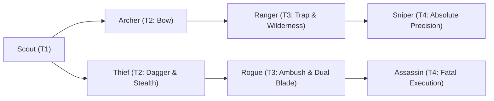

# 🛡️ Database Kelas: Scout
> **Cabang:** `Jalur Lincah (Ranged / Assassin)` | **Tingkat:** `Tier 1` | **Batas Level:** `Lv. 1 – 10`

Penjelajah cekatan yang mengandalkan pengamatan, gerak cepat, dan kemampuan membaca medan untuk menghindari bahaya.

---

## 1. Profil & Identitas Peran
| Atribut Kelas | Rincian / Status |
| :--- | :--- |
| **Nama Resmi** | **Scout** |
| **Class ID Database** | `CID: 10` |
| **Tier Penguasaan** | `Tier 1` *(Level Cap: 10)* |
| **Promosi Dari** | `—` |
| **Promosi Lanjutan** | `Archer, Thief` |
| **Peran Utama** | `Pengintai Cekatan Pemula` |
| **Kelemahan Taktis** | *Standar kelemahan arketipe* |

## 2. Parameter Pertumbuhan & Karakteristik (Turn-Based RPG)

### A. 6 Base Stats (Atribut Dasar Kelas)
| STR | INT | DEX | LUK | AGI | VIT |
| :---: | :---: | :---: | :---: | :---: | :---: |
| **3** | **1** | **8** | **5** | **8** | **3** |

* **Peringkat Atribut Dasar:** `STR: D | INT: E | DEX: A | LUK: B | AGI: A | VIT: D`
* **Pertumbuhan Stat Alami (Fixed Stat Growth per Class Level):** `+1 DEX, +1 AGI, +1 LUK`
* **Kurva Kebutuhan EXP:** `Tier 1 [22, 14, 18, 18]`

### B. Stat Turunan Awal (Baseline Derived Stats)
*Nilai di bawah dihitung deterministik dari 6 Base Stats awal kelas menggunakan formula resmi Nusvanir (sebelum bonus perlengkapan & alokasi poin pemain):*

#### 1. Sumber Daya Vital & Tempur Utama
| Parameter | Nilai Baseline | Formula / Perhitungan Resmi |
| :--- | :---: | :--- |
| **Max HP** | `110` | `Base 50 + (VIT 3 * 15) + (STR 3 * 5)` |
| **Max MP** | `28` | `Base 20 + (INT 1 * 8)` |
| **Max SP** | `41` | `Base 20 + (VIT 3 * 5) + (STR 3 * 2)` *(Preserved antar battle)* |
| **ATK** | `18` | `(DEX 8 * 2) + (STR 3 * 0.5)` *(Ranged/Finesse)* |
| **DEF** | `6` | `Base + (VIT 3 * 1.5) + (STR 3 * 0.5)` |
| **MAT** | `2` | `Base + (INT 1 * 2)` |
| **MDF** | `4` | `Base + (INT 1 * 1.2) + (VIT 3 * 0.8)` |
| **Action Speed** | `12` | `Base + (AGI 8 * 1.5)` |

#### 2. Presisi, Kritikal & Regenerasi Giliran (X-Param & S-Param)
| Parameter | Nilai (%) | Formula Perhitungan |
| :--- | :---: | :--- |
| **Hit Rate (HIT)** | `86.6%` | `0.85 + (DEX 8 * 0.002)` (Cap 100%) |
| **Evasion Rate (EVA)** | `3.9%` | `0.02 + (AGI 8 * 0.002) + (LUK 5 * 0.0005)` (Cap 80%) |
| **Critical Rate (CRI)** | `5.1%` | `0.03 + (DEX 8 * 0.002) + (LUK 5 * 0.001)` (Cap 85%) |
| **Critical Evasion (CEV)** | `1.0%` | `(LUK 5 * 0.0015) + (VIT 3 * 0.001)` |
| **Critical Damage (CDMG)** | `152.5%` | `1.5 + (STR 3 * 0.003) + (DEX 8 * 0.002)` |
| **Guard Efficiency (GRD)** | `101.5%` | `1.0 + (VIT 3 * 0.005)` *(Mitigasi saat bertahan)* |
| **HP Regen / Turn (HRG)** | `0.09%` | `VIT 3 * 0.0003` |
| **MP Regen / Turn (MRG)** | `0.03%` | `INT 1 * 0.0003` |
| **SP Regen / Turn (TRG)** | `3.38%` | `0.03 + (AGI 8 * 0.0004) + (VIT 3 * 0.0002)` |

### C. Karakteristik, Sasis & Peralatan
* **Innate Trait:** `—`
* **Senjata yang Dapat Digunakan:** `Long Bow, Crossbow, Dagger`
* **Zirah & Pelindung:** `Light Armor`
* **Tipe Skill yang Dibuka:** `Magic, Support, Passive`

## 3. Daftar Lengkap Skill & Pembelajaran (Learnings)
*Seluruh skill di bawah ini otomatis terbuka saat mencapai Class Level yang ditentukan.*

| Level | Nama Skill | Tipe / Elemen | Biaya | Target | Formula / Efek Matematis | Deskripsi & Catatan |
| :---: | :--- | :--- | :---: | :--- | :--- | :--- |
| **1** | **Quick Shot** | `Physical` / `Neutral` | `4 SP` | 1 Target | `Math.max(0, a.atk * 1.15 - b.def * 0.5) (Priority +2)` | Tembakan kilat yang dilepas dengan kecepatan tinggi sebelum musuh bertindak. |
| **1** | **Hunter's Mark** | `Support` / `Neutral` | `6 SP` | 1 Target | `-` | Menandai target untuk meningkatkan akurasi dan damage serangan berikutnya. |
| **3** | **Eagle Eye** | `Passive` / `Neutral` | `0 SP` | Self | `-` | Pandangan tajam penjelajah yang meningkatkan HIT dan CRI secara permanen. |
| **5** | **Piercing Arrow** | `Physical` / `Neutral` | `8 SP` | 1 Target | `Math.max(0, a.atk * 1.4 - b.def * 0.25)` | Anak panah berhulu runcing yang mengabaikan sebagian pertahanan armor lawan. |
| **7** | **Scatter Shot** | `Physical` / `Neutral` | `12 SP` | 3 Random Enemies | `Math.max(0, a.atk * 0.85 - b.def * 0.2) per hit` | Melepaskan beberapa anak panah sekaligus ke arah sekelompok musuh. |
| **9** | **Poison Arrow** | `Physical` / `Neutral` | `10 SP` | 1 Target | `Math.max(0, a.atk * 1.2 - b.def * 0.4) (Poison 50%)` | Panah berlumur racun hutan yang menimbulkan kerusakan berulang tiap giliran. |

---

## 4. Alur Evolusi & Percabangan Kelas
