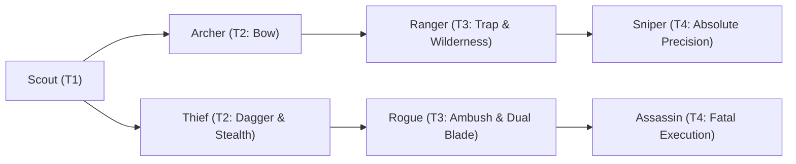

# 🛡️ Database Kelas: Archer
> **Cabang:** `Jalur Lincah (Ranged / Assassin)` | **Tingkat:** `Tier 2` | **Batas Level:** `Lv. 1 – 30`

Pemanah terlatih yang mengandalkan ketenangan, ketepatan, dan jarak untuk menjatuhkan musuh sebelum mereka mendekat.

---

## 1. Profil & Identitas Peran
| Atribut Kelas | Rincian / Status |
| :--- | :--- |
| **Nama Resmi** | **Archer** |
| **Class ID Database** | `CID: 47` |
| **Tier Penguasaan** | `Tier 2` *(Level Cap: 30)* |
| **Promosi Dari** | `—` |
| **Promosi Lanjutan** | `Ranger` |
| **Peran Utama** | `Ranged Precision DPS` |
| **Kelemahan Taktis** | *Low physical durability; limited melee safety.* |

## 2. Parameter Pertumbuhan & Karakteristik (Turn-Based RPG)

### A. 6 Base Stats (Atribut Dasar Kelas)
| STR | INT | DEX | LUK | AGI | VIT |
| :---: | :---: | :---: | :---: | :---: | :---: |
| **6** | **2** | **16** | **7** | **12** | **6** |

* **Peringkat Atribut Dasar:** `STR: C | INT: E | DEX: A | LUK: B | AGI: B | VIT: D`
* **Pertumbuhan Stat Alami (Fixed Stat Growth per Class Level):** `+2 DEX, +1 AGI`
* **Kurva Kebutuhan EXP:** `Tier 2 [28, 18, 28, 28]`

### B. Stat Turunan Awal (Baseline Derived Stats)
*Nilai di bawah dihitung deterministik dari 6 Base Stats awal kelas menggunakan formula resmi Nusvanir (sebelum bonus perlengkapan & alokasi poin pemain):*

#### 1. Sumber Daya Vital & Tempur Utama
| Parameter | Nilai Baseline | Formula / Perhitungan Resmi |
| :--- | :---: | :--- |
| **Max HP** | `170` | `Base 50 + (VIT 6 * 15) + (STR 6 * 5)` |
| **Max MP** | `36` | `Base 20 + (INT 2 * 8)` |
| **Max SP** | `62` | `Base 20 + (VIT 6 * 5) + (STR 6 * 2)` *(Preserved antar battle)* |
| **ATK** | `35` | `(DEX 16 * 2) + (STR 6 * 0.5)` *(Ranged/Finesse)* |
| **DEF** | `12` | `Base + (VIT 6 * 1.5) + (STR 6 * 0.5)` |
| **MAT** | `4` | `Base + (INT 2 * 2)` |
| **MDF** | `7` | `Base + (INT 2 * 1.2) + (VIT 6 * 0.8)` |
| **Action Speed** | `18` | `Base + (AGI 12 * 1.5)` |

#### 2. Presisi, Kritikal & Regenerasi Giliran (X-Param & S-Param)
| Parameter | Nilai (%) | Formula Perhitungan |
| :--- | :---: | :--- |
| **Hit Rate (HIT)** | `88.2%` | `0.85 + (DEX 16 * 0.002)` (Cap 100%) |
| **Evasion Rate (EVA)** | `4.8%` | `0.02 + (AGI 12 * 0.002) + (LUK 7 * 0.0005)` (Cap 80%) |
| **Critical Rate (CRI)** | `6.9%` | `0.03 + (DEX 16 * 0.002) + (LUK 7 * 0.001)` (Cap 85%) |
| **Critical Evasion (CEV)** | `1.7%` | `(LUK 7 * 0.0015) + (VIT 6 * 0.001)` |
| **Critical Damage (CDMG)** | `155.0%` | `1.5 + (STR 6 * 0.003) + (DEX 16 * 0.002)` |
| **Guard Efficiency (GRD)** | `103.0%` | `1.0 + (VIT 6 * 0.005)` *(Mitigasi saat bertahan)* |
| **HP Regen / Turn (HRG)** | `0.18%` | `VIT 6 * 0.0003` |
| **MP Regen / Turn (MRG)** | `0.06%` | `INT 2 * 0.0003` |
| **SP Regen / Turn (TRG)** | `3.60%` | `0.03 + (AGI 12 * 0.0004) + (VIT 6 * 0.0002)` |

### C. Karakteristik, Sasis & Peralatan
* **Innate Trait:** `Field Marksman`
* **Senjata yang Dapat Digunakan:** `Long Bow, Crossbow`
* **Zirah & Pelindung:** `Light Armor`
* **Tipe Skill yang Dibuka:** `Physical, Support, Ultimate, Passive`

## 3. Daftar Lengkap Skill & Pembelajaran (Learnings)
*Seluruh skill di bawah ini otomatis terbuka saat mencapai Class Level yang ditentukan.*

| Level | Nama Skill | Tipe / Elemen | Biaya | Target | Formula / Efek Matematis | Deskripsi & Catatan |
| :---: | :--- | :--- | :---: | :--- | :--- | :--- |
| **1.0** | **Quick Shot** | `Physical` / `Normal Attack` | `4 SP` | One Enemy | `Math.max(0, a.atk * 1.15 - b.def * 0.5)` | a.atk * 1.15 - b.def * 0.5 (Priority +2) |
| **1.0** | **Hunter's Mark** | `Support` / `None / Neutral` | `6 SP` | One Enemy | `-` | Marks target for 3 turns; marked target takes +10% damage from Archer skills | Status: Marked *(Efek: Add State 222 Marked: 100%)* |
| **3.0** | **Eagle Eye** | `Passive` / `None / Neutral` | `0 SP` | User | `-` | Hit Rate +12% & Critical Rate +4% |
| **8.0** | **Piercing Arrow** | `Physical` / `Normal Attack` | `6 SP` | One Enemy | `Math.max(0, a.atk * 1.5 - b.def * 0.3)` | a.atk * 1.5 - b.def * 0.3 (Ignore 20% DEF) |
| **12.0** | **Scatter Shot** | `Physical` / `Normal Attack` | `8 SP` | One Random Enemy (repeat handles multi-hit) | `Math.max(0, a.atk * 0.9 - b.def * 0.15)` | a.atk * 0.9 - b.def * 0.15 per hit (3 hits) |
| **17.0** | **Swift Reflexes** | `Passive` / `None / Neutral` | `0 SP` | User | `-` | Agility +12% & Evasion +8% |
| **22.0** | **Poison Arrow** | `Physical` / `Normal Attack` | `8 SP` | One Enemy | `Math.max(0, a.atk * 1.15 - b.def * 0.5)` | a.atk * 1.15 - b.def * 0.5 (Poison 60%) *(Efek: Add State 203 Poison: 60%)* |
| **26.0** | **Precision Shot** | `Physical` / `Normal Attack` | `14 SP` | One Enemy | `Math.max(0, a.atk * 2.2 - b.def * 0.2)` | a.atk * 2.2 - b.def * 0.2 (Crit Rate +40%) |
| **30.0** | **Arrow Storm** | `Ultimate` / `None / Neutral` | `22 SP` | All Enemies | `Math.max(0, a.atk * 0.7 - b.def * 0.10)` | a.atk * 0.7 - b.def * 0.10 per hit (4 hits; +15% total damage vs Hunter's Mark) | +20% damage vs Hunter's Mark | Status: 4 hits; +20% damage vs Hunter's Mark *(Efek: Add State 222 Marked: 100%)* |

---

## 4. Alur Evolusi & Percabangan Kelas
