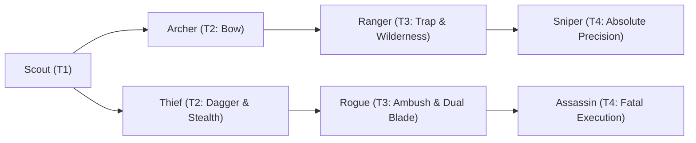

# 🛡️ Database Kelas: Thief
> **Cabang:** `Jalur Lincah (Ranged / Assassin)` | **Tingkat:** `Tier 2` | **Batas Level:** `Lv. 1 – 30`

Petualang licin yang hidup dari kelincahan, tipu daya, dan kemampuan mengambil kesempatan saat orang lain lengah.

---

## 1. Profil & Identitas Peran
| Atribut Kelas | Rincian / Status |
| :--- | :--- |
| **Nama Resmi** | **Thief** |
| **Class ID Database** | `CID: 48` |
| **Tier Penguasaan** | `Tier 2` *(Level Cap: 30)* |
| **Promosi Dari** | `—` |
| **Promosi Lanjutan** | `Rogue` |
| **Peran Utama** | `Stealth / Utility DPS` |
| **Kelemahan Taktis** | *Very fragile if evasion/stealth fails.* |

## 2. Parameter Pertumbuhan & Karakteristik (Turn-Based RPG)

### A. 6 Base Stats (Atribut Dasar Kelas)
| STR | INT | DEX | LUK | AGI | VIT |
| :---: | :---: | :---: | :---: | :---: | :---: |
| **6** | **2** | **12** | **10** | **16** | **5** |

* **Peringkat Atribut Dasar:** `STR: C | INT: E | DEX: B | LUK: A | AGI: A | VIT: D`
* **Pertumbuhan Stat Alami (Fixed Stat Growth per Class Level):** `+2 AGI, +1 DEX`
* **Kurva Kebutuhan EXP:** `Tier 2 [25, 16, 25, 25]`

### B. Stat Turunan Awal (Baseline Derived Stats)
*Nilai di bawah dihitung deterministik dari 6 Base Stats awal kelas menggunakan formula resmi Nusvanir (sebelum bonus perlengkapan & alokasi poin pemain):*

#### 1. Sumber Daya Vital & Tempur Utama
| Parameter | Nilai Baseline | Formula / Perhitungan Resmi |
| :--- | :---: | :--- |
| **Max HP** | `155` | `Base 50 + (VIT 5 * 15) + (STR 6 * 5)` |
| **Max MP** | `36` | `Base 20 + (INT 2 * 8)` |
| **Max SP** | `57` | `Base 20 + (VIT 5 * 5) + (STR 6 * 2)` *(Preserved antar battle)* |
| **ATK** | `27` | `(DEX 12 * 2) + (STR 6 * 0.5)` *(Ranged/Finesse)* |
| **DEF** | `10` | `Base + (VIT 5 * 1.5) + (STR 6 * 0.5)` |
| **MAT** | `4` | `Base + (INT 2 * 2)` |
| **MDF** | `6` | `Base + (INT 2 * 1.2) + (VIT 5 * 0.8)` |
| **Action Speed** | `24` | `Base + (AGI 16 * 1.5)` |

#### 2. Presisi, Kritikal & Regenerasi Giliran (X-Param & S-Param)
| Parameter | Nilai (%) | Formula Perhitungan |
| :--- | :---: | :--- |
| **Hit Rate (HIT)** | `87.4%` | `0.85 + (DEX 12 * 0.002)` (Cap 100%) |
| **Evasion Rate (EVA)** | `5.7%` | `0.02 + (AGI 16 * 0.002) + (LUK 10 * 0.0005)` (Cap 80%) |
| **Critical Rate (CRI)** | `6.4%` | `0.03 + (DEX 12 * 0.002) + (LUK 10 * 0.001)` (Cap 85%) |
| **Critical Evasion (CEV)** | `2.0%` | `(LUK 10 * 0.0015) + (VIT 5 * 0.001)` |
| **Critical Damage (CDMG)** | `154.2%` | `1.5 + (STR 6 * 0.003) + (DEX 12 * 0.002)` |
| **Guard Efficiency (GRD)** | `102.5%` | `1.0 + (VIT 5 * 0.005)` *(Mitigasi saat bertahan)* |
| **HP Regen / Turn (HRG)** | `0.15%` | `VIT 5 * 0.0003` |
| **MP Regen / Turn (MRG)** | `0.06%` | `INT 2 * 0.0003` |
| **SP Regen / Turn (TRG)** | `3.74%` | `0.03 + (AGI 16 * 0.0004) + (VIT 5 * 0.0002)` |

### C. Karakteristik, Sasis & Peralatan
* **Innate Trait:** `Street Shadow`
* **Senjata yang Dapat Digunakan:** `Dagger`
* **Zirah & Pelindung:** `Light Armor`
* **Tipe Skill yang Dibuka:** `Physical, Support, Ultimate, Passive`

## 3. Daftar Lengkap Skill & Pembelajaran (Learnings)
*Seluruh skill di bawah ini otomatis terbuka saat mencapai Class Level yang ditentukan.*

| Level | Nama Skill | Tipe / Elemen | Biaya | Target | Formula / Efek Matematis | Deskripsi & Catatan |
| :---: | :--- | :--- | :---: | :--- | :--- | :--- |
| **1.0** | **Steal** | `Physical` / `None / Neutral` | `4 SP` | One Enemy | `-` | Steal 1 item; if failed, 3% Max HP recoil | Attempts to steal 1 item; failed attempt costs 3% Max HP |
| **3.0** | **Shadow Step** | `Passive` / `None / Neutral` | `0 SP` | User | `-` | Evasion +12% & Critical Rate +4% |
| **6.0** | **Quick Slash** | `Physical` / `Normal Attack` | `4 SP` | One Enemy | `Math.max(0, a.atk * 1.15 - b.def * 0.5)` | a.atk * 1.15 - b.def * 0.5 (Priority +2) |
| **10.0** | **Venom Strike** | `Physical` / `Normal Attack` | `6 SP` | One Enemy | `Math.max(0, a.atk * 1.3 - b.def * 0.4)` | a.atk * 1.3 - b.def * 0.4 (Poison 60%) *(Efek: Add State 203 Poison: 60%)* |
| **12.0** | **Hide** | `Support` / `None / Neutral` | `8 SP` | User | `-` | Shadow State: Evasion +70%, single-target damage taken -30%, 1 turn | Shadow State: Evasion +70%, single-target damage taken -30% (1 turn) *(Efek: Apply FX State 449 (FX 1296 - Hide) as specified)* |
| **14.0** | **Backstab** | `Physical` / `Normal Attack` | `8 SP` | One Enemy | `Math.max(0, a.atk * 1.7 - b.def * 0.3)` | a.atk * 1.7 - b.def * 0.3 (100% Crit if Hidden) |
| **18.0** | **Shadow Reflexes** | `Passive` / `None / Neutral` | `0 SP` | User | `-` | Agility +15% |
| **22.0** | **Smoke Bomb** | `Support` / `None / Neutral` | `10 SP` | All Enemies | `-` | Blind 50% to all enemies *(Efek: Add State 212 Blind: 100%)* |
| **26.0** | **Shadow Lunge** | `Physical` / `Normal Attack` | `14 SP` | One Enemy | `Math.max(0, a.atk * 2.1 - b.def * 0.3)` | a.atk * 2.1 - b.def * 0.3 | Evasion +50% against the next physical attack (1 turn) *(Efek: Apply FX State 451 (FX 1300 - Shadow Lunge) as specified)* |
| **30.0** | **Execution Strike** | `Ultimate` / `None / Neutral` | `22 SP` | One Enemy | `Math.max(0, a.atk * 2.6 - b.def * 0.15)` | a.atk * 2.6 - b.def * 0.15; +20% damage if target HP <30% (Non-Boss) | Non-Boss target below 20% HP: 15% Instant Death chance. |

---

## 4. Alur Evolusi & Percabangan Kelas
