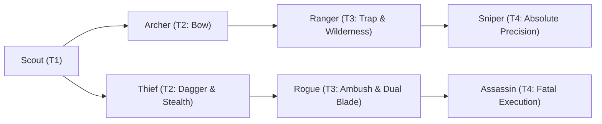

# 🛡️ Database Kelas: Ranger
> **Cabang:** `Jalur Lincah (Ranged / Assassin)` | **Tingkat:** `Tier 3` | **Batas Level:** `Lv. 1 – 40`

Pengelana alam liar yang memahami jejak, medan, cuaca, dan kebiasaan makhluk yang menghuni Nusvanir.

---

## 1. Profil & Identitas Peran
| Atribut Kelas | Rincian / Status |
| :--- | :--- |
| **Nama Resmi** | **Ranger** |
| **Class ID Database** | `CID: 49` |
| **Tier Penguasaan** | `Tier 3` *(Level Cap: 40)* |
| **Promosi Dari** | `Archer` |
| **Promosi Lanjutan** | `Sniper` |
| **Peran Utama** | `Mark / Trap / Companion DPS` |
| **Kelemahan Taktis** | *Generalist; less burst than Sniper and less stealth than Rogue line.* |

## 2. Parameter Pertumbuhan & Karakteristik (Turn-Based RPG)

### A. 6 Base Stats (Atribut Dasar Kelas)
| STR | INT | DEX | LUK | AGI | VIT |
| :---: | :---: | :---: | :---: | :---: | :---: |
| **12** | **4** | **34** | **12** | **24** | **14** |

* **Peringkat Atribut Dasar:** `STR: C | INT: E | DEX: S | LUK: B | AGI: A | VIT: C`
* **Pertumbuhan Stat Alami (Fixed Stat Growth per Class Level):** `+2 DEX, +1 AGI, +1 VIT`
* **Kurva Kebutuhan EXP:** `Tier 3 [34, 24, 34, 34]`

### B. Stat Turunan Awal (Baseline Derived Stats)
*Nilai di bawah dihitung deterministik dari 6 Base Stats awal kelas menggunakan formula resmi Nusvanir (sebelum bonus perlengkapan & alokasi poin pemain):*

#### 1. Sumber Daya Vital & Tempur Utama
| Parameter | Nilai Baseline | Formula / Perhitungan Resmi |
| :--- | :---: | :--- |
| **Max HP** | `320` | `Base 50 + (VIT 14 * 15) + (STR 12 * 5)` |
| **Max MP** | `52` | `Base 20 + (INT 4 * 8)` |
| **Max SP** | `114` | `Base 20 + (VIT 14 * 5) + (STR 12 * 2)` *(Preserved antar battle)* |
| **ATK** | `74` | `(DEX 34 * 2) + (STR 12 * 0.5)` *(Ranged/Finesse)* |
| **DEF** | `27` | `Base + (VIT 14 * 1.5) + (STR 12 * 0.5)` |
| **MAT** | `8` | `Base + (INT 4 * 2)` |
| **MDF** | `16` | `Base + (INT 4 * 1.2) + (VIT 14 * 0.8)` |
| **Action Speed** | `36` | `Base + (AGI 24 * 1.5)` |

#### 2. Presisi, Kritikal & Regenerasi Giliran (X-Param & S-Param)
| Parameter | Nilai (%) | Formula Perhitungan |
| :--- | :---: | :--- |
| **Hit Rate (HIT)** | `91.8%` | `0.85 + (DEX 34 * 0.002)` (Cap 100%) |
| **Evasion Rate (EVA)** | `7.4%` | `0.02 + (AGI 24 * 0.002) + (LUK 12 * 0.0005)` (Cap 80%) |
| **Critical Rate (CRI)** | `11.0%` | `0.03 + (DEX 34 * 0.002) + (LUK 12 * 0.001)` (Cap 85%) |
| **Critical Evasion (CEV)** | `3.2%` | `(LUK 12 * 0.0015) + (VIT 14 * 0.001)` |
| **Critical Damage (CDMG)** | `160.4%` | `1.5 + (STR 12 * 0.003) + (DEX 34 * 0.002)` |
| **Guard Efficiency (GRD)** | `107.0%` | `1.0 + (VIT 14 * 0.005)` *(Mitigasi saat bertahan)* |
| **HP Regen / Turn (HRG)** | `0.42%` | `VIT 14 * 0.0003` |
| **MP Regen / Turn (MRG)** | `0.12%` | `INT 4 * 0.0003` |
| **SP Regen / Turn (TRG)** | `4.24%` | `0.03 + (AGI 24 * 0.0004) + (VIT 14 * 0.0002)` |

### C. Karakteristik, Sasis & Peralatan
* **Innate Trait:** `Wilderness Hunter`
* **Senjata yang Dapat Digunakan:** 08 Long Bow, 09 Crossbow
* **Zirah & Pelindung:** 03 Light Armor
* **Tipe Skill yang Dibuka (Skill Types):** `03 Skill, 05 Ultimate` *(Skill pasif aktif otomatis via YEP_AutoPassiveStates)*

## 3. Daftar Lengkap Skill & Pembelajaran (Learnings)
*Seluruh skill di bawah ini otomatis terbuka saat mencapai Class Level yang ditentukan.*

| Level | Nama Skill | Tipe / Elemen | Biaya | Target | Formula / Efek Matematis | Deskripsi & Catatan |
| :---: | :--- | :--- | :---: | :--- | :--- | :--- |
| **1.0** | **Fracture Shot** | `03 Skill` / `01 Neutral` | `6 SP` | One Enemy | `Math.max(1, a.atk * 1.35 - b.def * 0.4)` | a.atk * 1.35 - b.def * 0.4 |
| **1.0** | **Hunter's Gaze** | `03 Skill` / `01 Neutral` | `12 SP` | All Enemies | `-` | Reveals Stealth and marks all enemies for 2 turns | Reveals Stealth and applies Mark to all enemies |
| **1.0** | **Wild Stride** | `Passive` / `01 Neutral` | `0 SP` | User | `-` | AGI +12%, Move/Field Evasion +10% |
| **4.0** | **Snare Trap** | `03 Skill` / `01 Neutral` | `8 SP` | One Enemy | `Math.max(1, a.atk * 0.7 - b.def * 0.5)` | a.atk * 0.7 - b.def * 0.5 |
| **9.0** | **Grasping Roots** | `03 Skill` / `01 Neutral` | `4 MP / 8 SP` | One Enemy | `Math.max(1, a.atk * 1.4 - b.def * 0.4)` | a.atk * 1.4 - b.def * 0.4 |
| **12.0** | **Hunter's Focus** | `Passive` / `01 Neutral` | `0 SP` | User | `-` | Damage +10% vs Marked targets; Crit Rate +8% |
| **14.0** | **Phantom Shot** | `03 Skill` / `01 Neutral` | `10 SP` | One Enemy | `Math.max(1, a.atk * 1.5 - b.def * 0.4)` | a.atk * 1.5 - b.def * 0.4; ignores 20% Evasion | Ignores 20% target Evasion |
| **19.0** | **Arrow Barrage** | `03 Skill` / `01 Neutral` | `6 MP / 14 SP` | All Enemies | `Math.max(1, a.atk * 0.75 - b.def * 0.12)` | a.atk * 0.75 - b.def * 0.12 per hit (3 hits) |
| **22.0** | **Shrapnel Trap** | `03 Skill` / `01 Neutral` | `12 SP` | Field / Custom Scope | `Math.max(1, a.atk * 1.3 - b.def * 0.3)` | a.atk * 1.3 - b.def * 0.3 |
| **25.0** | **Lupine Companion** | `Passive` / `01 Neutral` | `0 SP` | Custom Mixed Scope | `-` | Summons Lupine companion for 5 turns; companion damage +10% while target is Marked |
| **28.0** | **Titan Piercer** | `03 Skill` / `01 Neutral` | `16 SP` | One Enemy | `Math.max(1, a.atk * 2.5 - b.def * 0.1)` | a.atk * 2.5 - b.def * 0.1 |
| **31.0** | **Nature's Wrath** | `03 Skill` / `01 Neutral` | `10 MP / 22 SP` | All Enemies | `Math.max(1, a.atk * 1.8 - b.def * 0.3)` | a.atk * 1.8 - b.def * 0.3 |
| **36.0** | **Multi-Shot Mastery** | `Passive` / `01 Neutral` | `0 SP` | User | `-` | Multi-hit skills deal +10% total damage; no per-hit stacking |
| **40.0** | **Forestbreaker Arrow** | `05 Ultimate` / `01 Neutral` | `15 MP / 35 SP` | One Enemy | `Math.max(1, a.atk * 4.2 - b.def * 0.05)` | a.atk * 4.2 - b.def * 0.05 | Sure Hit; +15% damage vs Marked target. |

---

## 4. Alur Evolusi & Percabangan Kelas
