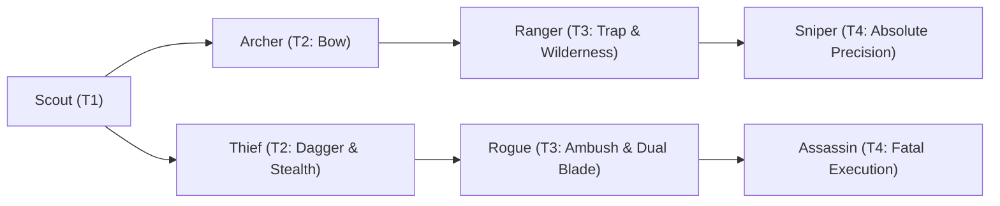

# 🛡️ Database Kelas: Rogue
> **Cabang:** `Jalur Lincah (Ranged / Assassin)` | **Tingkat:** `Tier 3` | **Batas Level:** `Lv. 1 – 40`

Petualang oportunis yang mengandalkan kelicikan, kecepatan, dan serangan tepat untuk memenangkan pertarungan dengan caranya sendiri.

---

## 1. Profil & Identitas Peran
| Atribut Kelas | Rincian / Status |
| :--- | :--- |
| **Nama Resmi** | **Rogue** |
| **Class ID Database** | `CID: 50` |
| **Tier Penguasaan** | `Tier 3` *(Level Cap: 40)* |
| **Promosi Dari** | `Thief` |
| **Promosi Lanjutan** | `Assassin` |
| **Peran Utama** | `Evasive Combo / Bleed` |
| **Kelemahan Taktis** | *Fragile; relies on tempo/evasion and conditional damage.* |

## 2. Parameter Pertumbuhan & Karakteristik (Turn-Based RPG)

### A. 6 Base Stats (Atribut Dasar Kelas)
| STR | INT | DEX | LUK | AGI | VIT |
| :---: | :---: | :---: | :---: | :---: | :---: |
| **12** | **4** | **24** | **18** | **32** | **10** |

* **Peringkat Atribut Dasar:** `STR: C | INT: E | DEX: A | LUK: A | AGI: S | VIT: D`
* **Pertumbuhan Stat Alami (Fixed Stat Growth per Class Level):** `+2 AGI, +1 DEX, +1 LUK`
* **Kurva Kebutuhan EXP:** `Tier 3 [32, 22, 32, 32]`

### B. Stat Turunan Awal (Baseline Derived Stats)
*Nilai di bawah dihitung deterministik dari 6 Base Stats awal kelas menggunakan formula resmi Nusvanir (sebelum bonus perlengkapan & alokasi poin pemain):*

#### 1. Sumber Daya Vital & Tempur Utama
| Parameter | Nilai Baseline | Formula / Perhitungan Resmi |
| :--- | :---: | :--- |
| **Max HP** | `260` | `Base 50 + (VIT 10 * 15) + (STR 12 * 5)` |
| **Max MP** | `52` | `Base 20 + (INT 4 * 8)` |
| **Max SP** | `94` | `Base 20 + (VIT 10 * 5) + (STR 12 * 2)` *(Preserved antar battle)* |
| **ATK** | `54` | `(DEX 24 * 2) + (STR 12 * 0.5)` *(Ranged/Finesse)* |
| **DEF** | `21` | `Base + (VIT 10 * 1.5) + (STR 12 * 0.5)` |
| **MAT** | `8` | `Base + (INT 4 * 2)` |
| **MDF** | `13` | `Base + (INT 4 * 1.2) + (VIT 10 * 0.8)` |
| **Action Speed** | `48` | `Base + (AGI 32 * 1.5)` |

#### 2. Presisi, Kritikal & Regenerasi Giliran (X-Param & S-Param)
| Parameter | Nilai (%) | Formula Perhitungan |
| :--- | :---: | :--- |
| **Hit Rate (HIT)** | `89.8%` | `0.85 + (DEX 24 * 0.002)` (Cap 100%) |
| **Evasion Rate (EVA)** | `9.3%` | `0.02 + (AGI 32 * 0.002) + (LUK 18 * 0.0005)` (Cap 80%) |
| **Critical Rate (CRI)** | `9.6%` | `0.03 + (DEX 24 * 0.002) + (LUK 18 * 0.001)` (Cap 85%) |
| **Critical Evasion (CEV)** | `3.7%` | `(LUK 18 * 0.0015) + (VIT 10 * 0.001)` |
| **Critical Damage (CDMG)** | `158.4%` | `1.5 + (STR 12 * 0.003) + (DEX 24 * 0.002)` |
| **Guard Efficiency (GRD)** | `105.0%` | `1.0 + (VIT 10 * 0.005)` *(Mitigasi saat bertahan)* |
| **HP Regen / Turn (HRG)** | `0.30%` | `VIT 10 * 0.0003` |
| **MP Regen / Turn (MRG)** | `0.12%` | `INT 4 * 0.0003` |
| **SP Regen / Turn (TRG)** | `4.48%` | `0.03 + (AGI 32 * 0.0004) + (VIT 10 * 0.0002)` |

### C. Karakteristik, Sasis & Peralatan
* **Innate Trait:** `Nightblade Training`
* **Senjata yang Dapat Digunakan:** `Dagger`
* **Zirah & Pelindung:** `Light Armor`
* **Tipe Skill yang Dibuka:** `Physical, Support, Ultimate, Passive`

## 3. Daftar Lengkap Skill & Pembelajaran (Learnings)
*Seluruh skill di bawah ini otomatis terbuka saat mencapai Class Level yang ditentukan.*

| Level | Nama Skill | Tipe / Elemen | Biaya | Target | Formula / Efek Matematis | Deskripsi & Catatan |
| :---: | :--- | :--- | :---: | :--- | :--- | :--- |
| **1.0** | **Twin Blade Mastery** | `Passive` / `None / Neutral` | `0 SP` | User | `-` | Dual-wield damage +10%; Off-hand penalty reduced by 25% |
| **1.0** | **Cross Slash** | `Physical` / `Normal Attack` | `8 SP` | One Enemy | `Math.max(0, a.atk * 0.9 - b.def * 0.4)` | a.atk * 0.9 - b.def * 0.4 per hit (2 hits) |
| **4.0** | **Shadow Meld** | `Support` / `None / Neutral` | `10 SP` | User | `-` | Evasion +40% and next single-target physical hit deals +20% damage (2 turns) | Evasion +40%; next single-target physical hit +20% (2 turns) *(Efek: Apply FX State 457 (FX 1318 - Shadow Meld) as specified)* |
| **9.0** | **Viper's Dance** | `Physical` / `Normal Attack` | `14 SP` | None / Custom | `Math.max(0, a.atk * 0.7 - b.def * 0.10)` | a.atk * 0.7 - b.def * 0.10 per hit (4 hits) |
| **12.0** | **Sadistic Executioner** | `Passive` / `None / Neutral` | `0 SP` | User | `-` | Damage +15% against targets below 40% HP |
| **14.0** | **Phantom Decoy** | `Physical` / `None / Neutral` | `12 SP` | User | `-` | Creates a decoy with 15% Max HP; 50% chance to redirect a single-target attack for 2 turns | Decoy: 15% Max HP; 50% single-target redirect chance (2 turns) *(Efek: Apply FX State 459 (FX 1321 - Phantom Decoy) as specified)* |
| **19.0** | **Mutilate** | `Physical` / `Normal Attack` | `16 SP` | One Enemy | `Math.max(0, a.atk * 2.0 - b.def * 0.2)` | a.atk * 2.0 - b.def * 0.2 |
| **22.0** | **Smokescreen** | `Support` / `None / Neutral` | `12 SP` | All Enemies | `-` | Enemy Hit Rate -20% for 2 turns *(Efek: Apply FX State 460 (FX 1323 - Smokescreen) as specified)* |
| **25.0** | **Shadow Ambush** | `Passive` / `None / Neutral` | `0 SP` | User | `-` | First attack against an unalerted target deals +20% damage and gains +15% Crit Rate |
| **28.0** | **Jugular Sever** | `Physical` / `Normal Attack` | `18 SP` | One Enemy | `Math.max(0, a.atk * 1.7 - b.def * 0.2)` | a.atk * 1.7 - b.def * 0.2 |
| **31.0** | **Blade Tempest** | `Physical` / `Normal Attack` | `16 SP` | All Enemies | `Math.max(0, a.atk * 0.7 - b.def * 0.2)` | a.atk * 0.7 - b.def * 0.2 per hit (3 hits) |
| **36.0** | **Illusive Demise** | `Passive` / `None / Neutral` | `0 SP` | User | `-` | Evasion +15%; once per battle, survive a lethal hit at 1 HP |
| **40.0** | **Thousand Cuts** | `Ultimate` / `None / Neutral` | `40 SP` | One Enemy | `Math.max(0, a.atk * 0.5 - b.def * 0.05)` | a.atk * 0.5 - b.def * 0.05 per hit (8 hits); +20% total damage vs Bleeding targets | 8-hit sequence; +20% total damage vs Bleeding targets. |

---

## 4. Alur Evolusi & Percabangan Kelas
