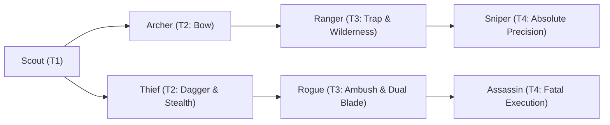

# 🛡️ Database Kelas: Sniper
> **Cabang:** `Jalur Lincah (Ranged / Assassin)` | **Tingkat:** `Tier 4` | **Batas Level:** `Lv. 1 – 50`

Penembak ahli yang sabar menunggu satu kesempatan sempurna sebelum melepaskan tembakan yang menentukan.

---

## 1. Profil & Identitas Peran
| Atribut Kelas | Rincian / Status |
| :--- | :--- |
| **Nama Resmi** | **Sniper** |
| **Class ID Database** | `CID: 51` |
| **Tier Penguasaan** | `Tier 4` *(Level Cap: 50)* |
| **Promosi Dari** | `Ranger` |
| **Promosi Lanjutan** | `Windrunner (Tier 5)` |
| **Peran Utama** | `Precision Burst / Mark` |
| **Kelemahan Taktis** | *High precision but low durability and lower mobility than Assassin.* |

## 2. Parameter Pertumbuhan & Karakteristik (Turn-Based RPG)

### A. 6 Base Stats (Atribut Dasar Kelas)
| STR | INT | DEX | LUK | AGI | VIT |
| :---: | :---: | :---: | :---: | :---: | :---: |
| **18** | **6** | **64** | **20** | **35** | **20** |

* **Peringkat Atribut Dasar:** `STR: C | INT: E | DEX: S+ | LUK: A | AGI: A | VIT: C`
* **Pertumbuhan Stat Alami (Fixed Stat Growth per Class Level):** `+3 DEX, +1 AGI, +1 LUK`
* **Kurva Kebutuhan EXP:** `Tier 4 [38, 28, 38, 38]`

### B. Stat Turunan Awal (Baseline Derived Stats)
*Nilai di bawah dihitung deterministik dari 6 Base Stats awal kelas menggunakan formula resmi Nusvanir (sebelum bonus perlengkapan & alokasi poin pemain):*

#### 1. Sumber Daya Vital & Tempur Utama
| Parameter | Nilai Baseline | Formula / Perhitungan Resmi |
| :--- | :---: | :--- |
| **Max HP** | `440` | `Base 50 + (VIT 20 * 15) + (STR 18 * 5)` |
| **Max MP** | `68` | `Base 20 + (INT 6 * 8)` |
| **Max SP** | `156` | `Base 20 + (VIT 20 * 5) + (STR 18 * 2)` *(Preserved antar battle)* |
| **ATK** | `137` | `(DEX 64 * 2) + (STR 18 * 0.5)` *(Ranged/Finesse)* |
| **DEF** | `39` | `Base + (VIT 20 * 1.5) + (STR 18 * 0.5)` |
| **MAT** | `12` | `Base + (INT 6 * 2)` |
| **MDF** | `23` | `Base + (INT 6 * 1.2) + (VIT 20 * 0.8)` |
| **Action Speed** | `52` | `Base + (AGI 35 * 1.5)` |

#### 2. Presisi, Kritikal & Regenerasi Giliran (X-Param & S-Param)
| Parameter | Nilai (%) | Formula Perhitungan |
| :--- | :---: | :--- |
| **Hit Rate (HIT)** | `97.8%` | `0.85 + (DEX 64 * 0.002)` (Cap 100%) |
| **Evasion Rate (EVA)** | `10.0%` | `0.02 + (AGI 35 * 0.002) + (LUK 20 * 0.0005)` (Cap 80%) |
| **Critical Rate (CRI)** | `17.8%` | `0.03 + (DEX 64 * 0.002) + (LUK 20 * 0.001)` (Cap 85%) |
| **Critical Evasion (CEV)** | `5.0%` | `(LUK 20 * 0.0015) + (VIT 20 * 0.001)` |
| **Critical Damage (CDMG)** | `168.2%` | `1.5 + (STR 18 * 0.003) + (DEX 64 * 0.002)` |
| **Guard Efficiency (GRD)** | `110.0%` | `1.0 + (VIT 20 * 0.005)` *(Mitigasi saat bertahan)* |
| **HP Regen / Turn (HRG)** | `0.60%` | `VIT 20 * 0.0003` |
| **MP Regen / Turn (MRG)** | `0.18%` | `INT 6 * 0.0003` |
| **SP Regen / Turn (TRG)** | `4.80%` | `0.03 + (AGI 35 * 0.0004) + (VIT 20 * 0.0002)` |

### C. Karakteristik, Sasis & Peralatan
* **Innate Trait:** `Deadeye Discipline`
* **Senjata yang Dapat Digunakan:** 08 Long Bow, 09 Crossbow
* **Zirah & Pelindung:** 03 Light Armor
* **Tipe Skill yang Dibuka (Skill Types):** `03 Skill, 04 Summon, 05 Ultimate` *(Skill pasif aktif otomatis via YEP_AutoPassiveStates)*

## 3. Daftar Lengkap Skill & Pembelajaran (Learnings)
*Seluruh skill di bawah ini otomatis terbuka saat mencapai Class Level yang ditentukan.*

| Level | Nama Skill | Tipe / Elemen | Biaya | Target | Formula / Efek Matematis | Deskripsi & Catatan |
| :---: | :--- | :--- | :---: | :--- | :--- | :--- |
| **1.0** | **Marksman Instinct** | `Passive` / `01 Neutral` | `0 SP` | Custom Mixed Scope | `-` | First target hit becomes Marked for 3 turns; damage +8% and Hit Rate +10% vs Marked | Passive: First target hit becomes Marked for 3 turns; damage +8% and Hit Rate +10% vs Marked. |
| **1.0** | **Focus Energy** | `03 Skill` / `01 Neutral` | `10 SP` | User | `-` | Focus: Crit Rate +20%, Hit Rate +20%, damage +10% for 1 turn | Crit Rate +20%, Hit Rate +20%, damage +10% (1 turn) *(Efek: Apply FX State 464 (FX 1330 - Focus Energy) as specified)* |
| **4.0** | **Nature Concealment** | `03 Skill` / `01 Neutral` | `16 SP` | User | `-` | Concealment: Evasion +60%, cannot be targeted by direct single-target attacks for 1 turn; ends after attacking | Concealment: Evasion +60%, untargetable by direct single-target attacks for 1 turn; ends after attacking *(Efek: Apply FX State 465 (FX 1331 - Nature Concealment) as specified)* |
| **7.0** | **Call of Nature: Lupine** | `04 Summon` / `01 Neutral` | `20 SP` | Field / Custom Scope | `-` | Summons Lupine for 4 turns; auto-attack a.atk * 0.9 | Summons Lupine companion for 4 turns; maximum 1 companion |
| **9.0** | **Lupine Ride** | `Passive` / `01 Neutral` | `0 SP` | Custom Mixed Scope | `-` | While riding Lupine: AGI +20%, Evasion +10%, ranged damage +10% |
| **14.0** | **Call of Nature: Falcon** | `03 Skill` / `01 Neutral` | `22 SP` | Field / Custom Scope | `-` | Summons Falcon for 3 turns; party Hit Rate +15% while active |
| **18.0** | **Ambush Mastery** | `Passive` / `01 Neutral` | `0 SP` | User | `-` | Damage +10% against targets that have not acted; ignore 15% DEF | Passive: Damage +10% against targets that have not acted; ignore 15% DEF. |
| **23.0** | **Piercing Shot** | `03 Skill` / `01 Neutral` | `26 SP` | Line / Cover Target | `Math.max(1, a.atk * 2.7 - b.def * 0.1)` | a.atk * 2.7 - b.def * 0.1; ignores 40% DEF | Ignores 40% DEF; cannot crit |
| **27.0** | **Cold-Blooded Executioner** | `Passive` / `01 Neutral` | `0 SP` | User | `-` | Crit Damage +20%; +8% damage vs targets below 30% HP | Passive: Crit Damage +20%; +8% damage vs targets below 30% HP. |
| **33.0** | **Enchant Elemental Arrow** | `03 Skill` / `01 Neutral` | `15 SP` | User | `-` | Choose Fire/Ice/Wind/Earth/Lightning/Metal/Sonic; attacks gain chosen element and +10% elemental damage for 3 turns | Elemental Arrow: choose one element; attacks gain that element and +10% elemental damage (3 turns) *(Efek: Apply FX State 469 (FX 1338 - Enchant Elemental Arrow) as specified)* |
| **45.0** | **Dead Eye Shot** | `05 Ultimate` / `01 Neutral` | `45 SP` | One Enemy | `Math.max(1, a.atk * 5.5 - b.def * 0.05)` | a.atk * 5.5 - b.def * 0.05 | Sure Hit; ignores 40% DEF; +15% damage vs Marked target; cannot crit. Non-Boss target below 20% HP: 10% Instant Death. |

---

## 4. Alur Evolusi & Percabangan Kelas
