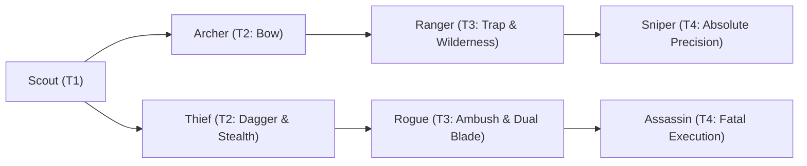

# 🛡️ Database Kelas: Assassin
> **Cabang:** `Jalur Lincah (Ranged / Assassin)` | **Tingkat:** `Tier 4` | **Batas Level:** `Lv. 1 – 50`

Pembunuh terlatih yang menjadikan kesunyian, ketepatan, dan kejutan sebagai bagian utama dari setiap tugasnya.

---

## 1. Profil & Identitas Peran
| Atribut Kelas | Rincian / Status |
| :--- | :--- |
| **Nama Resmi** | **Assassin** |
| **Class ID Database** | `CID: 52` |
| **Tier Penguasaan** | `Tier 4` *(Level Cap: 50)* |
| **Promosi Dari** | `Rogue` |
| **Promosi Lanjutan** | `Shadow Walker (Tier 5)` |
| **Peran Utama** | `Stealth Execution / Mark` |
| **Kelemahan Taktis** | *Lowest HP/DEF; Sure Hit and AoE pressure are hard counters.* |

## 2. Parameter Pertumbuhan & Karakteristik (Turn-Based RPG)

### A. 6 Base Stats (Atribut Dasar Kelas)
| STR | INT | DEX | LUK | AGI | VIT |
| :---: | :---: | :---: | :---: | :---: | :---: |
| **20** | **6** | **40** | **32** | **52** | **16** |

* **Peringkat Atribut Dasar:** `STR: B | INT: E | DEX: S | LUK: S | AGI: S+ | VIT: C`
* **Pertumbuhan Stat Alami (Fixed Stat Growth per Class Level):** `+2 AGI, +2 DEX, +1 LUK`
* **Kurva Kebutuhan EXP:** `Tier 4 [38, 28, 38, 38]`

### B. Stat Turunan Awal (Baseline Derived Stats)
*Nilai di bawah dihitung deterministik dari 6 Base Stats awal kelas menggunakan formula resmi Nusvanir (sebelum bonus perlengkapan & alokasi poin pemain):*

#### 1. Sumber Daya Vital & Tempur Utama
| Parameter | Nilai Baseline | Formula / Perhitungan Resmi |
| :--- | :---: | :--- |
| **Max HP** | `390` | `Base 50 + (VIT 16 * 15) + (STR 20 * 5)` |
| **Max MP** | `68` | `Base 20 + (INT 6 * 8)` |
| **Max SP** | `140` | `Base 20 + (VIT 16 * 5) + (STR 20 * 2)` *(Preserved antar battle)* |
| **ATK** | `90` | `(DEX 40 * 2) + (STR 20 * 0.5)` *(Ranged/Finesse)* |
| **DEF** | `34` | `Base + (VIT 16 * 1.5) + (STR 20 * 0.5)` |
| **MAT** | `12` | `Base + (INT 6 * 2)` |
| **MDF** | `20` | `Base + (INT 6 * 1.2) + (VIT 16 * 0.8)` |
| **Action Speed** | `78` | `Base + (AGI 52 * 1.5)` |

#### 2. Presisi, Kritikal & Regenerasi Giliran (X-Param & S-Param)
| Parameter | Nilai (%) | Formula Perhitungan |
| :--- | :---: | :--- |
| **Hit Rate (HIT)** | `93.0%` | `0.85 + (DEX 40 * 0.002)` (Cap 100%) |
| **Evasion Rate (EVA)** | `14.0%` | `0.02 + (AGI 52 * 0.002) + (LUK 32 * 0.0005)` (Cap 80%) |
| **Critical Rate (CRI)** | `14.2%` | `0.03 + (DEX 40 * 0.002) + (LUK 32 * 0.001)` (Cap 85%) |
| **Critical Evasion (CEV)** | `6.4%` | `(LUK 32 * 0.0015) + (VIT 16 * 0.001)` |
| **Critical Damage (CDMG)** | `164.0%` | `1.5 + (STR 20 * 0.003) + (DEX 40 * 0.002)` |
| **Guard Efficiency (GRD)** | `108.0%` | `1.0 + (VIT 16 * 0.005)` *(Mitigasi saat bertahan)* |
| **HP Regen / Turn (HRG)** | `0.48%` | `VIT 16 * 0.0003` |
| **MP Regen / Turn (MRG)** | `0.18%` | `INT 6 * 0.0003` |
| **SP Regen / Turn (TRG)** | `5.40%` | `0.03 + (AGI 52 * 0.0004) + (VIT 16 * 0.0002)` |

### C. Karakteristik, Sasis & Peralatan
* **Innate Trait:** `Veiled Predator`
* **Senjata yang Dapat Digunakan:** `Dagger`
* **Zirah & Pelindung:** `Light Armor`
* **Tipe Skill yang Dibuka:** `Physical, Support, Ultimate, Passive`

## 3. Daftar Lengkap Skill & Pembelajaran (Learnings)
*Seluruh skill di bawah ini otomatis terbuka saat mencapai Class Level yang ditentukan.*

| Level | Nama Skill | Tipe / Elemen | Biaya | Target | Formula / Efek Matematis | Deskripsi & Catatan |
| :---: | :--- | :--- | :---: | :--- | :--- | :--- |
| **1.0** | **Phantom Thread** | `Passive` / `None / Neutral` | `0 SP` | User | `-` | Evasion +15%; damage from behind +15% |
| **1.0** | **Shadow Mark** | `Passive` / `None / Neutral` | `0 SP` | Custom Mixed Scope | `-` | Attacks can apply Shadow Mark, max 3 stacks; each stack +4% damage from Assassin; lasts 3 turns | Passive: Shadow Mark max 3 stacks; each stack +4% Assassin damage; lasts 3 turns. |
| **1.0** | **Phantom Shuriken** | `Physical` / `Normal Attack` | `12 SP` | One Enemy | `Math.max(0, a.atk * 0.7 - b.def * 0.05)` | a.atk * 0.7 - b.def * 0.05 per hit (3 hits) | Priority +2; each cast can add at most 1 Shadow Mark. |
| **4.0** | **Shadow Clone** | `Support` / `None / Neutral` | `18 SP` | Field / Custom Scope | `-` | Creates 1 clone for 2 turns; clone has 30% caster Max HP and deals 35% of caster attack damage | Summons 1 Shadow Clone for 2 turns; clone deals 35% attack damage *(Efek: Apply FX State 472 (FX 1343 - Shadow Clone) as specified)* |
| **8.0** | **Toxic Coating** | `Passive` / `None / Neutral` | `0 SP` | User | `-` | Attacks have 30% Poison chance; Poison damage +15% | Passive: Attacks have 30% Poison chance; Poison damage +15%. |
| **12.0** | **Shadow Cloak** | `Support` / `None / Neutral` | `15 SP` | User | `-` | Evasion +70%, single-target damage taken -30%, duration 1 turn; ends after attacking | Evasion +70%, single-target damage taken -30% (1 turn); ends after attacking *(Efek: Apply FX State 474 (FX 1345 - Shadow Cloak) as specified)* |
| **14.0** | **Shadow Clone Strike** | `Physical` / `Normal Attack` | `22 SP` | One Enemy | `Math.max(0, a.atk * 1.3 - b.def * 0.1)` | a.atk * 1.3 - b.def * 0.1 per hit; hits = 1 + active clones (max 2 hits) | Gains one extra hit if a Shadow Clone is active; maximum 2 hits |
| **19.0** | **Phantom Executioner** | `Passive` / `None / Neutral` | `0 SP` | User | `-` | Damage +20% vs targets below 35% HP; execution bonus does not affect Bosses |
| **25.0** | **Toxic Smoke Bomb** | `Support` / `None / Neutral` | `25 SP` | Custom Mixed Scope | `-` | Poison 55% and Hit Rate -15% to all enemies for 2 turns; user Evasion +15% for 2 turns | Enemy Hit Rate -15% and user Evasion +15% (2 turns). | Status: Poison (55%) *(Efek: Add State 203 Poison: 55% | Apply FX State 476 (FX 1348 - Toxic Smoke Bomb) as specified)* |
| **31.0** | **Silent Killer** | `Passive` / `None / Neutral` | `0 SP` | User | `-` | Critical Rate +10%; attacks against Silenced targets deal +15% damage |
| **38.0** | **Phantom Slash** | `Physical` / `Normal Attack` | `30 SP` | One Enemy | `Math.max(0, a.atk * 3.0 - b.def * 0.08)` | a.atk * 3.0 - b.def * 0.08 |
| **45.0** | **Shadow Dance : Omnislash** | `Ultimate` / `None / Neutral` | `50 SP` | Field / Custom Scope | `Math.max(0, a.atk * 0.8 - b.def * 0.03)` | a.atk * 0.8 - b.def * 0.03 per hit (6 hits); final hit +35% damage | 6-hit sequence; Sure Hit; ignores 25% DEF. Consumes all Shadow Marks for +5% total damage per stack. |

---

## 4. Alur Evolusi & Percabangan Kelas
