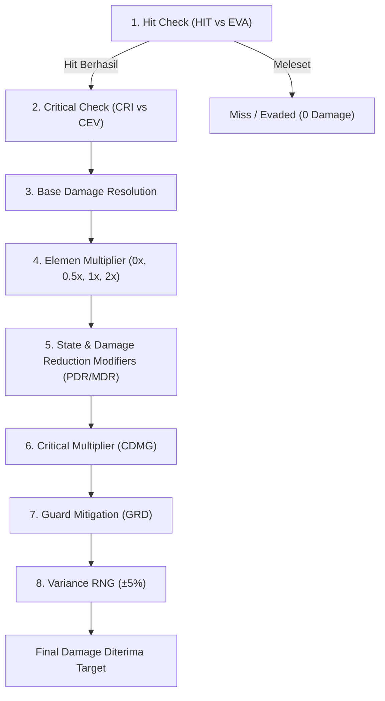
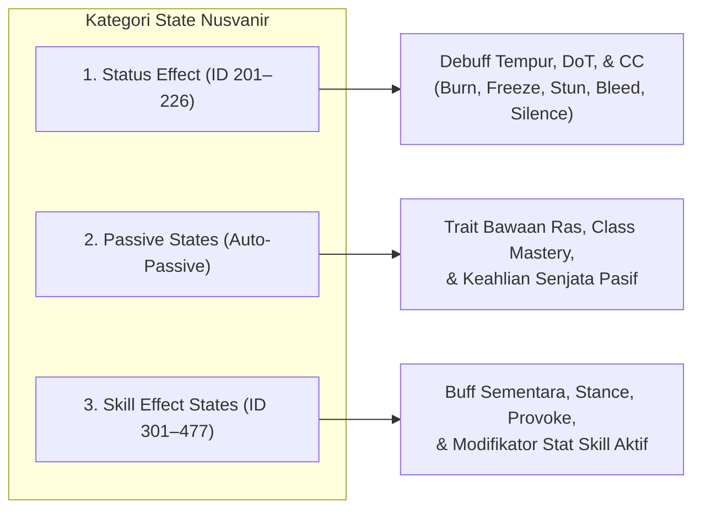
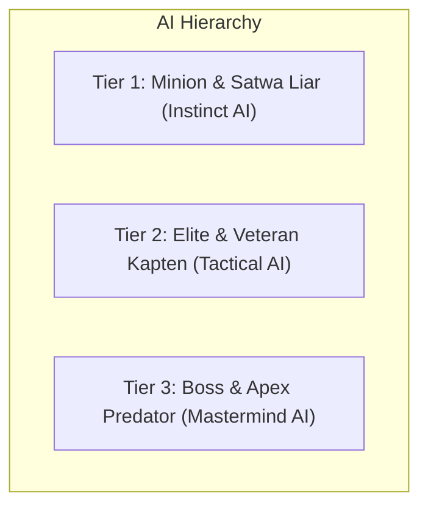

# ⚔️ Sistem Resolusi Tempur, Mekanik Aksi, & Hierarki AI Nusvanir

Dokumen ini adalah spesifikasi teknis dan acuan implementasi resmi untuk pipeline kalkulasi pertarungan, manajemen aksi *Active Turn-Based*, mekanisme *Target Rate (TGR)*, integrasi kategori *State*, serta hierarki kecerdasan buatan (*Enemy AI*) dalam game RPG *Turn-Based* Nusvanir. Seluruh konfigurasi tipe elemen, skill, senjata, zirah, dan slot peralatan mengacu pada [STANDAR_DATABASE_TYPES_RPG_MAKER.md](file:///mnt/DC9EA2C29EA29494/Nusvanir_Vault/06_Sistem%20Game%20&%20Ekonomi/STANDAR_DATABASE_TYPES_RPG_MAKER.md).

---

## 1. Formula Resolusi Kerusakan (Damage Pipeline)

Setiap aksi penyerangan fisik maupun sihir dievaluasi melalui pipa eksekusi (*pipeline*) deterministik 8 langkah berikut untuk memastikan keseimbangan nilai dan menghindari kerusakan 0 yang mematikan dinamika pertarungan:

### A. Formula Base Damage (Langkah 3)

Untuk mencegah nilai *defense* yang terlalu tinggi membuat serangan bernilai 0 (*zero damage issue*), Nusvanir menggunakan formula mitigasi terukur:

* **Serangan Fisik (Physical Damage):**
  $$\text{Base Damage} = \max\left(1, (\text{a.atk} \times \text{SkillMult}) - (\text{b.def} \times 0.75)\right)$$
  *Jika skill memiliki atribut Armor Piercing (Penetrasi Zirah):*
  $$\text{Base Damage} = \max\left(1, (\text{a.atk} \times \text{SkillMult}) - (\text{b.def} \times 0.25)\right)$$

* **Serangan Sihir (Magical Damage):**
  $$\text{Base Damage} = \max\left(1, (\text{a.mat} \times \text{SkillMult}) - (\text{b.mdf} \times 0.65)\right)$$

* **True Damage (Kerusakan Murni / Recoil / Kutukan Darah):**
  $$\text{Base Damage} = \text{Nilai Flat} \text{ atau } (\text{a.mat} \times \text{SkillMult}) \quad \text{[Mengabaikan DEF & MDF target]}$$

### B. Urutan Modifikator Tambahan (Langkah 4 – 8)

1. **Elemental Affinity:** Dikalikan matriks efektivitas dari [Mekanik_Efektivitas_Elemen.md](file:///mnt/DC9EA2C29EA29494/Nusvanir_Vault/06_Sistem%20Game%20&%20Ekonomi/Mekanik_Efektivitas_Elemen.md) ($0\times, 0.5\times, 1.0\times, 2.0\times$).
2. **PDR / MDR State Modifier:** Pengurang rasio dari buff/debuff zirah dan pasif (misal: *Physical Damage Rate* $80\% = \times 0.8$).
3. **Critical Multiplier:** Jika langkah 2 memicu Critical, kalikan dengan $\text{CDMG} = 1.5 + (\text{STR} \times 0.003) + (\text{DEX} \times 0.002) + \text{Equip CDMG}$.
4. **Guard Mitigation:** Jika target mengambil aksi Bertahan (*Guard*), kerusakan dipotong sebesar:
   $$\text{Mitigated Damage} = \frac{\text{Damage}}{2 \times \text{GRD}}$$
   *(Dengan $\text{GRD} = 1.0 + (\text{VIT} \times 0.005) + \text{Equip GRD}$).*
5. **Variance (Variasi Serangan):** Diterapkan acak dengan batas aman $\pm 5\%$ agar angka pertarungan dinamis tanpa merusak prediksi pemain.

---

## 2. Sistem Giliran Active Turn-Based & Kecepatan Skill

Sistem pertempuran Nusvanir berjalan dalam format **Active Turn-Based (ATB / Dynamic CTB)** di mana aliran giliran berjalan mulus berdasarkan akumulasi kecepatan unit:

### A. Pengisian Bar Aksi (Action Gauge Accumulation)
* Kecepatan pengisian bar giliran dihitung langsung dari parameter **Action Speed**:
  $$\text{Action Speed} = \text{Base AGI} + (\text{AGI} \times 1.5) + \text{Equip AGI}$$
* Unit dengan AGI tinggi mengisi gauge lebih cepat dan dapat bertindak lebih sering dalam rentang waktu yang sama.

### B. Modifikator Kecepatan Skill (*Skill Speed Modifiers*)
Mengacu pada aturan konfigurasi resmi `MV CONFIG` di database, percepatan giliran skill distandarisasi secara berjenjang:

| Kategori Kecepatan | Nilai Speed Modifier | Karakteristik & Contoh Skill |
| :--- | :---: | :--- |
| **Priority +4 (Absolute Instant)** | `+2000` | Memotong antrean aksi total tanpa jeda. Contoh: *Defensive Stance (Guard)*, *Emergency Potion*. |
| **Priority +3 (Reflex Action)**    | `+1500` | Manuver refleks tingkat tinggi. Contoh: *Shadow Step*, *Counter Stance*. |
| **Priority +2 (High Priority)**    | `+1000` | Interupsi cepat. Contoh: *Interrupting Bash*, *Wind Ward*. |
| **Priority +1 (Fast Action)**      | `+500`  | Manuver lincah. Mengurangi jeda aksi. Contoh: *Quick Slash*, *Dart Throw*. |
| **Standard Action**                | `0`     | Aksi bertarung umum. Kecepatan murni mengikuti Action Speed aktor. |
| **Heavy / Cast Delay**             | `-200 s/d -600` | Serangan berat atau mantra bertingkat. Contoh: *Crushing Hammer*, *Fireball*. |
| **Grand Channelling**              | `-1000 s/d -2000` | Sihir bencana alam atau teknik pamungkas (*Apex*). Contoh: *Meteor Swarm*, *Judgment of Light*. |

---

## 3. Sistem Ancaman Target (TGR & Taunt Mechanics)

Untuk memaksimalkan peran kelas *Tanker* (*Squire*, *Knight*, *Paladin*) dalam melindungi karakter rapuh (*Mage*, *Priest*, *Scout*), sistem penargetan musuh diatur oleh **Target Rate (TGR)**:

### A. Matriks Default TGR Berdasarkan Arketipe Kelas
* **Tanker Fisik (Squire, Knight, Paladin):** **150% – 200% TGR** *(Secara alami lebih mencolok dan menarik perhatian musuh).*
* **Fighter / Brawler / Warrior:** **100% TGR** *(Nilai standar / baseline).*
* **Mage / Support / Acolyte / Priest:** **75% – 85% TGR** *(Cenderung berada di belakang barisan pertahanan).*
* **Scout / Rogue / Assassin:** **50% – 70% TGR** *(Lincah berkamuflase dan bergerak di titik buta musuh).*

### B. Mekanik Provokasi & Pengalihan (Taunt & Stealth)
1. **Status Taunt / Provoke (Skill Tanker):**
   * Memberikan status sementara (*Skill Effect State*) ke pengguna selama 1–3 giliran.
   * Mengatur TGR pengguna menjadi `1000%` atau mengunci evaluasi AI musuh tipe *Single Target* agar hanya bisa mengincar sang pelindung.
2. **Status Stealth / Camouflage (Skill Lincah):**
   * Menurunkan TGR menjadi `10%` atau memberikan kondisi *Untargetable* sementara, memaksa serangan musuh dialihkan ke sekutu lainnya.

---

## 4. Arsitektur 3 Kategori State (Database Synchronization)

Kamus lengkap seluruh 203 State dan status efek resmi (ID 201–477) dapat dilihat di [Kamus_State_&_Status_Efek.md](file:///mnt/DC9EA2C29EA29494/Nusvanir_Vault/06_Sistem%20Game%20&%20Ekonomi/Kamus_State_&_Status_Efek.md). Sesuai struktur database Nusvanir, seluruh efek status dikelompokkan ke dalam 3 jenis dengan aturan siklus hidup yang terpisah:

1. **Status Effect (ID 201–226):**
   * Dikenakan melalui serangan, mantra musuh, atau jebakan lingkungan.
   * Memiliki durasi hitungan giliran (*Turn End decay*) dan prioritas pembatalan (misal: status *Sleep* otomatis hilang bila terkena damage fisik).
2. **Passive States (Auto-Passive System):**
   * Melekat permanen pada Karakter berdasarkan Ras ([04_Ras](file:///mnt/DC9EA2C29EA29494/Nusvanir_Vault/04_Ras/)), Class yang aktif, atau Zirah yang dipakai.
   * Tidak memiliki durasi turn dan tidak dapat dihapus dengan skill *Dispel/Cleanse*.
3. **Skill Effect States (ID 301–477):**
   * Dihasilkan sebagai efek samping dari skill spesifik (misal: *Iron Skin* setelah memakai skill bertahan, *Enflamed Weapon* setelah melafalkan mantra api).
   * Memiliki mekanisme *Stacking* (maksimal 3 tumpukan untuk intensitas efek) dan auto-remove saat pertempuran berakhir.

---

## 5. Hierarki Kecerdasan Buatan Musuh (Tiered Enemy AI Framework)

Tingkat kecerdasan taktis musuh berbanding lurus dengan status sosial, hierarki biologis, dan kedudukan (*Tier*) entitas tersebut:

### A. Tier 1: Minion & Satwa Liar (*Instinct-Driven AI*)
* **Pola Pikir:** Mengikuti naluri murni dan menyerang target dengan ancaman fisik paling nyata.
* **Targeting:** Bergantung 100% pada bobot **TGR** pemain (hampir selalu menyerang tank yang memprovokasi).
* **Rotasi Skill:** Sederhana dan berbobot probabilitas:
  * $75\%$ Serangan biasa (*Basic Attack*).
  * $25\%$ Skill alami (cakaran beracun, gigitan) saat cooldown selesai.
* **Reaksi Krisis:** Bila HP $< 20\%$, monster satwa dapat mencoba melarikan diri (*Flee*) atau memasuki status kalap (*Enrage*).

### B. Tier 2: Pasukan Elit, Penyihir, & Kapten Gilda (*Tactical AI*)
* **Pola Pikir:** Memahami taktik tempur, sinergi formasi, dan kelemahan peran musuh.
* **Targeting:**
  * Secara berkala mengabaikan TGR normal jika mendeteksi target dengan **HP $< 25\%$** untuk melakukan eliminasi (*Finishing Blow*).
  * Menargetkan anggota party yang sedang terkena status rapuh atau sedang merapal sihir (*Interrupt Casting*).
* **Manajemen Aksi:**
  * Membuka pertempuran dengan menggunakan skill *Buff* pertahanan atau memanggil minion tambahan.
  * Jika terkena *Taunt*, musuh Tier 2 memiliki opsi memilih serangan bertipe **Area of Effect (AoE)** untuk tetap mencelakakan lini belakang party meskipun terpaksa membidik tanker.

### C. Tier 3: Boss, Demon Lord, & Entitas Apex (*Mastermind AI & Phase Scripting*)
* **Pola Pikir:** Pengendali arena mutlak dengan skrip pertempuran multifase.
* **Multi-Action:** Memiliki jatah **2 hingga 3 aksi per giliran**.
* **Phase Scripting (Pergantian Fase Dinamis):**
  * **Fase 1 (100% – 60% HP):** Mengamati ritme party, melancarkan debuff elemen, dan menguji ketahanan tanker.
  * **Fase 2 (60% – 30% HP):** Mengaktifkan aura khusus, melakukan *Self-Cleanse* untuk menghapus seluruh debuff pemain, dan meningkatkan frekuensi serangan AoE.
  * **Fase 3 (Bawah 30% HP - Desperation):** Membuka rotasi serangan pamungkas terjadwal (misal: giliran kelipatan 3 melepaskan *Nuke Attack* berkekuatan tinggi yang mewajibkan seluruh anggota party melakukan *Guard* atau memasang pelindung barrier).
* **Penanganan Dispel & Taunt:**
  * Tidak dapat dikunci *Taunt* secara terus-menerus (memiliki resistensi kumulatif terhadap status kendali).
  * Mampu membaca ancaman *Healer* utama dan meluncurkan kutukan penahan pemulihan (*Anti-Heal / Miasma*).

---

## 6. Penyelarasan Kurva Perkembangan (MV Trait & Growth Alignment)

Pertumbuhan parameter di database disinkronkan secara konsisten antara kurva eksponensial RPG Maker MV dengan rumus deterministik Nusvanir:

1. **Parameter Dasar:** Kurva Base Stat pada sheet `CLASS Trait` berfungsi sebagai garis panduan pertumbuhan alami per class level (Level 1–50/60).
2. **Poin Bebas Pemain:** Tambahan 3 Stat Points per Base Level melalui modul script diakumulasikan di atas kurva bawaan tersebut tanpa merusak formula stat turunan.
3. **Budget Perlengkapan per Tier:**
   * **Tier 1 (Novice):** Senjata dasar $8 \sim 18\ \text{ATK}$, Zirah $4 \sim 12\ \text{DEF}$.
   * **Tier 2 (Initiate):** Senjata $20 \sim 45\ \text{ATK}$, Zirah $15 \sim 35\ \text{DEF}$.
   * **Tier 3 (Adept):** Senjata $50 \sim 95\ \text{ATK}$, Zirah $40 \sim 75\ \text{DEF}$.
   * **Tier 4 (Master):** Senjata $100 \sim 180\ \text{ATK}$, Zirah $80 \sim 150\ \text{DEF}$.
   * **Tier 5 (Apex / Relic):** Senjata $200+\ \text{ATK}$ dengan afinitas pasif unik.

