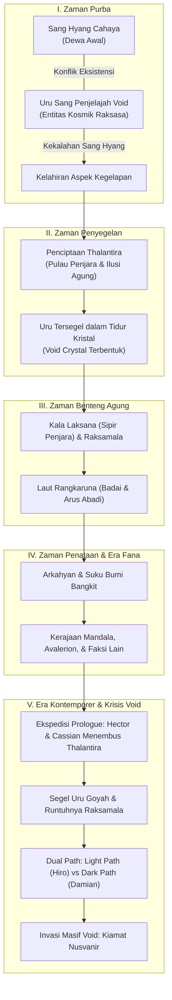
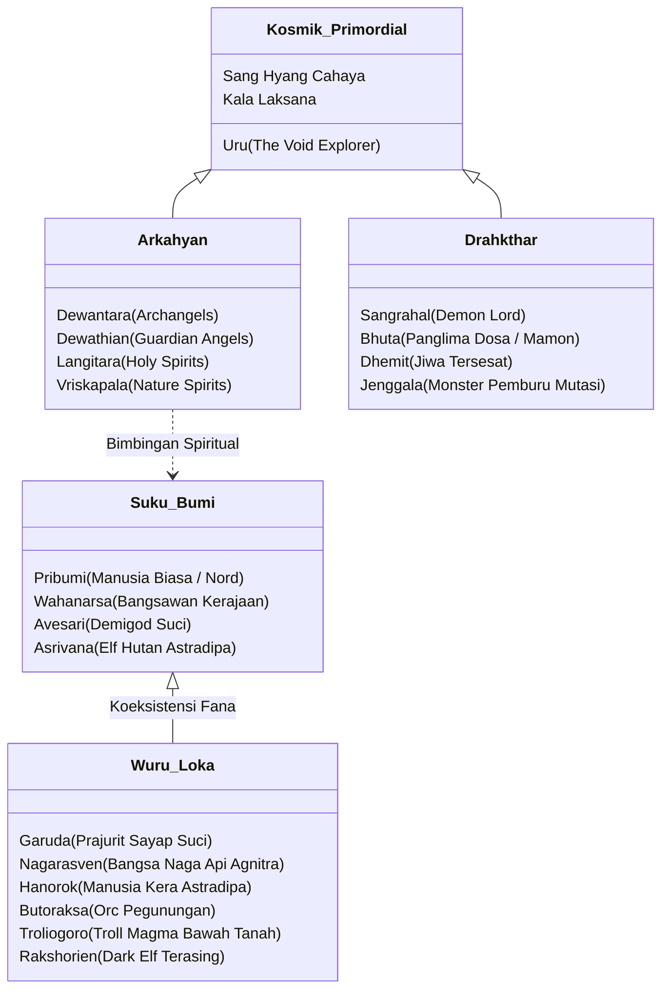
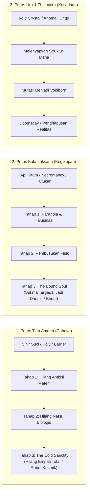
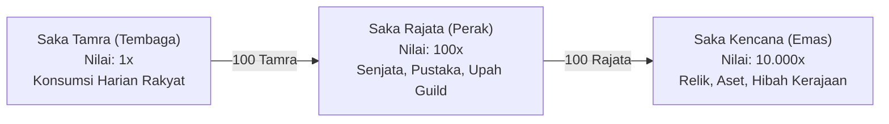
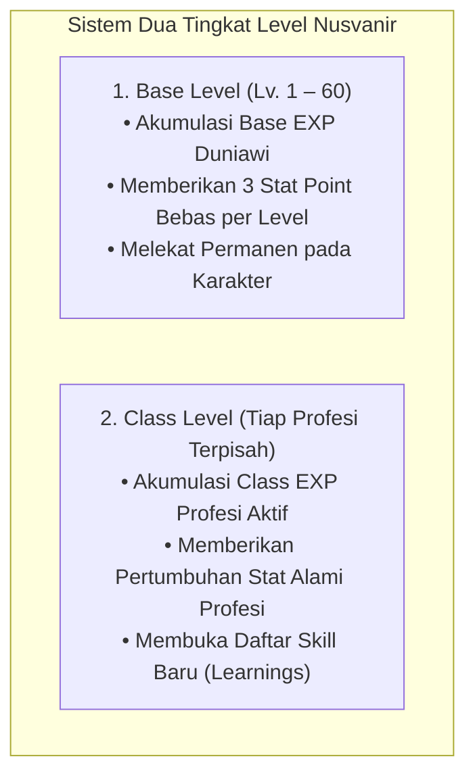

# KITAB NUSVANIR: KODEX SEMESTA
**Kompilasi Kosmologi, Geografi Global, Taksonomi Entitas, dan Catatan Sejarah Nusvanir**

---

## PENGANTAR: PERSPEKTIF PENELITI MANDALA

> *“Dunia ini tidak pernah sesederhana yang dikhotbahkan para pendeta di lingkar istana, atau seringan dongeng yang disenandungkan para penyair di kedai pelabuhan. Di balik fajar emas yang memayungi benua dan riak tenang samudra perak, berdenyut rahasia kelam yang dibeli dengan darah para pendahulu. Kitab ini bukan sekadar catatan geografi; ini adalah saksi bisu atas tatanan kosmik yang rapuh—panggung di mana para dewa bermain, manusia bertaruh nyawa, dan kegelapan menanti saatnya untuk terjaga.”*
> 
> — **Catatan Pembuka Sang Peneliti Pribumi Kerajaan Mandala**

Kodex Semesta Nusvanir disusun melalui sudut pandang seorang **peneliti Pribumi dari Kerajaan Mandala**. Di dalam kosmologi fana, Mandala adalah titik poros peradaban—titik nol tempat seluruh jalur maritim, jalur darat, perdagangan antar-ras, dan manuver politik berpusat. Namun, kapasitas sang penyusun kodex melampaui batasan penglihatan rakyat jelata: ia menghimpun catatan dari fragmen prasasti kuno, terjemahan kitab suci *Purāṇakathā*, interogasi tawanan perang, dokumen rahasia dewan istana, hingga rekaman artefak magis yang terpendam.

Dalam membaca naskah ini, pembaca harus membedakan secara tegas antara dua lapis pengetahuan:
1. **Pengetahuan Resmi (Doktrin Kerajaan & Agama):** Catatan sejarah yang diajarkan di akademi-akademi militer, kuil pemujaan Surya, dan institusi keagamaan Avalerion untuk menjaga moralitas serta ketertiban masyarakat fana.
2. **Lore Tersembunyi (*The Hidden Truth*):** Fakta absolut alam semesta mengenai entitas kosmik purba, manipulasi ilusi pulau penjara, dan asal-usul sejati ancaman kiamat (*Doomsday*) yang sengaja disensor dari ingatan publik.

---

## BAB I: KOSMOLOGI PRIMORDIAL & KRONOLOGI SEMESTA



### 1. Sejarah Penciptaan: Mitos Resmi vs Lore Tersembunyi

#### Doktrin Resmi: Tangisan di Lautan Kosmos
Menurut naskah keagamaan *Pawiyatan Prabha Suci* dan kuil pemujaan *Agama Surya*, sebelum ada waktu, hanya ada kekosongan tanpa batas tempat bertahtanya **Sang Hyang Cahaya**. Diceritakan bahwa karena kesepian yang mendalam, Sang Hyang meneteskan air mata ke ruang hampa. Tetesan air mata itu memadat menjadi daratan dan lautan Nusvanir, sementara napas pertamanya melahirkan vegetasi dan kehidupan fana. Agar semesta memiliki harmoni dinamis, Sang Hyang membelah sebagian kekuatannya menjadi **Kala Laksana** untuk mengatur jalannya sangkala (waktu) dan bayang-bayang.

#### Lore Tersembunyi: *The Old Tale* (Hakikat Eksistensi Uru)
Sebagaimana terungkap dari manuskrip kuno tak bertanggal yang ditemukan di kedalaman palung Rangkaruna:
* **Kedatangan Sang Penjelajah Void:** Jauh sebelum peradaban fana ada—pada era ketika Nusvanir dihuni binatang purba raksasa—seorang pengelana kosmik berukuran sebesar galaksi bernama **Uru** melintasi dimensi ini. Uru adalah manifestasi absolut dari **Void** (Kehampaan Kosmik). Tertarik oleh percikan kehidupan primitif yang langka, Uru memadatkan wujudnya seukuran makhluk duniawi untuk sekadar bermain dan mengamati.
* **Benturan Eksistensi & Lahirnya Kegelapan:** Keberadaan pasif energi Void milik Uru tidak dapat bersanding dengan energi murni Sang Hyang Cahaya. Benturan medan energi keduanya memicu kepunahan massal prasejarah. Sang Hyang yang murka berusaha mengusir Uru, namun kalah telak oleh kekuatan absolut sang penjelajah ketiadaan. Di titik terendah saat Cahaya meredup nyaris padam, lahirlah antitesisnya: **Kegelapan**.
* **Ilusi Agung Thalantira (Śaptadvīpa):** Menyadari kekuatan murni tak dapat membunuh Uru, Sang Hyang memadukan Cahaya, Kegelapan, dan energi Alam untuk merancang sebuah jebakan ilusi. Ia menciptakan sebuah pulau tropis buatan yang sangat mempesona—sebuah taman bermain kosmik bernama **Thalantira**. Ketika Uru terbuai mengeksplorasi keajaiban pulau tersebut, Sang Hyang menyegel kesadaran Uru ke dalam kristal purba di perut gunung api pulau tersebut.
* **Tidur Abadi & Void Crystal:** Uru tertidur dalam ilusi bahwa ia masih bebas bermain. Pikirannya memproyeksikan ekosistem pulau, arsitektur kuil, dan makhluk-makhluk bayangan yang terasa nyata. Selama beribu tahun penyegelan, serpihan tubuh kosmik Uru yang terlepas mengeras menjadi materi paling berbahaya di alam semesta: **Void Crystal**.
* **Fungsi Sejati Raksamala & Rangkaruna:** Untuk memastikan ilusi Uru tidak terganggu oleh makhluk fana, Sang Hyang menempatkan aspek Kegelapannya, **Kala Laksana**, sebagai sipir pelindung utama. Sang Hyang membangun benua kegelapan **Raksamala** tepat di lintasan laut antara daratan fana dan Thalantira, serta memagari kawasan itu dengan **Laut Rangkaruna** yang dipenuhi badai petir dan monster laut abyssal. Raksamala sengaja dirancang sebagai ancaman menakutkan agar para pelaut fana gentar dan berbalik arah sebelum sempat mendekati pulau penjara Uru.

---

### 2. Periodisasi Sejarah Nusvanir

| Era | Peristiwa Utama & Karakteristik | Status Kosmik |
| :--- | :--- | :--- |
| **I. Zaman Purba** | Pengembaraan Uru ke Nusvanir; kehancuran ekosistem prasejarah; kekalahan Sang Hyang Cahaya dan kelahiran elemen Kegelapan. | Bencana Prasejarah |
| **II. Zaman Penyegelan** | Penciptaan Thalantira; Uru tertipu ke dalam tidur ilusi; serpihan tubuhnya mengkristal menjadi *Void Crystal*. | Keseimbangan Ilusi |
| **III. Zaman Benteng Agung** | Pembentukan Kala Laksana, benua Raksamala, dan isolasi Laut Rangkaruna sebagai perimeter pertahanan berlapis penutup Thalantira. | Pengamanan Segel |
| **IV. Zaman Penataan** | Sang Hyang mengangkat ras *Arkahyan*; kebangkitan bangsa *Avesari*, *Garuda*, *Pribumi*, *Wahanarsa*, *Asrivana*, dan *Nagarasven*; pendirian Kerajaan Suci Avalerion dan Kerajaan Mandala. | Fajar Peradaban |
| **V. Keseimbangan Rapuh** | Peradaban fana berkembang; Raksamala di bawah Sangrahal aktif menculik jiwa manusia lewat portal Jenggala; isolasi ketat antar-wilayah. | Ketegangan Tertutup |
| **VI. Era Ekspedisi (Prologue)** | Tragedi Rama & Shinta; ekspedisi Hector dan Cassian menembus Rangkaruna hingga mencapai inti Thalantira; bangunnya kesadaran Uru; teror Mamon di Aqualis; jatuhnya vonis pengasingan Avalerion; pemisahan bayi kembar Hiro dan Damian. | Pecahnya Segel |
| **VII. Era Ketidakseimbangan (Untold Story)** | Timeskip 5 tahun; meluapnya sihir Cahaya pasca-invasi gagal; invasi kilat Hector membantai seluruh komandan Bhuta Raksamala dan membebaskan Damian dari kutukan Sangrahal; Hector menyerap kegelapan absolut menjadi *Death Knight*; pembentukan aliran *Hellfire* di Thalantira bersama Damian. | Runtuhnya Benteng Purba |
| **VIII. Era Dualitas & Invasi Void (Kisah Utama)** | Invasi masif portal Void ke seluruh Nusvanir; jatuhnya kota-kota Mandala; terisolasinya Avalerion dan kejatuhan moral Tirta Amarta; perjalanan *The Light Path* (Hiro, Aran Sylvar, Adhiva) menuju *Transcendence* berhadapan dengan *The Dark Path* (Damian & Hector). | Krisis Kiamat (*Doomsday*) |

---

## BAB II: ATLAS GEOGRAFI 11 WILAYAH NUSVANIR

Dari ruang kerja sang peneliti di Lingkar Dharma Ibu Kota Mandala, bentang daratan Nusvanir terbagi menjadi sebelas wilayah administratif dan geografis:

```
                                [ UTARA ]
                             Gunung Arkananta
                          (Pilar Bumi & Gua Salju)
                                     |
               Avalerion             |             Astradipa
         (Kerajaan Cahaya Suci)      |        (Hutan Keramat Asrivana)
                     \               |               /
                      \              |              /
  [ BARAT ] ----------> [ KERAJAAN MANDALA ] <---------- [ TIMUR ]
  Nusa Sayendra       (Pusat Peradaban 5 Lingkar)        Kota Bebas Cakrawala
 (Kepulauan Garuda)          /       |       \            (Oasis & Pasar Gelap)
                            /        |        \
                Tirta Amarta         |         Pulau Naga Agnitra
            (Lembah Air Suci Dewa)   |      (Domain Gunung Api Nagarasven)
                                     |
                            Laut Rangkaruna
                        (Samudra Badai Abadi)
                                     |
                             Pulau Raksamala
                       (Domain Kegelapan Purba)
                                     |
                           Pulau Thalantira
                    (Penjara Ilusi Uru / Kiamat)
                                [ SELATAN ]
```

### 1. Kerajaan Mandala (Pusat Peradaban Fana)
Kerajaan manusia terbesar yang dihuni oleh ras *Pribumi* dan *Wahanarsa*. Terletak tepat di jantung benua, Mandala mengendalikan jalur perdagangan utama darat dan laut.
* **Ibu Kota Mandala (Struktur 5 Lingkar Konsentris):**
  * *Lingkar Surya:* Dataran tertinggi, takhta Prabu Mandalapati, kediaman bangsawan darah biru, dan kuil pemujaan Matahari.
  * *Lingkar Dharma:* Pusat ilmu pengetahuan, akademi perpustakaan besar, gilda perapal mantra, dan laboratorium riset magis *Loka Cakra*.
  * *Lingkar Wira:* Zona pertahanan militer, barak ksatria, akademi taktik perang, dan pandai besi persenjataan.
  * *Lingkar Samodra:* Kompleks logistik dermaga sungai besar, gudang distribusi beras, dan transit komoditas antar-wilayah.
  * *Lingkar Bumi:* Distrik terluar dan terpadat, pemukiman kaum pekerja Pribumi, pasar rakyat, kedai petualang, dan penginapan murah.
* **Empat Kota Satelit Utama:**
  * **Aqualis:** Kota pelabuhan timur termahsyur di muara Rangkaruna; pusat maritim nelayan, galangan kapal, dan markas bayangan *Guild Dark Thorn*.
  * **Valkindra:** Benteng pertahanan militer garis barat laut yang berbatasan langsung dengan perbatasan luar Avalerion.
  * **Arthiska:** Dataran subur beririgasi magis yang berfungsi sebagai lumbung pangan padi dan gandum seantero kerajaan.
  * **Hermindar:** Kota metropolitan perdagangan bebas, pusat sirkulasi perbankan, dan pelelangan barang mewah.
* **Struktur Politik: Prabu Mandalapati & Dewan Candra Nawa (Sembilan Arta):**
  Raja memimpin bersama sembilan menteri penasihat (*Arta*) yang memegang hak veto politik. Figur krusial meliputi *Arta Ksatradhika* (Panglima Ordo Ksatria), *Arta Surya Pandita* (Otoritas Agama Surya), *Arta Mahasena* (Jenderal Strategi Perang), *Arta Mantrawisesa* (Kepala Sains Sihir), *Arta Jagatwijaya* (Menteri Niaga), *Arta Taniwijaya* (Ketahanan Pangan), *Arta Samudranatha* (Laksamana Laut), *Arta Budhaksara* (Pendidikan & Sastra), dan *Arta Dhanaprabha* (Bendahara Rahasia yang mendanai riset terlarang).

### 2. Hutan Keramat Astradipa
Wilayah hutan hujan lebat di timur laut Mandala yang diselimuti kabut hijau magis. 
* Dihuni oleh bangsa peri **Asrivana** yang hidup harmonis di kanopi pepohonan raksasa dan bangsa kera petarung **Hanorok** yang menjaga perbatasan terestrial.
* Astradipa menyimpan anomali berupa celah retakan dimensi (*Rift*) yang kerap memuntahkan monster liar ke perbatasan Mandala. Selama invasi Void, pertahanan Hanorok sempat terputus total dari komunikasi luar.

### 3. Kerajaan Suci Avalerion (Benteng Doktrin Cahaya)
Peradaban teokrasi absolut yang berdiri di dataran tinggi barat laut.
* Dilindungi oleh dinding marmer putih raksasa dan doktrin mutlak Sang Hyang Cahaya. Rumah bagi ribuan *Holy Knight* dan *Paladin* berzirah perak murni yang memandang rendah ras fana karena dianggap rentan terhadap dosa kegelapan.
* **Pawiyatan Prabha Suci:** Akademi tertinggi para imam (*Priest*) dan cendekiawan hukum yang dipimpin figur spiritual seperti *Sage Luna*. Menjalankan hukum pengasingan tanpa kompromi bagi pelanggar tata tertib suci.
* *Catatan Krisis Kontemporer:* Pasca-runtuhnya outpost penjaga, Avalerion terkunci di balik kubah isolasi Void pekat yang menahan Sangrahal di penjara bawah tanahnya.

### 4. Pulau Naga Agnitra
Kepulauan vulkanik aktif di lautan timur yang dipenuhi sungai lava mengalir dan puncak bebatuan obsidian hitam.
* Domain absolut dari ras **Nagarasven** (bangsa naga bersisik baja). Mereka hidup dalam hierarki kekuatan alam liar dan menjaga sarang logam murni *Adamantite Nest*.
* Memiliki kekuatan pertahanan alami yang sangat superior; Agnitra adalah satu-satunya wilayah yang berhasil memukul mundur invasi Bhuta Void secara mandiri tanpa bantuan faksi lain, namun memilih bersikap isolasionis tertutup.

### 5. Pegunungan Arkananta
Rangkaian pegunungan salju vertikal yang membelah utara benua Nusvanir, dipercaya sebagai tiang penyangga kubah langit semesta (*Langit Pertiwi*).
* Lereng bawah dan lembahnya dihuni oleh suku perkasa **Butoraksa** (Orc), gua-gua magma bawah tanahnya ditinggali **Troliogoro** (Troll), sedangkan jaringan terowongan terdalamnya menjadi suaka persembunyian suku buangan **Rakshorien** (Dark Elf).
* Wilayah ini sangat kaya akan bijih besi, kristal kuarsa, dan material tempa persenjataan berat.

### 6. Kota Bebas Cakrawala
Kota metropolis perdagangan gurun yang dibangun di sekitar oasis air misterius di perbatasan timur laut.
* Menjadi tempat bertemunya pedagang buronan, tentara bayaran, ilmuwan murtad, dan penyelundup dari seluruh penjuru dunia. Hukum kerajaan Mandala tidak berlaku di sini.
* Dikuasai secara de facto oleh **Sindikat Cakrawala** di bawah pimpinan maestro pasar gelap, **Tuan Midas**, yang memperdagangkan artefak langka dan relik terlarang. 
* Saat bencana Void melanda, oasis kehidupan Cakrawala berubah menjadi danau ungu beracun yang menenggelamkan kota ke dalam anarki total.

### 7. Nusa Sayendra (Kawasan Langit Para Garuda)
Gugusan kepulauan batu melayang di langit barat daya Nusvanir yang ditopang oleh anomali medan magnet angin suci.
* Negeri berdaulat ras suci **Garuda**. Ibu kotanya bertahta di **Puncak Emas Swargaloka**, tempat para tetua agung melatih seni penerbangan tempur dan meditasi jiwa.
* Memiliki hubungan spiritual purba dengan bangsa *Avesari*. Ras Garuda memiliki imunitas mutlak terhadap infeksi miasma kegelapan, namun tetap rentan terhadap korupsi Void jika tuannya tidak berada di samping mereka.

### 8. Kota Suci Tirta Amarta
Lembah air terjun abadi bertingkat sembilan di lereng barat pegunungan suci, tempat Sang Hyang Cahaya diyakini pertama kali menghembuskan napas kehidupan ke bumi.
* Menjadi pusat ziarah spiritual tertinggi bagi pemeluk doktrin Cahaya. Air suci Amarta memiliki properti menetralisir racun kutukan dan memurnikan senjata fana.
* *Krisis Moral:* Ketika gerbang Void terbuka, sebagian besar rahib penjaga kuil melarikan diri sembari menjarah peti persembahan emas dan koin Saka milik peziarah, menyingkap kepalsuan iman di balik doktrin suci yang kaku.

### 9. Laut Rangkaruna
Bentangan samudra luas di selatan yang memisahkan daratan fana dengan wilayah kegelapan.
* Memiliki anomali pusaran air mematikan, terumbu karang tajam berbentuk taring raksasa, dan langit kelam yang tak pernah berhenti disambar badai petir. Dihuni oleh leviathan purba seperti *Hiu Purba Tulang*, *Hydra*, dan *Paus Penelan Armada*.
* Berfungsi sebagai parit pertahanan alamiah untuk mencegah siapa pun mendekati Raksamala atau Thalantira tanpa restu magis khusus.

### 10. Pulau Raksamala (Benteng Kegelapan Purba)
Benua karang hitam di seberang Rangkaruna yang tidak pernah tersentuh sinar fajar.
* Dulunya merupakan pusat kekaisaran iblis (*Drahkthar*) di bawah komando **Sangrahal** dan para komandan *Bhuta*. Sumber ribuan portal *Jenggala* yang meneror pesisir manusia selama berabad-abad.
* *Status Terkini: Hancur Total.* Pasca-ekspedisi balas dendam Hector yang membantai seluruh komandan dan menumbangkan takhta Raksamala, daratan ini kini menjadi padang abu sepi tak bertuan.

### 11. Pulau Misterius Thalantira (Śaptadvīpa)
Pulau vulkanik purba yang terletak jauh di balik Raksamala, dikelilingi laut petir abadi dan karang hitam protektif.
* **Wujud Ilusi vs Realitas:** Di mata luar, pulau ini memancarkan aura surga ilusi dengan padang rumput bercahaya. Namun di intinya, Thalantira adalah penjara magma ungu tempat Uru tertidur lelap.
* Menjadi satu-satunya deposit alami **Void Crystal**. Di kedalaman reruntuhan kuil peninggalannya, Hector dan Damian mendirikan kuil terlarang untuk menempa seni sihir pamungkas *Hellfire* (Api Neraka).

---

## BAB III: TAKSONOMI & HIERARKI AGUNG RAS



Struktur populasi Nusvanir diatur ke dalam empat taksonomi besar:

### 1. Bangsa Arkahyan (Entitas Pengawas Langit)
Diciptakan langsung oleh Sang Hyang Cahaya sebagai pengawas tatanan metafisika benua:
* **Dewantara:** Malaikat purba tingkat tertinggi pembawa dekrit kosmik, tidak berwujud fisik padat dan jarang menampakkan diri pada bangsa fana.
* **Dewathian:** Malaikat pelindung bersenjata tombak cahaya yang bertugas menjaga perbatasan dimensi suci dari intusi kegelapan.
* **Langitara:** Roh-roh angin suci yang mengendalikan iklim, curah hujan magis, dan arus udara semesta.
* **Vriskapala:** Roh primordial penjaga pohon-pohon dunia di hutan Astradipa, mampu memanipulasi flora liar untuk menelan penyerbu.

### 2. Suku Bumi (Fondasi Peradaban Fana)
Ras cerdas penghuni dataran rendah yang mendirikan institusi kota dan pemerintahan:
* **Pribumi (Nord):** Populasi terbesar di benua. Memiliki fisik tangguh, adaptabilitas tinggi terhadap berbagai iklim, dan mentalitas ulet. Mereka adalah petani, pengrajin pandai besi, pedagang pasar, pelaut nelayan, dan prajurit baris depan.
* **Wahanarsa (Keturunan Bangsawan):** Manusia dengan garis keturunan ningrat yang memiliki bakat kepemimpinan, diplomasi politik, serta kecakapan birokrasi pemerintahan di Kerajaan Mandala.
* **Avesari (Demigod):** Manusia berdarah campuran ilahi yang memiliki umur sangat panjang dan bakat sihir Cahaya tingkat tinggi. Sebagian besar mengabdi di kasta tertinggi Avalerion.
* **Asrivana (Elf):** Penduduk asli Astradipa berumur ratusan tahun, berparas anggun dengan telinga meruncing. Ahli dalam navigasi hutan rimba, pemanah runduk (*Ranger*), dan manipulasi sihir botani alami.

### 3. Bangsa Wuru Loka (Penjaga Alam & Kekuatan Liar)
Ras berdarah murni yang memiliki kekuatan fisik di atas rata-rata manusia dan terikat pada bioma spesifik:
* **Garuda:** Bangsa avians bersayap emas dari Nusa Sayendra. Memiliki penghormatan spiritual tinggi terhadap kehormatan perang, pandangan mata setajam elang, dan imunitas alami mutlak terhadap miasma gelap.
* **Nagarasven:** Bangsa naga pulau Agnitra. Memiliki sisik tahan api ekstrem, nafas magma penghancur, dan insting dominasi wilayah yang tak tertandingi.
* **Hanorok:** Bangsa kera petarung di Astradipa yang memiliki kecerdasan taktik gerilya, kelincahan akrobatik, dan kesetiaan mutlak pada pakta persahabatan dengan Asrivana.
* **Butoraksa (Orc):** Kaum pejuang bertubuh gempal kekar di pegunungan Arkananta. Memiliki kekuatan otot luar biasa, mengandalkan senjata tumpul gada raksasa, dan menjunjung hukum adu tanding fisik.
* **Troliogoro (Troll):** Makhluk berkulit batu obsidian yang hidup di sekitar celah lava Arkananta. Jantung mereka menyimpan inti magma yang memancarkan panas konstan.
* **Rakshorien (Dark Elf):** Cabang Asrivana yang terusir ke gua-gua gelap akibat konflik perang purba. Berkulit pucat kelabu dan terpaksa menggunakan sihir bayangan demi bertahan hidup dari ancaman monster bawah tanah.

### 4. Bangsa Drahkthar (Entitas Dunia Bawah)
Makhluk kegelapan yang lahir dari poros Kala Laksana dan peradaban Raksamala:
* **Sangrahal (The Demon Lord):** Penguasa tertinggi kegelapan duniawi yang bertakhta di atas lautan mayat Raksamala. Penagih hutang kutukan jiwa yang memperbudak sukma manusia.
* **Bhuta (Panglima Dosa):** Iblis elite pelaksana kehendak kehancuran. Masing-masing memimpin satu benteng dosa, seperti **Mamon** (Bhuta Keserakahan) yang mampu memanipulasi logam berkarat dan tentara zombi.
* **Dhemit:** Jiwa-jiwa manusia yang tersesat akibat kontrak sihir gelap yang gagal, gentayangan tanpa jasad padat, memangsa hawa kehidupan orang hidup.
* **Jenggala:** Monster mutasi hasil infeksi miasma hitam Raksamala (Ahool, Banshee, Leyak, Wight, Gasing Maut) yang kerap melintasi portal untuk memburu mangsa di tanah fana.

---

## BAB IV: HUKUM SIHIR, KONSEKUENSI SUKMA, & ANOMALI VOID

Di alam Nusvanir, energi sihir tidak pernah gratis. Hukum pertukaran setara kosmik menuntut harga yang harus dibayar dari kemanusiaan sang pengguna:



### 1. Sihir Cahaya (Poros Tirta Amarta)
* **Karakteristik:** Menarik sisa-sisa pancaran napas Sang Hyang. Berwujud pendaran putih keemasan, pelindung sakral (*barrier*), penyembuhan mutlak, dan pemusnahan undead (*Turn Undead*).
* **Konsekuensi Jiwa: *The Cold Sanctity* (Erosi Kemanusiaan)**
  * *Tahap Awal:* Kehilangan ketertarikan pada harta, pangkat, dan materi duniawi.
  * *Tahap Menengah:* Lenyapnya dorongan biologis, hasrat romansa, dan kehangatan rasa kekeluargaan.
  * *Tahap Akhir:* Hilangnya empati emosional seutuhnya. Pengguna bertransformasi menjadi entitas dingin yang mengukur segala sesuatu murni lewat hitungan logis "Keseimbangan Semesta", tega mengorbankan jutaan nyawa tanpa rasa bersalah.

### 2. Sihir Kegelapan (Poros Kala Laksana)
* **Karakteristik:** Menarik daya gravitasi bayang-bayang ketiadaan. Menghasilkan kobaran api hitam, manipulasi bayangan fisik, pembusukan material, kutukan instan, dan kebangkitan mayat (*Necromancy*).
* **Konsekuensi Jiwa: *The Bound Soul* (Perbudakan Sukma)**
  * *Tahap Awal:* Munculnya bisikan-bisikan gaib di dalam kepala yang memicu paranoia akut dan kegilaan visual.
  * *Tahap Menengah:* Nekrosis jaringan tubuh; kulit menghitam dan membusuk layaknya mayat berjalan.
  * *Tahap Akhir:* Kesadaran ego runtuh total; sukma ditarik paksa menjadi budak abadi di bawah kendali Sangrahal.

### 3. Anomali Void (Ketiadaan Uru & Void Crystal)
* **Karakteristik:** Bukan merupakan elemen sihir konvensional, melainkan "anti-realitas" berwarna ungu pekat yang menelan dan menghancurkan seluruh formulasi mana. 
* Kontak fisik dengan debu *Void Crystal* mampu menghapus eksistensi immortal iblis seperti Mamon secara permanen tanpa proses reinkarnasi. Bencana terbesar terjadi ketika energi Void mencemari kristal-kristal penopang kehidupan benua.

### 4. Seni Sihir Hitam Mutlak: *Hellfire* (Api Neraka)
* Diciptakan oleh Hector bersama Damian selama masa pengasingan di Thalantira.
* Merupakan fusi terlarang antara energi kutukan Void Uru dengan tekad kematian sang mantan Paladin. Menghasilkan lidah api ungu kehitaman yang membakar bukan hanya daging, melainkan memusnahkan konsep jiwa lawan hingga tak tersisa.

---

## BAB V: DRAMATIS PERSONAE (TOKOH PENENTU TAKDIR)

Tatanan sejarah Nusvanir digerakkan oleh persilangan takdir dua generasi:

### 1. Generasi Pendahulu (Pahlawan Prologue & Pengasingan)
* **Hector (Dari Paladin Avalerion Menuju The Death Knight):** Mantan ksatria suci terkuat Avalerion berambut pirang keemasan. Demi menyelamatkan nyawa putra angkatnya, Damian, dari kutukan Sangrahal, ia mengorbankan kesuciannya, membantai seisi Raksamala, dan mengikatkan diri pada Uru sebagai *Death Knight* pertama Nusvanir.
* **Cassian (Mantan Priest Suci / Eksil Peneliti Pesisir):** Sahabat seperjuangan Hector yang dijatuhi hukuman buang 50 tahun oleh Avalerion akibat membongkar rahasia Thalantira. Tinggal di gubuk pesisir Aqualis, membesarkan Hiro sembari meneliti teknologi kelautan bersama Jane.
* **Jane (Istri Cassian / Mantan Assassin Dark Thorn):** Putri angkat nelayan Rama dan Shinta. Sosok wanita tangguh dan mematikan yang menggantungkan sepasang belati pembunuhnya demi menjadi ibu rumah tangga yang hangat pelindung keluarga di Aqualis.
* **Rama & Shinta:** Pasangan nelayan miskin dan pemanah Asrivana di pesisir Aqualis. Tragedi penangkapan Rama oleh badai Rangkaruna menjadi pemicu awal pecahnya ekspedisi penemuan Thalantira.
* **Komandan Darius & Sage Luna:** Otoritas tertinggi militer dan akademik Kerajaan Suci Avalerion yang menjatuhkan vonis pemisahan takdir bagi si kembar Hiro dan Damian.

### 2. Generasi Penerus (The Dual Paths)
* **Hiro (Tokoh Utama — *The Light Path*):**
  * *Identitas:* Pemuda dengan tanda lahir bintang di tangan kanan, anak kandung Rama-Shinta yang dibesarkan oleh Cassian dan Jane di Aqualis.
  * *Perjalanan:* Mengawali langkah sebagai kadet militer Mandala, tewas di perbatasan Astradipa saat menahan serbuan Void Jenggala, dibangkitkan oleh Cassian eksil, lalu menempuh jalan *Transcendence* di kuil Tirta Amarta dan Puncak Emas Nusa Sayendra sebagai Sang Terpilih penyeimbang semesta.
* **Damian (Tokoh Utama — *The Dark Path*):**
  * *Identitas:* Saudara kembar Hiro yang diselamatkan oleh pengorbanan zirah Hector.
  * *Perjalanan:* Dibesarkan di dalam benteng api neraka Thalantira di bawah tempaan keras sang Death Knight. Mewarisi seni *Hellfire* dan dipersiapkan sebagai wadah hidup bagi kebangkitan Uru.
* **Aran Sylvar:** Pemuda pemburu dari ras Asrivana di Astradipa yang menjadi rekan seperjuangan Hiro; diberkahi rune busur angin oleh para Tetua Garuda Nusa Sayendra.
* **Adhiva:** Ksatria tempur ras Garuda yang diutus mendampingi dan mengawasi kestabilan kekuatan Cahaya di dalam tubuh Hiro.

---

## BAB VI: EKONOMI MIKRO & MATERIAL KOSMIK

### 1. Standarisasi Tiga Koin Mandala (Cap Candra Nawa)



* **Saka Tamra (Koin Tembaga):** Alat tukar harian rakyat jelata di Lingkar Bumi untuk membeli gandum, sayur, ikan laut Aqualis, dan sewa kamar penginapan murah.
* **Saka Rajata (Koin Perak):** Digunakan para petualang dan pedagang antar-kota untuk membeli ramuan kimia, perlengkapan zirah standar, dan membayar kontrak pengawalan Gilda Arthapasa.
* **Saka Kencana (Koin Emas):** Mata uang bernilai tinggi untuk transaksi makro antar-kerajaan, pembelian perkebunan, artefak kuno, atau penyelesaian tebusan diplomatik tingkat dewa.

### 2. Material Esensial, Loot Ekosistem, & Komoditas Terlarang

| Kategori Material | Nama Material | Asal Wilayah | Karakteristik & Kegunaan Tempa |
| :--- | :--- | :--- | :--- |
| **Botani & Cairan** | *Bunga Abadi Astradipa* | Hutan Astradipa | Memancarkan pendar bioluminesensi; bahan utama ramuan penenang sukma dari erosi mental. |
| | *Esensi Air Suci Amarta* | Tirta Amarta | Air murni penangkal racun kutukan tingkat tinggi dan penyepuh logam berproperti *Holy*. |
| **Drop Monster (Loot)** | *Kulit Kasar Jenggala* | Raksamala / Hutan | Sangat liat dan tahan sobek; bahan baku zirah ringan (*leather armor*) para pemburu. |
| | *Inti Magma Troliogoro* | Goa Arkananta | Kristal panas membara dari dada Troll; memberikan efek elemen api permanen pada senjata baja. |
| | *Taring Baja Butoraksa* | Lembah Arkananta | Taring padat Orc pegunungan; dihaluskan sebagai campuran tonik penambah kapasitas beban fisik. |
| **Logam Legendaris** | *Logam Adamantite Murni* | Sarang Agnitra & Gua Salju | Logam hitam keperakan paling keras di dunia; bahan baku pembuatan zirah Death Knight dan belati Jane. |
| **Komoditas Terlarang** | *Serpihan Kala Laksana* | Pesisir Rangkaruna | Pecahan batu hitam kutukan; meningkatkan daya hancur senjata namun mengikis kewarasan jiwa. |
| | *Void Crystal* | Inti Thalantira | Serpihan beku tubuh kosmik Uru. Artefak pemusnah realitas bernilai hingga 100.000+ Saka Kencana di pasar gelap Tuan Midas. |

---

## BAB VII: SISTEM ATRIBUT, DOKTRIN TEMPUR TURN-BASED, & PROFESI PETUALANG

> *“Kekuatan seorang kesatria tidak lahir dari mukjizat tanpa aturan; ia mengalir dari perpaduan harmonis antara tempaan raga fana, kedalaman fokus batin, dan kehendak mutlak yang menggerakkan senjata di genggaman. Dalam naskah-naskah rahasia Mandala, pertempuran dipahami sebagai tarian giliran waktu—di mana setiap detik keputusan menentukan apakah seorang petualang akan berdiri menyongsong fajar atau rebah selamanya di pelukan tanah.”*
> 
> — **Doktrin Seni Perang Gilda Arthapasa & Peneliti Kerajaan Mandala**

### 1. Enam Arus Daya Hidup & Parameter Turunan Deterministik

Setiap entitas bernyawa di jagat Nusvanir—mulai dari rakyat jelata, ksatria suci, satwa liar, hingga para naga purba—digerakkan oleh **6 Atribut Dasar (*Base Stats*)**:

| Atribut | Nama Lengkap | Filosofi Alam & Peran Tempur |
| :---: | :--- | :--- |
| **STR** | *Strength* | Tenaga otot murni dan daya hantam fisik jarak dekat. Menambah daya serang (ATK), memperluas cadangan Stamina (Max SP), meningkatkan kapasitas darah dasar, dan melipatgandakan *Critical Damage*. |
| **INT** | *Intelligence* | Ketajaman intelek dan kapasitas penampungan energi Mana. Menentukan daya rusak sihir (*MAT*), ketahanan magis (*MDF*), kapasitas Mana (*Max MP*), dan regenerasi Mana alami per putaran. |
| **DEX** | *Dexterity* | Presisi saraf, koordinasi mata, dan kehalusan gerak. Menentukan akurasi serangan (*HIT*), kekuatan senjata proyektil dan lincah (*Ranged/Finesse*), serta peluang serangan kritikal. |
| **LUK** | *Luck* | Keselarasan jiwa dengan benang takdir kosmis. Menentukan peluang serangan keberuntungan (*Critical Rate*), penolakan serangan kritikal lawan (*Critical Evasion*), dan penghindaran sekunder. |
| **AGI** | *Agility* | Kecepatan refleks dan keleluasaan manuver tubuh. Menentukan inisiatif giliran bertindak (*Action Speed / ATB Fill*), peluang mengelak (*EVA*), dan regenerasi stamina alami (*TRG*). |
| **VIT** | *Vitality* | Ketahanan jaringan tubuh dan vitalitas hayat. Fondasi kapasitas darah utama (*Max HP*), daya tahan fisik (*DEF*), efisiensi pertahanan saat bertahan (*Guard Efficiency - GRD*), dan cadangan SP. |

Seluruh parameter pertarungan diturunkan secara deterministik matematis sesuai acuan resmi [Sistem_Stat_&_Formula_Turn_Based.md](file:///mnt/DC9EA2C29EA29494/Nusvanir_Vault/06_Sistem%20Game%20&%20Ekonomi/Sistem_Stat_&_Formula_Turn_Based.md).

---

### 2. Doktrin Dua Jenjang Tingkat (Dual Level System)

Kemampuan tempur seorang petualang di dunia Nusvanir memisahkan antara pertumbuhan biologis pribadi dengan penguasaan profesi:



* **Batas Maksimum Jenjang Profesi (Level Cap per Tier):**
  * **Tier 1 (Novice):** Level 1 – 10 *(Fighter, Apprentice, Scout)*
  * **Tier 2 (Initiate):** Level 1 – 30 *(Warrior, Squire, Brawler, Magician, Acolyte, Occultist, Archer, Thief)*
  * **Tier 3 (Adept):** Level 1 – 40 *(Mercenary, Knight, Martial Artist, Mage, Cleric, Cultist, Ranger, Rogue)*
  * **Tier 4 (Master):** Level 1 – 50 *(Champion, Dragoon, Paladin, Monk, 8 Elementalist, Priest, Necromancer, Sniper, Assassin)*
  * **Tier 5 (Apex):** Level 1 – 60 *(Evolusi biologis/spiritual puncak eksklusif ras, seperti Berserker, Death Knight, Archmage, High Priest, Sky Sovereign)*

---

### 3. Sistem Ketahanan Raga: Stamina Points (SP)

Menggantikan sistem TP lama, Nusvanir menerapkan **Stamina Points (SP)** yang dinamis dan berakar pada kondisi fisik:
* **Kapasitas Dinamis Berskala:** Dihitung dari $\text{Base SP} + (\text{VIT} \times 5) + (\text{STR} \times 2) + \text{Equip SP}$.
* **Preserve SP (Ketahanan Antar-Pertempuran):** Karakter tidak kehilangan SP saat pertempuran berakhir. Sisa stamina tersimpan dari satu bentrokan ke bentrokan berikutnya di dungeon, menuntut perhitungan taktis.
* **Pemulihan Sukma (Recover All):** Istirahat di Penginapan (*Inn*), api perkemahan (*Campfire*), atau mukjizat pemulihan sakral memulihkan SP secara penuh bersamaan dengan HP dan MP.

---

### 4. Lima Disiplin Seni Pertempuran (The 5 Skill Types)

Agar mudah dipahami dan tertata rapi di medan perang, seluruh aksi skill aktif dikelompokkan ke dalam **5 Kategori Resmi** sesuai [STANDAR_DATABASE_TYPES_RPG_MAKER.md](file:///mnt/DC9EA2C29EA29494/Nusvanir_Vault/06_Sistem%20Game%20&%20Ekonomi/STANDAR_DATABASE_TYPES_RPG_MAKER.md):

| ID | Nama Disiplin | Definisi Desain & Ciri Pertarungan | Sumber Daya |
| :---: | :--- | :--- | :---: |
| **01** | **White Magic** | Sihir suci pemulihan (HP/MP/SP Heal), pembersihan status buruk (*Cleanse/Dispel*), pelindung ilahi (*Sanctuary/Barrier*), dan mukjizat kebangkitan (*Resurrection*). | **MP** |
| **02** | **Black Magic** | Sihir ofensif destruktif manipulasi elemen alam (*Fire, Water, Earth, Air*) dan energi turunan (*Electro, Cryo, Ferro, Sound*) hingga kutukan kegelapan (*Dark Magic*). | **MP** |
| **03** | **Skill** | Teknik fisik murni, jurus bela diri, manuver senjata, teriakan perang (*Battle Cry*), postur pertahanan (*Stance*), serta trik bayangan (*Stealth/Smoke Bomb*). | **SP** |
| **04** | **Summon** | Seni pemanggilan makhluk pendamping, arwah penunggu, familiars naga, atau kerangka kegelapan untuk bertarung di arena. | **MP / SP** |
| **05** | **Ultimate** | Jurus pamungkas terkuat per class (*Apex/Mastery*), membutuhkan investasi resource masif atau persyaratan khusus. | **SP Tinggi / MP Besar** |

*Catatan:* Seluruh keahlian pasif diaktifkan secara otomatis melalui modul `YEP_AutoPassiveStates` di latar belakang tanpa memenuhi menu aksi pertarungan.

---

### 5. Sebelas Elemen Semesta Nusvanir

Sesuai hukum kosmis dan diagram efektivitas [Mekanik_Efektivitas_Elemen.md](file:///mnt/DC9EA2C29EA29494/Nusvanir_Vault/06_Sistem%20Game%20&%20Ekonomi/Mekanik_Efektivitas_Elemen.md), energi alam terbagi menjadi 11 elemen:
1. `01 Neutral`: Energi fisik murni tanpa resonansi elemental.
2. `02 Fire (Pyro)`: Alam dasar — Menang melawan Tanah, Lemah melawan Air.
3. `03 Water (Hydro)`: Alam dasar — Menang melawan Api, Lemah melawan Udara.
4. `04 Earth (Geo)`: Alam dasar — Menang melawan Udara & Petir, Lemah melawan Api.
5. `05 Air (Aero)`: Alam dasar — Menang melawan Air, Diredam (0x) oleh Tanah.
6. `06 Electric (Electro)`: Energi turunan Api — Menghantarkan kerusakan dahsyat ke Besi (Steel), Lemah vs Es.
7. `07 Ice (Cryo)`: Energi turunan Air — Mengisolasi Listrik, Lemah melawan Suara & Api.
8. `08 Steel (Ferro)`: Energi turunan Tanah — Menahan Suara, Lemah melawan Listrik & Api.
9. `09 Sound (Sonic)`: Energi turunan Udara — Meremukkan struktur Es, Diredam Besi (0x).
10. `10 Holy (Cahaya Suci)`: Energi kosmik Sang Hyang — Menghancurkan Kegelapan (Dark).
11. `11 Dark (Kegelapan Kala)`: Energi kosmik Uru & Kala — Menelan Cahaya (Holy).

---

### 6. Kodeks Perlengkapan Perang (Weapons & Armors)

Sistem persenjataan dan zirah pelindung Nusvanir terkalibrasi ke dalam 7 Slot Perlengkapan (`YEP_EquipCore`) sesuai katalog [01_Weapons.md](file:///mnt/DC9EA2C29EA29494/Nusvanir_Vault/06_Sistem%20Game%20&%20Ekonomi/Equipment/01_Weapons.md) dan [02_Armors.md](file:///mnt/DC9EA2C29EA29494/Nusvanir_Vault/06_Sistem%20Game%20&%20Ekonomi/Equipment/02_Armors.md):
* **10 Tipe Senjata Resmi:** `01 Long Sword`, `02 Sword`, `03 Gloves`, `04 Spear`, `05 Axe`, `06 Staff`, `07 Rune`, `08 Long Bow`, `09 Crossbow`, `10 Dagger`.
* **6 Tipe Zirah Resmi:** `01 Basic Clothes`, `02 Magic Robe`, `03 Light Armor`, `04 Heavy Armor`, `05 Light Shield`, `06 Heavy Shield`.
* **Sistem Sinergi Set Bonus:** Menggunakan zirah lengkap dari set yang sama (misal: *Mandala Guard, Arkananta Trail, Avalerion Guardian, Astral*) memicu bonus kumulatif 2-Set hingga 5-Set.

---

### 7. Doktrin Resolusi Kerusakan & Hierarki AI Musuh

Sesuai spesifikasi [Sistem_Resolusi_Combat_&_AI.md](file:///mnt/DC9EA2C29EA29494/Nusvanir_Vault/06_Sistem%20Game%20&%20Ekonomi/Sistem_Resolusi_Combat_&_AI.md):
1. **Proteksi Anti-Zero Damage:** Setiap formula kerusakan fisik dan magis dibungkus dengan batas minimal aman:  
   $$\text{Base Physical} = \max\left(1, (\text{a.atk} \times \text{SkillMult}) - (\text{b.def} \times 0.75)\right)$$  
   $$\text{Base Magical} = \max\left(1, (\text{a.mat} \times \text{SkillMult}) - (\text{b.mdf} \times 0.65)\right)$$
2. **Mekanik Target Rate (TGR) & Provokasi (Taunt):**
   * Kelas pelindung (*Squire, Knight, Paladin*) membawa TGR alami **150% – 200%**, sementara kelas rapuh (*Mage, Scout*) memiliki TGR **50% – 85%**.
   * Skill provokasi memaksakan status `[0224] Taunt` (TGR 1000% selama 2 giliran).
3. **Hierarki Kecerdasan AI Musuh (80 Monster Bestiary):**
   * **Tier 1 (Instinct AI - 16 Monster):** Menyerang target dengan TGR tertinggi pemain (fokus ke tanker) dan memakai aksi lari/kalap saat kritis.
   * **Tier 2 (Tactical AI - 40 Monster):** Pasukan elit yang mengeksekusi target ber-HP $< 25\%$ dan membalas Taunt dengan serangan AoE/Elemen.
   * **Tier 3 (Mastermind AI - 24 Monster):** Bos purba dengan **2 hingga 3 aksi per giliran**, rotasi serangan terjadwal kelipatan 3 turn, dan perubahan fase dinamis (*Phase Scripting*) saat HP $< 50\%$ dan $< 30\%$.

---

### 8. Kamus Status Efek & Kutukan Medan Laga (ID 201 – 477)

Kamus status efek di [Kamus_State_&_Status_Efek.md](file:///mnt/DC9EA2C29EA29494/Nusvanir_Vault/06_Sistem%20Game%20&%20Ekonomi/Kamus_State_&_Status_Efek.md) mencatat **203 State Resmi**:
* **26 Canonical States (ID 201–226):** Status penyakit umum (*Burn, Poison, Bleed, Chill, Freeze, Paralyze, Stun, Root, Slow, Fear, Blind, Silence, Confusion, Vulnerable 30%/60%/100%, Soaked, Shock, Petrify, Float, Marked, Shadow Mark, Taunt, Curse, Polarized*).
* **177 Skill Effect & Passive States (ID 301–477):** Status buff khusus yang dipicu kemampuan unik profesi petualang.

---

## EPILOG KODEX: ISYARAT PECAHNYA FAJAR KIAMAT

> *“Catatan ini ditutup saat langit timur di atas perairan Rangkaruna mulai memancarkan pendar ungu yang tak wajar. Kubah Avalerion telah membisu, mata air suci Amarta telah ternoda, dan lolongan mutan Void mulai terdengar dari batas hutan Astradipa.*
> 
> *Dua anak manusia yang terlahir dari rahim keputusasaan di pesisir Aqualis kini berjalan di dua jalan yang saling bertolak belakang: yang satu melangkah ke puncak matahari bersama sayap-sayap emas Garuda, sementara yang lain berdiri di atas tungku api neraka bersama bayang-bayang ketiadaan.*
> 
> *Ketika kedua saudara itu bertemu kembali di medan laga, bukan hanya takdir Kerajaan Mandala yang akan ditentukan, melainkan jawaban atas pertanyaan purba: apakah semesta ini layak dipertahankan oleh Cahaya, ataukah sudah saatnya dikembalikan ke pelukan sunyi Sang Kehampaan.”*
> 
> — **Pena Terakhir Sang Peneliti Mandala**

